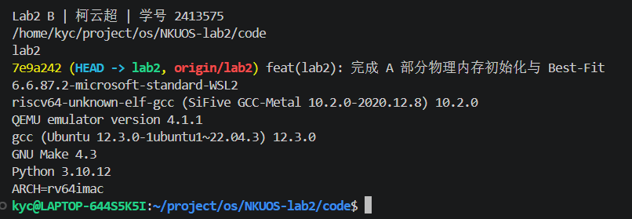
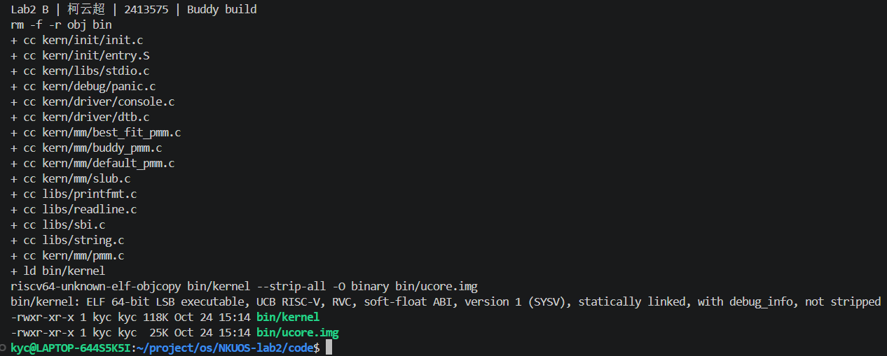
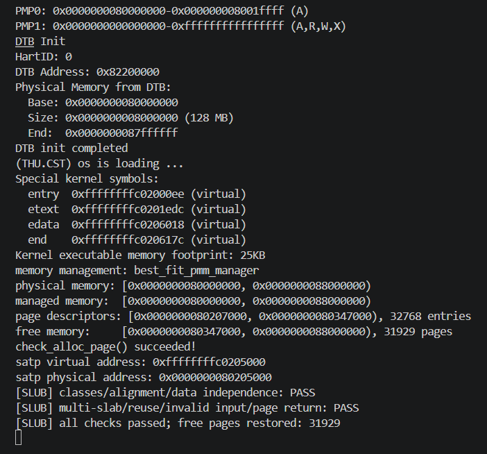
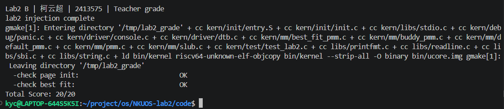

# Lab2 B：Buddy System 与 SLUB

负责人：**柯云超，2413575**。实现与自动验证日期：2026-10-23；本人复现、截图与整理日期：2026-10-24（北京时间）。工具：Codex 桌面应用，GPT-6。实现约定见 [B-spec.md](B-spec.md)，四份提示词见 [B-prompts.md](B-prompts.md)，截图步骤见 [B-截图操作指南.md](B-截图操作指南.md)。

## 1. 任务与整体逻辑

物理内存初始化先把可用页交给页分配器，Buddy 再按 2 的幂大小组织连续页，SLUB 在这些页面上划分小对象。前者解决物理页块的分配与合并，后者避免小对象每次独占整页。

```text
kern_init → dtb_init → pmm_init
    → init_pmm_manager → page_init → init_memmap → 当前管理器 check
    → slub_init → slub_check → 内核等待循环
```

页层仍默认 Best-Fit，使用 `make PMM=buddy` 切换到 Buddy；SLUB 通过公共 `alloc_page/free_page` 工作。B 的接入只在 `pmm.c` 增加选择分支，并在 `init.c` 增加 SLUB 初始化及自检，不改变 A 的 Page 布局或原始测试。

## 2. 环境与复现

| 项目 | 本次真实环境 |
| --- | --- |
| 宿主环境 | Windows 上的 WSL Ubuntu 22.04 |
| RISC-V GCC | SiFive GCC-Metal 10.2.0 |
| QEMU / 固件 | QEMU 4.1.1 / OpenSBI v0.4，SBI 0.1 |
| GNU Make / 主机 GCC / Python | 4.3 / 12.3.0 / 3.10.12 |
| 指令与 ABI | `ARCH=rv64imac`、`ABI=lp64` |
| 远端基线 | `origin/lab2`，`7e9a242` |
| 工作目录 | `/home/kyc/project/os/NKUOS-lab2/code` |

本机旧版工具链使用 `ARCH=rv64imac`；新版本的默认 ISA 字符串和 A 在 macOS 上记录的工具路径不应直接用于本机。

```sh
cd /home/kyc/project/os/NKUOS-lab2/code
source ~/.local/opt/riscv/env.sh
export ARCH=rv64imac
make PMM=buddy qemu
# 在 QEMU 中依次按 Ctrl+A、X 退出
make check-b
python3 tools/check_b_qemu.py --arch rv64imac
```

最后一个命令保存真实证据，并在教师评分清理本地构建后重新生成默认 Best-Fit 镜像。

## 3. Buddy 的实现

文件：`kern/mm/buddy_pmm.c`、`buddy_pmm.h`。

| 核心函数 | 职责 |
| --- | --- |
| `buddy_init` | 初始化 0～15 阶空闲链表及空闲页数 |
| `buddy_init_memmap` | 校验保留页，把任意起点和长度拆成对齐的幂次块 |
| `add_block` | 查找真正的同阶伙伴并逐级合并 |
| `buddy_alloc_pages` | 向上取整、找可用高阶块、逐级拆分并标记占用 |
| `buddy_free_pages` | 校验原始请求和所属块，归还实际占用的全部页面 |
| `buddy_check` | 内核启动时检查取整、对齐、不重叠、计数和回收 |

### 3.1 块和伙伴如何表示

k 阶块包含 `2^k` 页，空闲首页带 `PG_property`，`property` 是阶数。特别注意，0 阶首页的 `property=0`，必须结合标志位识别。

伙伴计算使用绝对物理页号：

```c
buddy_ppn = page2ppn(base) ^ (1UL << order);
```

例如 4 页块的页号 0 和 4 是伙伴，而页号 4 和 8 虽然相邻，却分别属于不同的 8 页父块，不可合并。实际代码使用包含 DRAM 基址的绝对页号，不能异或描述符指针。

初始化时从当前起点选择“满足页号对齐且不超过剩余页数”的最大阶块。这样 `[1,64)` 的 63 页也能全部注册，而不会向前覆盖保留页或向后越界。相邻区间即使乱序注册，仍可按伙伴关系合并；有保留空洞时不会跨洞合并。

### 3.2 分配、释放与内部碎片

请求 n 页时取整为 `2^ceil(log2(n))`，从对应阶向上找块，再逐层一分为二。保留左半块继续拆分，右半块挂入对应阶链表。实际占用的所有页都标记为已分配，首页保存原请求 n。

申请 3 页实际消耗 4 页，空闲页数减少 4；释放必须传入 `free_pages(p,3)`，校验成功后归还 4 页。这个约定与 `pmm_manager` 的“分配不少于 n 页”接口一致，但不同于 First-Fit/Best-Fit 恰好分配 n 页的行为。

释放只与“范围内、空闲、同阶”的伙伴合并，然后继续检查上一阶。错误大小、块内部页、重复释放均触发断言。零请求、超上限和空间不足返回 NULL，且不改变计数。

该实现的链表阶数查找和合并最多 15 级；分配与释放还会遍历实际占用页来维护状态，故不能把整体复杂度直接写成纯 `O(log N)`。向上取整带来内部碎片；即使空闲页总量足够，也可能因为缺少对齐大块而分配失败。

## 4. SLUB Challenge 的实现

文件：`kern/mm/slub.c`、`slub.h`。

```c
void slub_init(void);
void *slub_alloc(size_t size);
bool slub_free(void *object);
void slub_check(void);
```

### 4.1 两层架构

页层每次申请 1 页；对象层提供 16、32、64、128、256、512、1024、2048 字节共八类，支持任意 1～2048 字节请求并向上归类。页首保存 slab 元数据和位图，后面是 16 字节对齐的对象槽位。例如请求 33 字节进入 64 字节类别，不同类别不会混在同一 slab 中。

每类有 partial 和 full 链表：分配优先使用 partial；没有可用页时申请新页；页满后转入 full。释放一个 full 页中的对象后，将其转回 partial；最后一个对象释放后，整个页立即归还当前 PMM，确保不会保留隐含页占用。

### 4.2 所属 slab、复用与异常处理

对象地址按 4 KiB 向下取整得到候选 slab 地址。代码先扫描当前拥有的 slab 链表，找到已知页后才读取元数据，避免对任意错误指针直接解引用。随后验证对象起点、槽位索引和位图占用状态。

释放清除位图，槽位可以被再次分配。NULL 释放成功；对象内部指针、非本模块地址、当前未占用槽位释放失败并返回 false。0 字节和超过 2048 字节请求返回 NULL；新页申请失败也返回 NULL。

这是教学用简化实现：位图管理代替 Linux 完整 freelist；无每 CPU 缓存、锁、NUMA、构造函数和超过 2048 字节的大对象路径；对象不保证清零；不识别“释放后的旧地址已被另一次分配复用”的悬空指针。查找所属 slab 需要扫描链表，性能可继续优化。

## 5. 测试为什么有效

| 测试 | 覆盖及判断依据 | 实际结果 |
| --- | --- | --- |
| Buddy 内核自检 | 请求 1/2/3/5/8/17 页，验证物理对齐、相互不重叠、实际消耗、失败请求及乱序释放 | PASS |
| 非对齐 63 页区域 | 注册 `[1,64)`，耗尽每页再逆序释放，检查两侧保留页 | PASS |
| 拆分和多级合并 | 3 页申请占 4 页，释放两半后应重新满足 8 页申请；四个 4 页块最终恢复 16 页 | PASS |
| 非伙伴相邻块 | 仅释放页号 4 和 8 的两个 4 页块，空闲总数为 8 但 8 页请求必须失败 | PASS |
| 多区间和空洞 | 乱序注册相邻区间应合并；随机场景保留中间 16 页空洞及两端页 | PASS |
| Buddy 独立位图 | 20,000 次操作；预期成功条件是独立扫描存在完整、对齐、空闲的取整区间；每步核对页数和保留页 | PASS |
| 误释放 | 错误大小、内部页、重复释放，分别运行独立子进程检查 panic 退出码 100 | PASS |
| SLUB 内核自检 | 所有类别边界共 24 个大小、16 字节对齐、逐字节验证对象数据、260 个 16 字节对象跨多个 slab | PASS |
| SLUB 复用与异常 | 释放复用、两种奇偶顺序释放、非法指针和槽内指针、重复释放、0/2049/最大整数请求 | PASS |
| SLUB 主机随机 | 三种 PMM 各 5,000 次操作；比较活对象地址区间、验证写入数据、耗尽底层页后测试失败及恢复 | PASS |
| 内存诊断 | 直接编译真实分配器，启用 ASan/UBSan | PASS |

位图模型的预期结果不读取 Buddy 空闲链表，因而可以发现“实现和测试沿用同一错误规则”的问题。数据填充和活对象区间比较能够发现对象重叠，页数恢复能够发现 slab 泄漏；单看 PASS 字符串或管理器名称无法替代这些检查。

主机内存是页对齐的模拟缓冲区，不包含真实 RISC-V 地址翻译，因此仍需下面的 QEMU 启动验证。

## 6. 真实运行证据

证据目录：[evidence/B-20261023](evidence/B-20261023/summary.json)。其中保存工具版本、源码 SHA-256、每次启动的 ELF/镜像 SHA-256 及命令。

| 配置 | 验证结果与日志 |
| --- | --- |
| First-Fit + SLUB，128 MiB | [原始页分配检查、SLUB 自检通过](evidence/B-20261023/first_fit-128M-boot.log) |
| Buddy + SLUB，64 MiB | [全部自检通过](evidence/B-20261023/buddy-64M-boot.log) |
| Buddy + SLUB，128 MiB | [全部自检通过](evidence/B-20261023/buddy-128M-boot.log) |
| Buddy + SLUB，256 MiB | [实际内存 256 MiB，框架截断管理到 128 MiB，自检通过](evidence/B-20261023/buddy-256M-boot.log) |
| Best-Fit + SLUB，128 MiB | [原始页分配检查、SLUB 自检通过](evidence/B-20261023/best_fit-128M-boot.log) |
| 主机诊断与独立测试 | [host.log](evidence/B-20261023/host.log) |
| 教师评分 | [grade.log](evidence/B-20261023/grade.log)，20/20 |

128 MiB Buddy 串口关键输出：

```text
memory management: buddy_pmm_manager
free memory:     [0x0000000080347000, 0x0000000088000000), 31929 pages
[Buddy] rounding/alignment/split/merge/count: PASS
check_alloc_page() succeeded!
[SLUB] classes/alignment/data independence: PASS
[SLUB] multi-slab/reuse/invalid input/page return: PASS
[SLUB] all checks passed; free pages restored: 31929
```

数值依赖内核大小和编译器，后续构建不要求恰好 31929 页，但自检前后计数必须相等。内核检查完成后按框架设计停在等待循环；自动脚本看到最终成功标志后结束 QEMU，日志中的 signal 15 是脚本清理进程。

教师评分只检查初始化与 Best-Fit 身份，不能据此声称 Buddy/SLUB 被教师测试覆盖。本报告的 B 功能结果来自新增独立测试和实际内核自检。

## 7. 提示词与实际迭代

四份完整提示词独立保存在 [B-prompts.md](B-prompts.md)，区分 Buddy 实现、Buddy 测试、SLUB 实现、SLUB 测试。

第一轮实现中，Buddy 与 SLUB 均通过交叉编译和第一次 QEMU 自检。主机测试初次编译时，`-Wall -Werror` 把 A 保留的原始 Best-Fit 检查函数中的未使用变量当作错误；这不是新分配算法的运行错误。处理方法是在主机测试使用与原项目相同的 `-Wno-unused`，保留原始检查函数文本不变，之后所有测试通过。

验证脚本还处理了教师 `make grade` 会清理本地镜像的问题：评分完成后重新生成默认 Best-Fit 镜像。Linux 主机测试使用非 PIE 构建；此选项限定于 Linux，不强加给 A 的 macOS 环境。本机沿用已有工具链，没有新增系统安装。

本轮没有发现 Buddy/SLUB 随机测试中的算法错误，不补写不存在的失败经历。内核单 hart 检查、主机模拟和本次输入范围通过，并不意味着已验证多核、并发或所有硬件配置。

## 8. 本人复现截图与验收

柯云超于 2026-10-24 补充本人运行截图和五份手动运行日志。原计划的七项截图内容由六张图片完整覆盖，其中 B-04 与 B-05 合并为一张完整的主机测试图，无需另补 B-05。图片统一存放于 `report/images/`；逐项核对与全组剩余事项见 [截图核对清单](B-截图核对清单.md)。

### 8.1 B-01：环境与身份

截图包含姓名学号、lab2 分支及基线提交、WSL 环境、编译器与 QEMU 版本，以及 `ARCH=rv64imac`。



### 8.2 B-02：Buddy 全量构建

Buddy、SLUB 源文件均参与编译，完成链接与 objcopy，输出为带调试信息的 64 位 RISC-V ELF。对应 [本人构建日志](evidence/B-manual-buddy-build.log)。



### 8.3 B-03：Buddy 与 SLUB 内核运行

实际使用 `buddy_pmm_manager`，Buddy 与 SLUB 检查均通过，空闲页数恢复为 31929。对应 [本人 Buddy 启动日志](evidence/B-manual-buddy-boot.log)。


### 8.4 B-04 / B-05：Buddy 与 SLUB 完整主机测试（合并图）

同一张图包含 Buddy 的非对齐区域、伙伴合并、乱序注册与 20,000 次独立模型操作，SLUB 在三种 PMM 上各 5,000 次对象操作，以及三项误释放检查和 ASan/UBSan 最终结果。对应 [本人主机测试日志](evidence/B-manual-host.log)。


### 8.5 B-06：Best-Fit 与 SLUB 回归

实际使用 `best_fit_pmm_manager`，原始页分配检查及 SLUB 检查均通过，空闲页数恢复为 31929。对应 [本人 Best-Fit 启动日志](evidence/B-manual-best-fit-boot.log)。



### 8.6 B-07：教师评分

Page Init 和 Best-Fit 均为 OK，总分为 20/20。对应 [本人评分日志](evidence/B-manual-grade.log)。教师评分范围与第 6 节一致，不代替 Buddy/SLUB 的独立检查。



### 8.7 验收状态

B 的本人复现和截图已完成，必需截图无遗漏；B 的代码、报告、六张截图和运行日志纳入本次 lab2 提交。完整流程演示、答辩准备、全组交叉验收及课程最终提交仍待完成。C 的 QEMU 源码与 TLB 调试仍由 C 提供。

## 9. 知识点总结

见 [B-知识点总结.md](B-知识点总结.md)，涵盖全组主线的知识点、与 OS 原理的联系和差异，以及本实验未覆盖的重要内容；其中 C 部分是原理汇总，具体调试证据由 C 补充。
