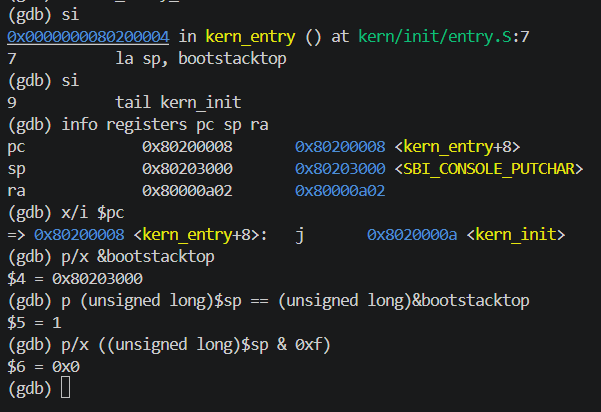

# B：练习一取证指南

适用目录：`/home/kyc/project/os/NKUOS/code`。依据拉取后的 `lab1` 分支编写，开始补写时的提交为 `be4398c`。命令供本人执行，报告中的实际数值和截图暂用占位符。

新版分工要求全员体验两道练习。本指南的 6 张图对应练习一及 C 初始化；练习二的完整复位跟踪方法和已有小组记录见 [报告第 4 节](report.md#4-练习-2使用-gdb-验证启动流程)，个人实践完成情况按实际填写。

## 1. 截图文件名与保存位置

全部保存为 PNG，放入 `NKUOS/report/images/`。Windows 中可打开：

```text
\\wsl.localhost\Ubuntu-22.04\home\kyc\project\os\NKUOS\report\images
```

| 顺序 | 文件名 | 应包含的真实终端输出 |
|---|---|---|
| 1 | `B-01-build-symbols.png` | 构建结果、入口反汇编、关键符号地址 |
| 2 | `B-02-entry-before.png` | 精确入口断点、原 PC/SP/RA、栈边界与大小 |
| 3 | `B-03-stack-after.png` | 执行 la 后的 SP、与栈顶相等、16 字节对齐、下一条跳转 |
| 4 | `B-04-enter-c.png` | kern_init 首地址、SP、RA 不变比较、BSS 边界和长度 |
| 5 | `B-05-bss-init.png` | memset 参数、与边界和长度的比较、返回 C 初始化的位置 |
| 6 | `B-06-boot.png` | QEMU 中的 OpenSBI 信息及内核消息 |

让命令与输出同时出现在截图中；可放大终端，调整到清晰可读的字号。完整日志保存到 `report/evidence/B-20261011/`，以下命令重复执行时会追加日志。重新取证的截图可另加后缀，避免覆盖仍需保留的证据。

## 2. 终端 A：环境、构建与截图 1

在 PowerShell 中执行，进入 Ubuntu：

```powershell
wsl.exe -d Ubuntu-22.04
```

从这里开始，终端 A 中输入的都是 **Ubuntu Bash 命令**：

```bash
source /home/kyc/.local/opt/riscv/env.sh
cd /home/kyc/project/os/NKUOS/code
mkdir -p ../report/evidence/B-20261011 ../report/images
set -o pipefail
```

先记录本机版本，供填写报告使用。这一步不用单独截图：

```bash
{
    date -Iseconds
    pwd
    git status --short --branch
    command -v make riscv64-unknown-elf-gcc riscv64-unknown-elf-gdb qemu-system-riscv64
    make --version
    riscv64-unknown-elf-gcc --version
    riscv64-unknown-elf-gdb --version
    qemu-system-riscv64 --version
} 2>&1 | tee -a ../report/evidence/B-20261011/environment.log
```

构建：

```bash
make 2>&1 | tee -a ../report/evidence/B-20261011/build.log
```

确认没有编译错误，再执行下面两条。`Nothing to be done` 表示产物已是最新，不等于执行了一次干净重建，不需要为了截图运行 `make clean`。

```bash
riscv64-unknown-elf-objdump -d --disassemble=kern_entry bin/kernel | tee -a ../report/evidence/B-20261011/entry-disassembly.log
riscv64-unknown-elf-nm -n bin/kernel | grep -E ' (kern_entry|kern_init|bootstack|bootstacktop|edata|end)$' | tee -a ../report/evidence/B-20261011/symbols.log
```

**现在截图：`B-01-build-symbols.png`。**

当前已有本机产物的参考为：

```text
80200000: auipc sp,0x3
80200004: mv    sp,sp
80200008: j     8020000a <kern_init>
```

重新构建后的实际输出优先。这里 la 对应前两条，tail 对应第三条；反汇编也可能显示 `addi`、`jal` 等基础指令名。若指令数量或跳转形式不同，后面的单步次数需按实际反汇编调整。

终端 A 接着执行：

```bash
make debug > /dev/tty 2>&1
```

QEMU 因 `-S` 暂停，没有新的启动输出是正常现象。保持它运行，接下来使用终端 B。调试期间保持 ELF 与镜像来自同一份构建，不要在另一终端重新编译。

## 3. 终端 B：连接 GDB

另开一个 PowerShell 标签页，进入 Ubuntu：

```powershell
wsl.exe -d Ubuntu-22.04
```

在 Ubuntu 终端 B 输入：

```bash
source /home/kyc/.local/opt/riscv/env.sh
cd /home/kyc/project/os/NKUOS/code
make gdb
```

出现 `(gdb)` 后，下面代码块全部是 **GDB 命令**，不要粘贴进 Bash：

```gdb
set pagination off
set logging file ../report/evidence/B-20261011/gdb.log
set logging overwrite off
set logging on
```

本机环境脚本指向 GDB 10.1，使用 `set logging on/off`。若更换工具后提示命令弃用，可以使用 `set logging enabled on/off`。

可先观察当前复位位置，不要求单独截图：

```gdb
info registers pc
x/5i $pc
```

若准备在本次会话中完整体验练习二，在设置下节入口断点之前，按报告第 4 节的方法逐条查看复位指令并进入 OpenSBI。本机 QEMU 4.1.1 的复位跳板为 5 条，与同学 QEMU 8.2.2 中的 6 条不同，具体指令以当前反汇编为准；不要把同学的寄存器数值照抄为本人的结果。

## 4. 截图 2：尚未执行入口代码

在 GDB 输入：

```gdb
hbreak *kern_entry
continue
info registers pc sp ra
x/3i $pc
p/x &bootstack
p/x &bootstacktop
p/d (unsigned long)&bootstacktop - (unsigned long)&bootstack
set $b_entry_ra = $ra
```

应停在 kern_entry 第一条机器指令，栈边界差应为 8192。当前箭头指向的指令尚未执行，不能把此时 SP 当作 la 的结果。`set $b_entry_ra` 只保存 GDB 便利变量，用来比较后续 RA。

**现在截图：`B-02-entry-before.png`。**

## 5. 截图 3：执行完整 la 展开

若截图 1、2 中入口仍是前述两条栈地址指令和一条跳转，执行：

```gdb
si
si
info registers pc sp ra
x/i $pc
p/x &bootstacktop
p (unsigned long)$sp == (unsigned long)&bootstacktop
p/x ((unsigned long)$sp & 0xf)
```

两次 si 执行 la 展开的两条机器指令。应看到：SP 与栈顶相等的比较为 1，低四位为 `0x0`，下一条是跳往 kern_init 的跳转，尚未执行。当前参考值为 `sp=0x80203000`、`pc=0x80200008`，按真实输出填写报告。

若实际展开不同，每次只执行一个 `si` 并用 `x/i $pc` 检查，直到完整栈地址设置结束、停在尾调用展开开始的位置。不要直接套用固定两步，也不要在这里执行 kern_init 的函数序言。

**现在截图：`B-03-stack-after.png`。**

## 6. 截图 4：尾调用进入 C 函数首地址

继续在 GDB 输入：

```gdb
tbreak *kern_init
continue
info registers pc sp ra
p $ra == $b_entry_ra
x/6i $pc
p/x &edata
p/x &end
p/d (unsigned long)&end - (unsigned long)&edata
```

`*kern_init` 指向函数第一条指令，避免普通源码断点停到函数序言之后。此时应进入 C 函数首地址，RA 比较为 1，SP 仍等于栈顶；后续 C 函数序言或普通函数调用可以改变 SP、RA，不能把此处的不变结论套到整个程序。

当前已有本机产物的 `edata=end=0x80203008`，清零长度为 0。若你也得到 0，如实记录即可。

**现在截图：`B-04-enter-c.png`。**

## 7. 截图 5：核对真实 memset 参数

从当前 C 函数首地址继续：

```gdb
set $b_bss_start = (unsigned long)&edata
set $b_bss_len = (unsigned long)&end - $b_bss_start
tbreak *memset
continue
info registers pc a0 a1 a2
p (unsigned long)$a0 == $b_bss_start
p $a1 == 0
p (unsigned long)$a2 == $b_bss_len
p/d $b_bss_len
finish
info registers pc sp
x/i $pc
```

RISC-V 调用约定的前三个参数依次放在 `a0/a1/a2`。停在 memset 首地址时，三项比较应均为 1，即参数确实是 BSS 起点、0 和清零长度。`finish` 运行到 memset 返回，最后 PC 应回到 kern_init 的后续位置。

**现在截图：`B-05-bss-init.png`。** 若输出超过一屏，放大终端，让参数比较和返回位置同时可见。

若长度为 0，这张图证明的是零长度调用及返回，不能据此声称观察到了 BSS 内容改变。若长度非零，这组命令核对调用参数和返回；要额外声称逐字节验证了全部 BSS 为零，还需另作内存检查。

若 `tbreak *memset` 提示符号不存在，先执行 `disassemble /r kern_init` 并保留输出；实际构建可能与当前参考不同，应核对优化后的调用位置再继续。

## 8. 截图 6：启动输出与退出

完成截图 5 后，在 GDB 输入：

```gdb
set logging off
detach
quit
```

detach 后内核继续运行。回到 **终端 A 的 QEMU 窗口**，应看到固件信息与：

```text
(THU.CST) os is loading ...
```

**现在截图：`B-06-boot.png`。** 如固件信息超出一屏，可滚动终端或增加窗口高度。消息后停在无限循环符合当前设计。

截图后退出 QEMU：按住 `Ctrl` 按一下 `A`，松开，再按 `X`。确认终端 A 回到 Bash 提示符。

如需另外保存普通启动的文本日志，退出调试 QEMU 后，在终端 A 执行：

```bash
timeout -k 2s 5s make qemu < /dev/null 2>&1 | tee -a ../report/evidence/B-20261011/boot.log
```

该命令观察 5 秒后自动结束，超时码 124 是预期的终止方式；启动是否成功以实际内核输出判断。此补充日志对应一次普通启动，不与前面的 GDB 会话混写为同一次运行。

## 9. 第一张和最后一张没有输出时补图

如果文本日志已有内容，但终端不显示，显式把输出送到 `/dev/tty`。当前观察到调试 QEMU 的标准输出连接到了管道，以下步骤不需要重做截图 2～5。

先回到运行 make debug 的终端 A，按 `Ctrl+A`，松开，再按 `X`，退出旧 QEMU，等 Bash 提示符出现。不要把下面的 Bash 命令直接粘贴进仍在运行的 QEMU。

在终端 A 中执行：

```bash
source /home/kyc/.local/opt/riscv/env.sh
cd /home/kyc/project/os/NKUOS/code
cat ../report/evidence/B-20261011/build.log \
    ../report/evidence/B-20261011/entry-disassembly.log \
    ../report/evidence/B-20261011/symbols.log > /dev/tty
```

此时截图为 `B-01-build-symbols.png`。这里显示的是本人刚才运行所留下的原始日志，不需要重新构建。

接着做一次普通启动，同时保存日志并显示到终端：

```bash
timeout -k 2s 5s make qemu < /dev/null 2>&1 | tee -a ../report/evidence/B-20261011/boot.log > /dev/tty
```

等待 5 秒结束后，截取 OpenSBI 信息和内核消息，保存为 `B-06-boot.png`。这是一次新的普通启动，记录时与之前的 GDB 会话区分。若仍未显示内核消息，保留该次 boot.log 再核对，不把它记为成功。

## 10. 补回报告

将报告第 3 节个人记录表格中的数值占位替换为实际观察，将截图占位替换为对应图片引用，例如：

```markdown

```

同时补姓名学号、本机工具版本、验证日期、个人总结与真实追问。若某步失败，保留日志并记录现象，修正后重新取证。

当前仓库缺少 `tools/grade.sh`，本流程不包含 `make grade`。GDB 连接被拒绝时，先查看终端 A 的 make debug 是否仍在运行；若 1234 端口占用，回到自己的旧 QEMU 窗口退出，再重新连接。
