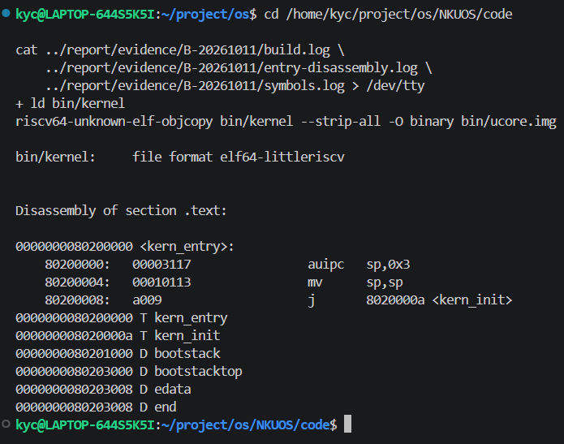
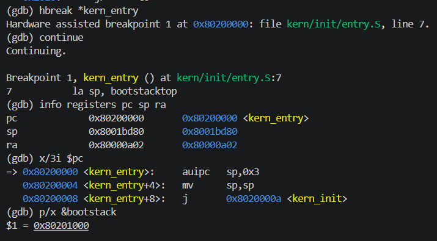
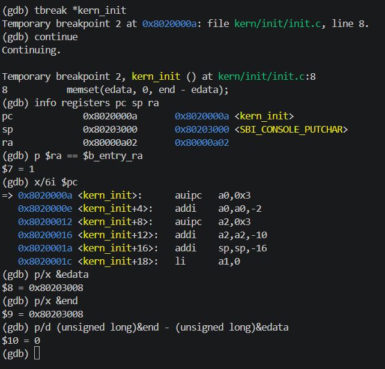
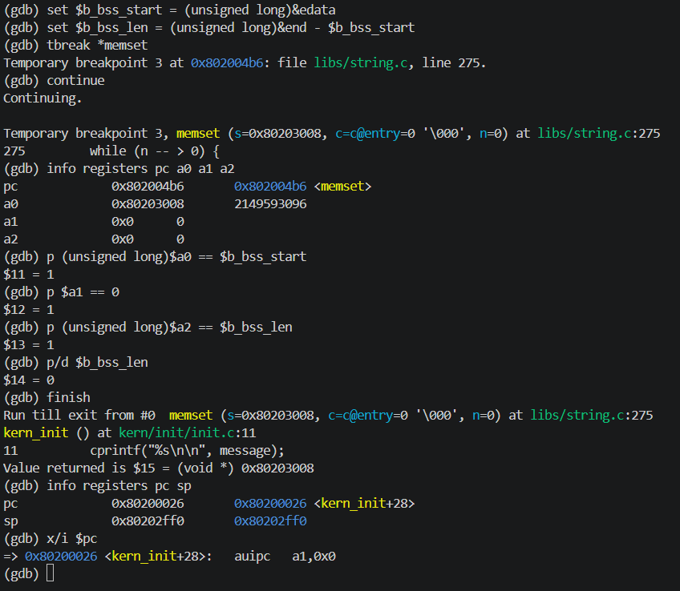
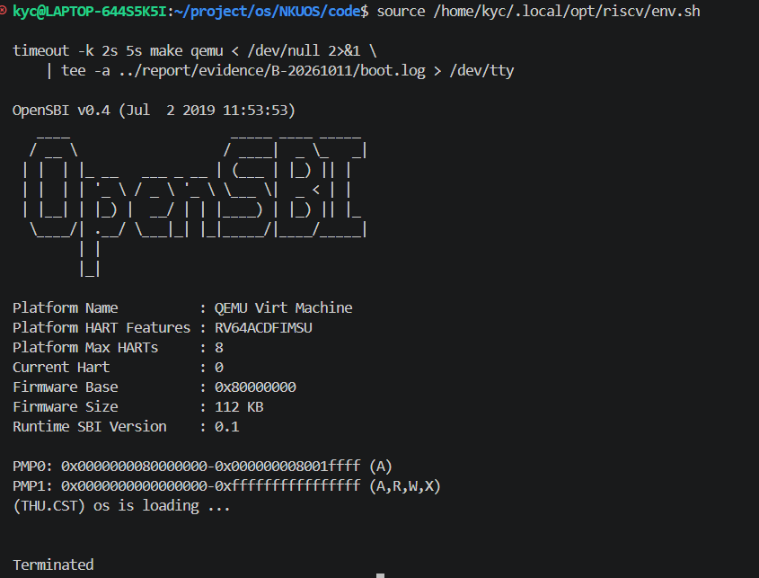

# Lab 1 实验报告：最小可执行内核与启动流程

Lab1 围绕最小内核的启动展开。我们结合源码和调试记录，分析代码如何获得正确的内存布局和运行条件，最终输出启动消息。

## 1. 实验概况、分工与环境

### 1.1 实验目标与分工

本实验以现有代码的分析和调试为主，目标是理解内核从哪里开始执行、执行前需要哪些准备，以及如何通过 QEMU 和 GDB 验证这些判断。报告整理覆盖 2026-10-08 至 2026-10-11 的构建与调试记录，各次观察以对应日志中的环境和日期为准。

我们共同学习和实践完整流程，按以下分工整理报告：

| 成员 | 报告主笔与整理职责 |
|---|---|
| 刘华彬，2411238（A） | 实验概况、整体逻辑与核心模块分析、OS 原理联系及实验总结，负责公共验证材料整理与全文整合 |
| 柯云超，2413575（B） | 练习 1：入口指令的操作、目的、栈与 C 初始化分析，以及对应观察记录 |
| 匡航逸，2412235（C） | 练习 2：复位到内核入口的启动跟踪、最初指令的位置与功能，以及对应调试记录 |

### 1.2 实验环境与记录来源

我们的工具版本有所不同，以下分别列出环境和记录；具体地址以对应构建与调试日志为准。

| 成员 | 实践环境 | AI 工具与底层模型 | 记录来源 |
|---|---|---|---|
| A：刘华彬 | Ubuntu 22.04.5 LTS（WSL）、Make 4.3、RISC-V GCC 15.1.0、Binutils 2.45、GDB 16.3 开发构建、QEMU 7.0.0、OpenSBI 1.0 | Codex，GPT-6（按会话记录） | [前期构建与启动汇总](evidence/build-link-20261008/summary.json)、[启动参数对照](evidence/boot-parameters-20261011/summary.json) |
| B：柯云超 | Ubuntu 22.04（WSL）、Make 4.3、SiFive RISC-V GCC 10.2.0、GDB 10.1、QEMU 4.1.1、OpenSBI 0.4 | Codex，GPT-6（按会话记录） | [环境记录](evidence/B-20261011/environment.log)、[启动日志](evidence/B-20261011/boot.log) |
| C：匡航逸 | Ubuntu 24.04.4 LTS（WSL）、Make 4.3、RISC-V GCC 13.2.0、Binutils 2.42、QEMU 8.2.2、OpenSBI 1.3、GDB 15.1 | Codex，GPT-6（按会话记录） | [启动调试汇总](evidence/gdb-boot-20261011/summary.json) |

构建和调试方法见 [代码 README](../code/README.md)。在我们使用的 QEMU 7.0.0 环境中，同镜像对照显示：手册的 `-device loader` 命令使 OpenSBI 的下一阶段入口为 0，改用 `-kernel` 后入口为 `0x80200000`，内核正常输出。我们据此保留该环境适配，详细原因见 [交接文档](A-构建链接交接.md#qemu)。

## 2. 章节整体逻辑与核心模块理解

### 2.1 章节主线

指导书按“内存布局与链接—SBI 输出—构建运行—GDB 跟踪”展开。我们的理解是，本章逐步解决三个问题：程序放在哪里、运行前需要什么条件、如何确认它已经执行。构建与执行是相互衔接的两个阶段：

```text
构建：.c/.S → .o → 按 kernel.ld 链接为 bin/kernel
      → objcopy 转成 bin/ucore.img

执行：QEMU 预加载固件和内核 → 复位代码 → OpenSBI
      → kern_entry 建立栈 → kern_init 清零、输出 → 无限循环
```

练习 1 解释入口为什么先建立栈再进入 C 函数；练习 2 从复位时的 PC 出发，验证执行权如何到达内核。两者分别从源码和实际执行过程检验这条主线。

### 2.2 构建与链接：确定布局和入口

`Makefile` 组织编译、链接与镜像转换，`tools/kernel.ld` 从 `0x80200000` 起安排代码和数据，通过 `ENTRY(kern_entry)` 指定 ELF 入口，并提供 `edata`、`end` 等初始化所需的边界符号。

`bin/kernel` 保留符号和调试信息，供 GDB 使用；`bin/ucore.img` 是运行用的裸镜像，不携带 ELF 入口元数据。因此，链接布局、加载位置和固件交接地址需要一致，`ENTRY` 本身不会让 CPU 自动跳转。[构建检查](evidence/build-link-20261008/summary.json) 中的入口和镜像比较，为后续设置断点提供了依据。

### 2.3 固件、入口与初始化：准备 C 代码的运行条件

QEMU 模拟机器，OpenSBI 参与启动并提供固件服务。第 4 节观察到的执行顺序是：`0x1000` 处的复位代码准备参数，跳到 `0x80000000` 的 OpenSBI，再进入 `0x80200000` 的内核。镜像此前已由 QEMU 放入内存，这里跟踪的是执行权的交接。

`kern/init/entry.S` 中的 `kern_entry` 设置 SP，再转入 `kern/init/init.c` 的 `kern_init`。前者提供函数调用所需的栈，后者根据链接符号执行 `memset(edata, 0, end - edata)`，随后输出并进入无限循环。我们认为这里最关键的是依赖关系：链接器给出内存边界，汇编准备栈，C 函数才能继续初始化。具体指令和寄存器变化见第 3、4 节。

### 2.4 输出模块：从格式字符串到固件服务

```text
cprintf → vcprintf → vprintfmt → cputch → cons_putc
        → sbi_console_putchar → sbi_call → ecall → OpenSBI
```

`kern/libs/stdio.c` 中的 `cprintf`、`vcprintf` 组织可变参数，`libs/printfmt.c` 中的 `vprintfmt` 解析格式并通过回调逐字符输出。`cputch` 调用 `cons_putc` 并累计字符数，后者通过 `sbi_console_putchar` 请求底层输出。

当前 `libs/sbi.c` 中的 `sbi_call` 将服务编号放入 `a7`、参数放入 `a0`～`a2`，执行 `ecall` 交给 OpenSBI。这样，内核负责格式化，固件提供底层输出服务。项目中的 `stdio.h` 对应这套内核接口；它让我们在尚未实现完整设备驱动时就能获得调试输出。

## 3. 练习 1：理解内核启动中的程序入口操作

**报告主笔：柯云超，2413575（B）。**

2026-10-11 完成入口与 C 初始化的源码分析，按本人运行的日志和 6 张终端截图记录构建、入口、栈、清零调用及启动输出。具体命令见 [练习一取证指南](B-练习一取证指南.md)。

### 题目

阅读 `kern/init/entry.S`，结合内核启动流程，说明 `la sp, bootstacktop` 和 `tail kern_init` 分别完成什么操作，目的是什么。

### 分析与回答

```asm
kern_entry:
    la sp, bootstacktop
    tail kern_init
```

#### la sp, bootstacktop：建立内核启动栈

`la` 是 load address 伪指令，将标号 `bootstacktop` 的地址写入 SP（`x2`），使内核使用自己的启动栈。它取得的是地址，不会读取该地址处的数据，也不负责在运行时申请栈空间。栈空间已由 `entry.S` 中的数据段定义预留：

```asm
.section .data
    .align PGSHIFT
    .global bootstack
bootstack:
    .space KSTACKSIZE
    .global bootstacktop
bootstacktop:
```

`mmu.h` 定义 `PGSHIFT=12`、`PGSIZE=4096`，`memlayout.h` 定义 `KSTACKPAGE=2`、`KSTACKSIZE=KSTACKPAGE * PGSIZE`，所以启动栈大小为 8192 字节。在当前 RISC-V GNU 汇编器中，`.align PGSHIFT` 将栈起点按 `2^12=4096` 字节对齐。汇编指示符安排空间和符号，CPU 在入口执行时通过设置 SP 开始使用这段空间。

栈区为 `[bootstack, bootstacktop)`。栈向低地址增长，初始 SP 指向预留区的高地址边界，后续建立栈帧时减小 SP，把保存寄存器、返回地址等所需的空间放在栈区内。页对齐的起点加上两页的大小，也保证栈顶满足标准 RISC-V ABI 在函数调用边界的 16 字节对齐要求。

C 编译器生成的函数可能立即调整 SP，保存寄存器并调用其他函数，因此进入 C 之前需要合法的栈。OpenSBI 交接时 SP 即使非零，也仍可能是固件使用的栈；内核通过这条指令显式建立自己的启动栈。

#### tail kern_init：交接给 C 初始化函数

`tail kern_init` 以 tail call 的方式跳转到 C 语言编写的内核初始化函数，不向 RA（`x1`）写入新的返回地址。普通 `call` 会建立返回到调用位置之后的地址，这里的入口在完成栈设置后直接交出执行权。

`kern_init` 声明为 `noreturn`，完成初始化和输出后进入无限循环，因此不需要返回到 `kern_entry`。`noreturn` 告知编译器函数不会正常返回；当前实现中，末尾的 `while (1) ;` 实际保证了这一点。

`la` 和 `tail` 都是伪指令，最终展开取决于汇编、重定位和链接松弛。已有反汇编中，`la` 对应 `auipc sp,0x3`、`mv sp,sp`，`tail` 对应跳到 `kern_init` 的 `j`；反汇编中的 `mv`、`j` 也可能是基础指令的别名。一次 GDB `si` 执行一条机器指令，不一定执行完一整条源码伪指令。

先设置 SP、再进入 C 函数的顺序体现了两者的依赖关系：汇编入口准备栈，C 初始化函数才能使用栈并进行后续调用。

#### kern_init：清零、输出与无限循环

```c
extern char edata[], end[];
memset(edata, 0, end - edata);
const char *message = "(THU.CST) os is loading ...\n";
cprintf("%s\n\n", message);
while (1)
    ;
```

`edata` 和 `end` 来自链接脚本的 `PROVIDE`，分别标记初始化数据结束处和 BSS 结束处。C 中使用 `extern char ...[]` 引用边界地址，不会额外分配两段数组。`end - edata` 以字节为单位，`memset` 将 `[edata,end)` 写成零，满足未显式初始化或零初始化的静态存储对象从零开始的 C 语义。

启动栈位于 `.data`，不在这里的 BSS 清零区间内；执行 `memset` 时已经在使用栈。若实际构建得到 `edata == end`，清零长度就是 0，调用不会写入任何 BSS 字节。第 4 节已有记录属于这一情况，本人的结果以重新运行时的边界和参数为准。

随后 `cprintf` 输出启动信息，程序停在无限循环。终端不再增加输出符合当前代码的控制流；字符格式化及 SBI 输出过程见第 2 节。

### 入口观察

入口调试主要观察栈空间、伪指令的实际展开，以及设置 SP 前后的变化。下表沿用第 4 节已有的小组调试记录，便于对照代码；B 的个人实践另列于后，可比较不同工具环境下的实际数值。

| 观察项 | 本次结果 | 日志或截图 |
|---|---|---|
| `bootstack`、`bootstacktop` 与栈大小 | `0x80201000`、`0x80203000`，相差 8192 字节 | [符号记录](evidence/gdb-boot-20261011/symbols.log) |
| `kern_entry` 的实际反汇编 | `auipc sp,0x3`、`mv sp,sp`、`j 0x8020000a` | [入口反汇编](evidence/gdb-boot-20261011/entry-disassembly.log) |
| 设置 SP 前后的变化 | 从 `0x80046eb0` 变为 `0x80203000`，等于 `bootstacktop` | [单步记录](evidence/gdb-boot-20261011/gdb.log) |
| 入口跳转后的 PC | `0x8020000a`，进入 `kern_init` | [单步记录](evidence/gdb-boot-20261011/gdb.log) |

第 4 节记录了本轮调试中执行入口指令后 PC 和 SP 的变化，可以与这两条伪指令的含义对应起来。

### B 本人运行记录与截图

2026-10-11 本人按 [练习一取证指南](B-练习一取证指南.md) 执行构建和 GDB 命令，记录保存在 `evidence/B-20261011/`。环境见 [environment.log](evidence/B-20261011/environment.log)，入口、栈和 C 初始化的完整输出见 [gdb.log](evidence/B-20261011/gdb.log)，补充普通启动的输出见 [boot.log](evidence/B-20261011/boot.log)。下表数值来自这些记录。

| 观察项 | 本人实际结果 | 截图文件名 |
|---|---|---|
| 构建、入口反汇编与关键符号 | make 完成链接及镜像转换；入口为 `0x80200000`；反汇编为 auipc、mv、j；栈边界为 `0x80201000`、`0x80203000` | `B-01-build-symbols.png` |
| 入口执行前的 PC、SP、RA 与栈边界 | `pc=0x80200000`、`sp=0x8001bd80`、`ra=0x80000a02`；栈大小 8192 字节 | `B-02-entry-before.png`；完整边界见 GDB 日志 |
| 执行完整 la 展开后的 SP | `pc=0x80200008`、`sp=0x80203000`；SP 与栈顶相等的比较为 1，低四位为 `0x0` | `B-03-stack-after.png` |
| tail 跳转到 kern_init 首地址 | `pc=0x8020000a`、`sp=0x80203000`；RA 保持 `0x80000a02`，比较为 1；`edata=end=0x80203008`，长度 0 | `B-04-enter-c.png` |
| memset 的真实调用参数与返回 | `a0=0x80203008`、`a1=0`、`a2=0`；三项参数比较均为 1；返回后 `pc=0x80200026`、`sp=0x80202ff0` | `B-05-bss-init.png` |
| 内核启动输出 | OpenSBI 0.4 启动后出现 `(THU.CST) os is loading ...`；普通启动使用 5 秒 timeout 结束观察 | `B-06-boot.png` |

构建的 [build.log](evidence/B-20261011/build.log) 记录了链接和 objcopy，并未显示本次逐个编译所有源文件，因此本轮不记为干净重建。入口反汇编和关键符号分别见 [entry-disassembly.log](evidence/B-20261011/entry-disassembly.log)、[symbols.log](evidence/B-20261011/symbols.log)。

以下截图由本人操作终端后保存。第 2 张底部未显示全部栈边界，缺少的边界和大小可从同次 GDB 日志核对。












截图 1 是本人将已有原始日志重新显示到终端后截取的结果。截图 6 对应调试结束后另做的一次普通启动，命令为 `timeout -k 2s 5s make qemu < /dev/null`，并通过 tee 保存 boot.log。末尾的 Terminated 对应超时终止；判断启动成功的依据是实际内核消息，不以超时命令作为内核正常退出。

这些观察说明，入口先切换到预留的内核栈，再通过不改写 RA 的跳转进入 C 函数。进入 C 后，函数序言将 SP 减小 16 字节，符合向低地址建立栈帧的行为。本次 BSS 长度为零，截图 5 证明的是零长度 memset 调用及返回，未观察到非空 BSS 内容改变。


## 4. 练习 2：使用 GDB 验证启动流程

**报告主笔：匡航逸，2412235（C）。本轮由 Codex 执行命令并保存调试记录。**

### 题目

使用 GDB 跟踪 QEMU 模拟的 RISC-V 从加电开始到执行内核第一条指令的过程，回答：最初执行的几条指令位于什么地址，主要完成哪些功能？记录调试过程与观察结果。

### 调试环境与方法

本轮使用 Ubuntu 24.04.4 LTS（WSL）、Make 4.3、RISC-V GCC 13.2.0、Binutils 2.42、QEMU 8.2.2、OpenSBI 1.3 和 GDB 15.1。当前环境安装的是 `gdb-multiarch`，它可以通过 `set architecture riscv:rv64` 调试 RISC-V 64 位程序。工具路径与版本见 [本轮汇总](evidence/gdb-boot-20261011/summary.json)。

在 `code/` 中执行 `make -B`，重新编译全部源文件，生成同一轮的 `bin/kernel` 和 `bin/ucore.img`。随后启动 QEMU，使用与 `make debug` 相同的参数：

```bash
qemu-system-riscv64 -machine virt -nographic -bios default \
    -kernel bin/ucore.img -s -S
```

`-S` 使 CPU 在开始执行前暂停，`-s` 开放默认的 GDB 调试端口 1234。GDB 加载 ELF 文件以取得内核符号，并连接 QEMU：

```gdb
file bin/kernel
set architecture riscv:rv64
target remote localhost:1234
set pagination off
info registers pc sp t0 a0 a1 a2
x/6i $pc
x/3i 0x80200000
watch *(unsigned int *)0x80200000
```

先逐条执行复位代码，观察寄存器；进入 OpenSBI 后，在 `0x80200000` 设置断点并继续运行，观察固件完成初始化后的跳转。最后单步执行内核第一条指令，确认内核已经开始运行。完整命令和输出见 [GDB 日志](evidence/gdb-boot-20261011/gdb.log)，本轮命令由 [实验脚本](evidence/gdb-boot-20261011/capture.py) 执行。

### 初始 PC 与最初六条指令

GDB 连接后，初始 PC 为 `0x1000`，SP 为 `0`。`x/6i $pc` 显示：

```asm
0x1000: auipc t0,0x0
0x1004: addi  a2,t0,40
0x1008: csrr  a0,mhartid
0x100c: ld    a1,32(t0)
0x1010: ld    t0,24(t0)
0x1014: jr    t0
```

这些指令位于 MROM（Machine ROM），是本次 QEMU `virt` 平台的复位代码。对每条指令执行一次 `si`，再查看相关寄存器，得到以下结果：

| 指令地址 | 指令 | 操作与执行后的观察 |
|---|---|---|
| `0x1000` | `auipc t0,0x0` | 将当前指令地址与立即数左移 12 位后的值相加。这里立即数为 0，得到 `t0 = 0x1000`，供后续计算地址 |
| `0x1004` | `addi a2,t0,40` | 得到 `a2 = 0x1028`，指向传给 OpenSBI 的启动信息 |
| `0x1008` | `csrr a0,mhartid` | 从 `mhartid` 读取当前 hart ID，得到 `a0 = 0` |
| `0x100c` | `ld a1,32(t0)` | 从 `0x1020` 读取 64 位地址，得到 `a1 = 0x87e00000`，即设备树的地址 |
| `0x1010` | `ld t0,24(t0)` | 从 `0x1018` 读取 OpenSBI 入口，得到 `t0 = 0x80000000` |
| `0x1014` | `jr t0` | 跳转到 `t0` 指向的地址，执行后 PC 为 `0x80000000`，进入 OpenSBI |

这里两条 `ld` 的作用可以通过内存检查直接看出：

```text
(gdb) x/2gx 0x1018
0x1018: 0x0000000080000000  0x0000000087e00000
```

`0x1018` 起的八个字节保存 OpenSBI 入口，`0x1020` 起的八个字节保存设备树地址。指令先从内存取出地址，再将地址用于传参或跳转。

为理解 `a2` 的作用，又检查了 `0x1028` 起的六个 64 位值，依次为 `0x4942534f`、`2`、`0x80200000`、`1`、`0`、`0`。它们对应 OpenSBI 的 `fw_dynamic_info` 中的 `magic`、`version`、`next_addr`、`next_mode`、`options` 和 `boot_hart`。其中 `next_addr` 给出内核入口，`next_mode = 1` 表示下一阶段使用 S 模式。这一对应关系可由 [OpenSBI 1.3 的结构定义](https://github.com/riscv-software-src/opensbi/blob/v1.3/include/sbi/fw_dynamic.h) 和 [QEMU 8.2.2 的复位代码](https://github.com/qemu/qemu/blob/v8.2.2/hw/riscv/boot.c) 核对。

因此，最初六条指令主要完成的是地址计算、参数准备和跳转。执行完后，PC 指向 OpenSBI，`a0`、`a1`、`a2` 分别保存 hart ID、设备树地址和启动信息地址，固件可以据此继续初始化。

### 从 OpenSBI 到内核第一条指令

第六次 `si` 后，在 `0x80000000` 处观察到 OpenSBI 的入口指令：

```asm
0x80000000: add s0,a0,zero
0x80000004: add s1,a1,zero
0x80000008: add s2,a2,zero
```

这三条指令先把复位代码传来的参数保存到 `s0`、`s1`、`s2`。随后设置内核入口断点：

```gdb
break *0x80200000
continue
info registers pc sp a0 a1
x/3i $pc
```

GDB 停在 `kern_entry` 的第一条指令前，PC 为 `0x80200000`，SP 为 `0x80046eb0`，`a0 = 0`，`a1 = 0x87e00000`。QEMU 终端中的 OpenSBI 输出也给出了 `Next Address = 0x80200000`、`Next Arg1 = 0x87e00000` 和 `Next Mode = S-mode`，与入口处的地址和参数对应。

内核入口的反汇编为：

```asm
0x80200000 <kern_entry>:   auipc sp,0x3
0x80200004 <kern_entry+4>: mv    sp,sp
0x80200008 <kern_entry+8>: j     0x8020000a <kern_init>
```

此时已经到达内核入口。再执行一次 `si` 后，PC 变为 `0x80200004`，SP 变为 `0x80203000`，说明 `0x80200000` 处的第一条内核指令已经执行。后续两次单步的结果如下：

| 停止位置 | PC | SP | 含义 |
|---|---|---|---|
| 入口断点 | `0x80200000` | `0x80046eb0` | 尚未执行入口指令，SP 仍指向固件使用的栈 |
| 第一次 `si` 后 | `0x80200004` | `0x80203000` | `auipc` 将 SP 设置为当前 PC 加 `0x3000` |
| 第二次 `si` 后 | `0x80200008` | `0x80203000` | `mv sp,sp` 对应的地址偏移为 0，SP 保持原值，`la` 执行完毕 |
| 第三次 `si` 后 | `0x8020000a` | `0x80203000` | `j` 跳转到 `kern_init`，开始执行 C 初始化函数 |

本次符号地址为 `bootstack = 0x80201000`、`bootstacktop = 0x80203000`，两者相差 `0x2000`，即 8192 字节。SP 的变化说明内核开始执行后会使用自己预留的栈；OpenSBI 之前使用的栈与内核栈分别属于两个启动阶段。

进一步在 `cprintf` 处设置断点，观察到格式字符串为 `"%s\n\n"`，字符串参数为 `"(THU.CST) os is loading ...\n"`。继续执行后，QEMU 输出：

```text
(THU.CST) os is loading ...
```

这与 `kern_init` 的代码一致：清零 `.bss` 范围，输出启动信息，再进入无限循环。本次 `edata` 与 `end` 均为 `0x80203008`，所以 `memset` 的长度为 0。完整输出见 [QEMU 日志](evidence/gdb-boot-20261011/qemu.log)。

### watchpoint 与镜像加载时机

按照练习提示，使用 `watch` 在 `0x80200000` 设置了 watchpoint。继续运行后，GDB 命中了内核入口断点，watchpoint 没有触发。回看初始 PC 仍为 `0x1000` 时的内存，`x/3i 0x80200000` 已经能够反汇编出 `kern_entry` 的三条指令。

随后将初始状态下 `0x80200000` 起的 12296 字节与 `bin/ucore.img` 比较，两者完全一致，SHA-256 均为 `36bef3842e20e33667dd8075563b890317fb18f9654ca961dcef4dc145eab84c`。这说明本轮启动中，QEMU 已在 CPU 开始执行前将内核镜像加载到物理内存。

watchpoint 记录设置后被监视内容的变化，而入口断点记录 CPU 到达指定地址的时刻。本轮镜像加载发生在设置 watchpoint 之前，所以调试中观察到的是复位代码跳转到 OpenSBI，再由 OpenSBI 将控制权交给已经位于内存中的内核。

### 问题的答案

在本次 QEMU 模拟的 RISC-V `virt` 平台上，加电复位后最初执行的六条指令位于 MROM 的 `0x1000`～`0x1014`。它们以当前 PC 为基址，准备 hart ID、设备树地址和 OpenSBI 所需的启动信息，读取 `0x80000000` 作为固件入口，再通过 `jr t0` 跳转。OpenSBI 在 M 模式下完成初始化后，将控制权交给 S 模式下位于 `0x80200000` 的内核；单步执行该地址处的指令后，SP 变为 `bootstacktop`，内核开始使用自己的栈。

## 5. 重要知识点与操作系统原理的联系

我们重点关注以下四组联系，它们既能解释当前代码，也帮助我们区分本实验与完整 OS 机制的范围。

### 5.1 内存布局与内存管理

链接脚本按用途安排 `.text`、`.rodata`、`.data` 和 `.bss`，解决程序内容如何放置的问题。OS 内存管理在此基础上还要负责分配、地址转换和保护。Lab1 使用固定布局，没有实现页表或动态分配；其中的页对齐只是地址约束，不代表已经实现分页管理。

### 5.2 启动栈与执行上下文

设置 SP 为 C 函数建立了可用的栈，函数进入后向低地址建立栈帧，与调用约定中的现场保存相联系。进程、线程的执行上下文也包含寄存器和栈，但上下文切换还需保存和恢复不同执行实体的状态。本实验仅初始化一条执行路径的栈，尚未涉及进程切换。

### 5.3 特权级与受控服务调用

S 模式的内核通过 `ecall` 请求 M 模式的 OpenSBI 服务，体现了按特权级划分职责、通过约定接口传参的思想。它与系统调用有相似的接口形式，但系统调用通常连接用户程序和内核，本实验连接的是内核和固件。因此，使用 SBI 并不等于实现了用户态系统调用。

### 5.4 输出分层与设备抽象

`cprintf` 处理格式，`cons_putc` 提供字符接口，SBI 连接固件服务。这与 OS 用统一接口隐藏设备细节的思想一致。当前实验只实现了一条简单输出路径，尚未涉及中断驱动、缓冲队列和设备调度。我们从中理解的是各层如何分工配合，而非完整设备管理的实现。

## 6. OS 原理中重要但本实验尚未覆盖的内容

结合当前内核的能力，我们认为后续还需要关注：

- **内存分配与虚拟内存：** 空闲页管理、页表映射、地址保护和缺页处理，解决多个程序如何使用有限内存的问题。
- **进程、线程与调度：** 执行实体的创建、上下文切换和时间片分配，使处理器能在多个任务之间切换。
- **内核中断、异常与系统调用：** 建立内核自己的事件处理入口，并支持用户程序受控地请求内核服务。
- **同步与死锁：** 处理并发访问共享资源时的互斥、协作和相互等待问题。
- **文件系统与持久化存储：** 通过文件、目录和块设备管理组织并保存数据。

Lab1 尚无用户程序和多任务执行，内核输出后进入无限循环。它提供了启动与观察的基础，以上资源管理机制仍需在后续实验中建立。

## 7. 实验反思与总结

刚接触 Lab1 时，我们以为主要工作是配好环境、运行程序，看到启动信息就算完成了大半。对照指导书阅读代码、跟踪执行后，才发现还有不少问题说不清楚：程序为什么从这里开始，进入 C 函数前需要做哪些准备，屏幕上的文字又是怎样输出的。实验结果虽然简单，却让我们把组成原理中学过的寄存器、指令和内存知识，与操作系统的实际启动过程联系起来。

Makefile 与手册的差异，也让我们重新看待实验中的“额外修改”。最初我们只关心能否照着手册运行，后来开始追问：这些修改解决了什么问题，在当前环境下是否必要？通过核对资料和对照运行，我们才理解了这处差异的原因。这让我们体会到，遇到与教程不同的结果时，应先弄清条件和原因，而不只是改到能运行；一次运行成功，也不代表已经理解了整个过程。

我们在实验中使用 Codex 辅助分析和整理，相关记录见 [prompt.md](prompt.md)。
