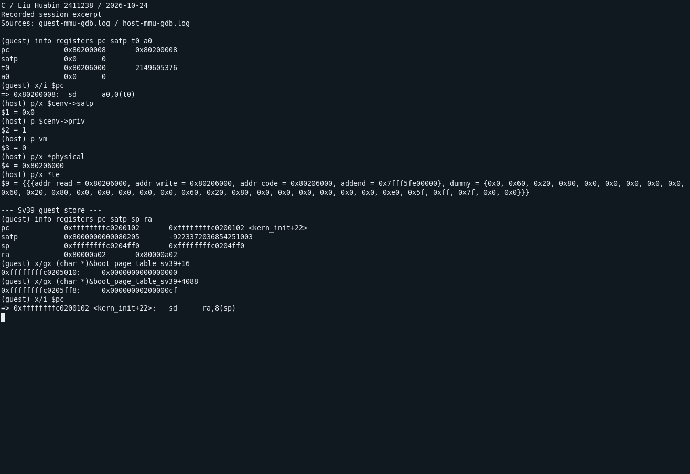
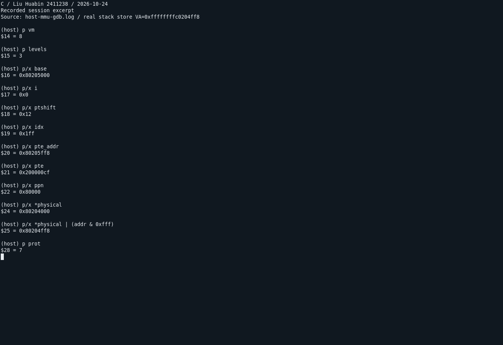
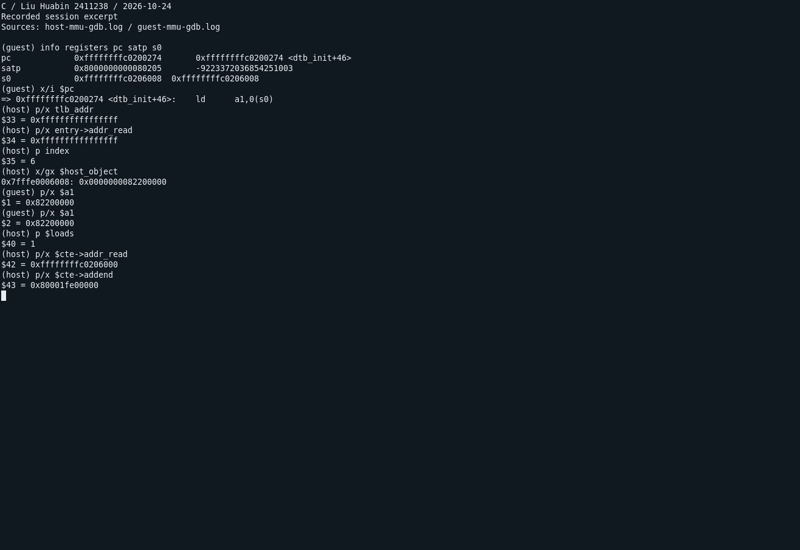
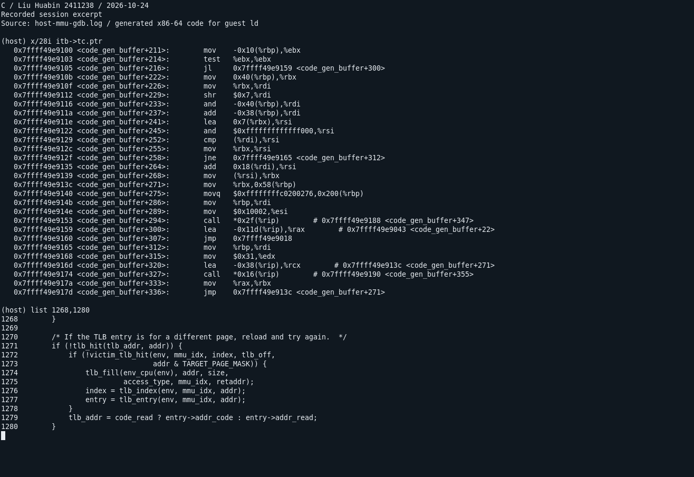
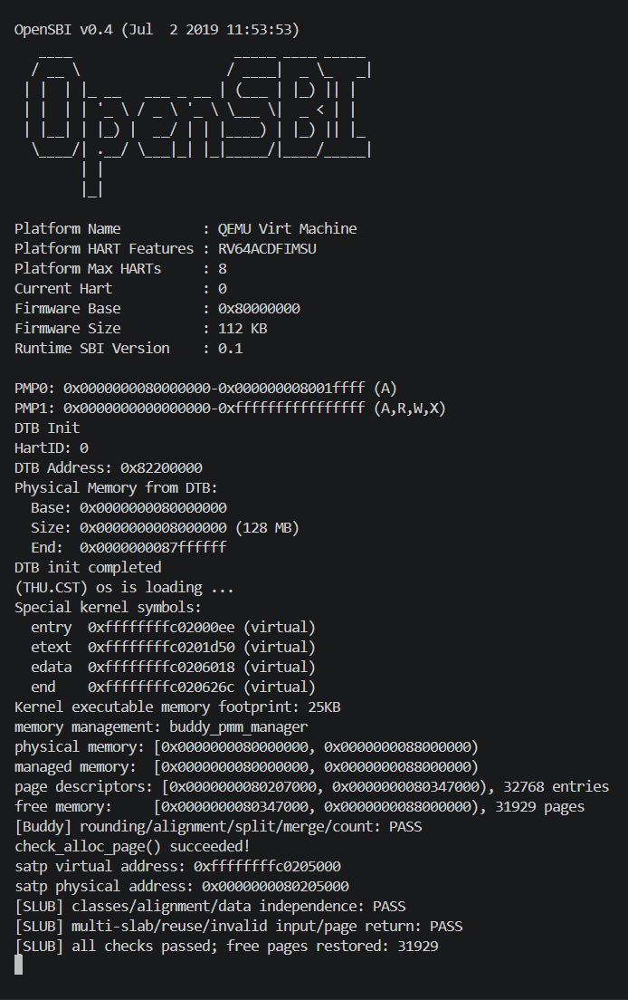
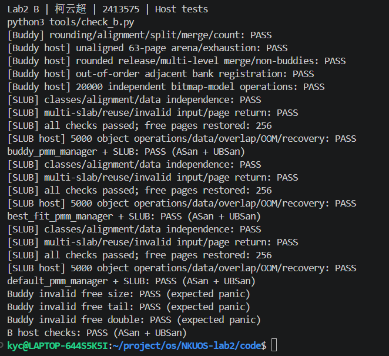
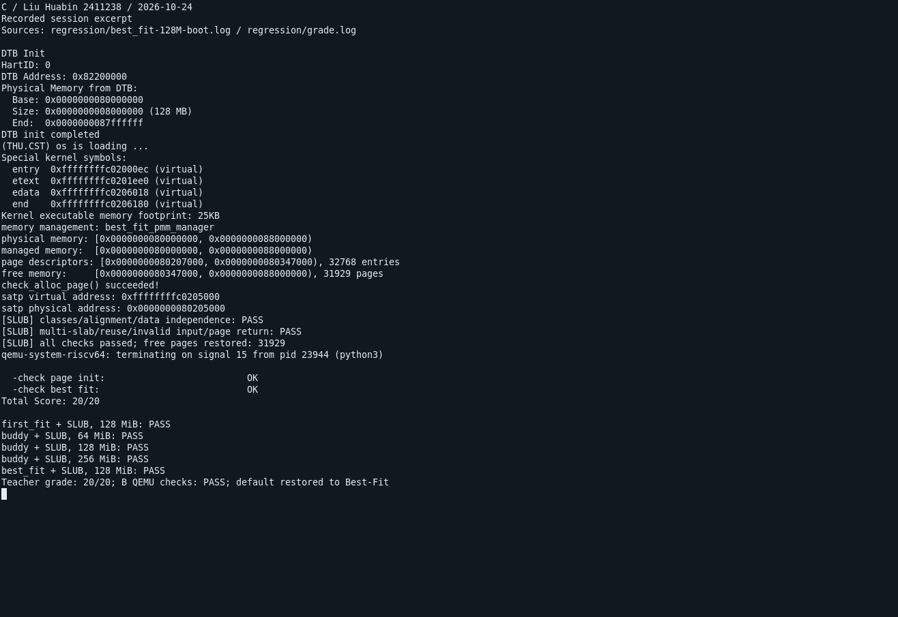

# 操作系统实验报告

## 实验基本信息

| 项目 | 内容 |
| --- | --- |
| 实验名称 | Lab2：物理内存管理、页分配与地址翻译 |
| 小组成员 | 匡航逸 2412235、柯云超 2413575、刘华彬 2411238 |
| 实现与整理日期 | 2026-10-23～2026-10-24 |
| 代码位置 | `../code/`，`lab2` 分支 |
| 运行入口 | 默认 Best-Fit；`make PMM=first_fit`、`make PMM=buddy` 切换页分配器 |

### 小组分工

| 成员 | 代码与实验任务 | 报告任务 |
| --- | --- | --- |
| 匡航逸 2412235（A） | 物理内存初始化，First-Fit 分析与修复，Best-Fit，实现基线及测试 | 初始化、基础分配算法、硬件内存范围思考题，保存 spec 与调试过程 |
| 柯云超 2413575（B） | Buddy System、简化 SLUB，独立模型与边界测试 | Buddy/SLUB 设计与四份提示词、知识点总结、运行截图 |
| 刘华彬 2411238（C） | 构建 QEMU 4.1.1 调试环境，双 GDB 调试页表和 TLB，比较分页前后访存，执行整合回归 | 地址翻译专题、GDB 日志与截图，将三部分整理为本报告 |

我们先由 A 建立可运行的物理页管理基线，B 在公共接口上扩展两种分配层次，C 在同一内核上观察模拟器的地址翻译。这样既能分别推进，也能在最终运行中检查各层接口是否衔接。

## 一、实验目的

这次实验要把启动时的一片 RAM 变成内核可以使用的内存资源。具体来说，需要先知道内存在哪里、哪些范围已经被占用，再为物理页建立管理信息，接着实现分配、拆分、回收与合并。页分配完成后，我们继续处理小对象，并从 QEMU 内部观察一次访存如何通过页表和软件 TLB 落到实际存储。

实验中的三个学习重点相互联系：物理内存初始化决定分配器的管理边界；First-Fit、Best-Fit、Buddy 决定如何组织和选择空闲页；页表与 TLB 决定已经存在的地址映射如何被执行。SLUB 把页层接口进一步变成对象接口，使我们能看到内存管理的层次关系。

## 二、实验环境

### 2.1 AI 工具

| 成员 | AI 编程工具 | 底层模型 | 使用过程 |
| --- | --- | --- | --- |
| 匡航逸 | Codex | GPT-6 | 阅读框架、整理初始化和分配器约定、生成实现与独立测试、排查启动问题 |
| 柯云超 | Codex 桌面应用 | GPT-6 | 分别设计 Buddy、SLUB 的实现与测试，整理运行材料 |
| 刘华彬 | Codex | GPT-6 | 构建调试版 QEMU，编写双 GDB 驱动，分析实际调用栈与生成代码，整合报告 |

我们在提示词里先约定接口和状态，再让 AI 生成实现。验证时既运行内核已有的检查，也使用独立模型和QEMU 启动。后文分别记录每部分的 spec、提示词和实际遇到的问题。

### 2.2 工具链与平台

| 项目 | A 的实现环境 | B 的实现与复现环境 | C 的调试与整合环境 |
| --- | --- | --- | --- |
| 宿主机 | macOS arm64 | WSL Ubuntu 22.04 | WSL2 Ubuntu 22.04，x86-64 |
| 交叉 GCC | xPack 15.2.0 | SiFive GCC-Metal 10.2.0 | RISC-V GCC 15.1.0 |
| QEMU | xPack 9.2.4 | 4.1.1 | 7.0.0 做基线启动，4.1.1 做源码调试与最终回归 |
| OpenSBI | 1.5.1 | 0.4 | 1.0 / 0.4，随 QEMU 分别使用 |
| Make | 3.81 | 4.3 | 4.3 |
| 调试器 | RISC-V GDB | 使用终端复现构建与测试 | host GDB 12.1；guest GDB 16.3.90.20250610-git |
| ISA / ABI | RV64、`lp64` | `rv64imac`、`lp64` | `rv64imac_zicsr_zifencei`、`lp64` |

默认 RAM 为 128 MiB，物理范围为 `[0x80000000,0x88000000)`；内核加载到 `0x80200000`，链接到 `0xffffffffc0200000`。普通物理页大小为 4 KiB。启动根表使用 1 GiB 叶子映射，二者粒度不同。

起始代码来自 `lab2.zip` 中的 `lab2_new/`。我们先完成物理页初始化和基础分配，再接入 Buddy 与 SLUB，最后用同一份内核进行地址翻译调试和整合回归。

## 三、实验整体逻辑分析

### 3.1 从启动映射到内存分配

内核在调用 `page_init()` 之前已经启用分页。`entry.S` 将根页表地址写入 `satp`，通过临时恒等映射完成从低地址到高地址的跳转，再清除临时项并刷新 TLB。这个最初的直接映射让内核能访问自身、设备树和后续的管理数据。

接下来，OpenSBI 通过寄存器传入的 DTB 描述物理 RAM。`dtb_init()` 保存 RAM 起点和长度，`page_init()` 从中确定可管理范围，建立描述符数组，并把固件、内核和元数据占用排除。只有剩余的完整页面才能交给分配器。

整个调用顺序是：

```text
OpenSBI：a0=hartid，a1=DTB 物理地址
  → entry.S：启动页表、开启 Sv39、跳入高地址、删除临时映射
  → kern_init：清零 BSS，解析 DTB，初始化控制台
  → pmm_init
      → init_pmm_manager：选定管理器，建立空闲状态
      → page_init：建立 Page 数组，确定可分配页面
          → init_memmap：将这些页面注册给当前管理器
      → 当前管理器 check：检查页分配与回收
  → slub_init / slub_check：在页上管理小对象
  → 内核等待循环
```

先初始化管理器，再注册内存，是因为 `init_memmap()` 要把空闲块加入管理器的数据结构。页分配检查放在注册之后；SLUB 放在页管理初始化之后，因为创建 slab 需要先申请物理页。

### 3.2 四种管理方式的关系

First-Fit 和 Best-Fit 都管理任意长度的连续空闲页块，区别主要在选块策略。Buddy 将块大小限制为 2 的幂，利用对齐和伙伴关系拆分、合并。SLUB 再在页面内部切分小对象，它依赖页分配器，并不替换页分配器。

地址翻译是贯穿这些操作的另一条线。比如 `alloc_pages()` 返回的是起始页的 `Page *`，内核要通过 `page2pa()` 得到物理地址，再利用直接映射得到可访问的虚拟地址。CPU 执行访存时，QEMU 模拟页表与权限检查，软件 TLB 则缓存可复用的访问结果。

## 四、实验内容与实现

### 4.1 物理内存探测与页描述符初始化

**负责人：匡航逸，2412235。** 核心函数为 `kern/mm/pmm.c` 中的 `static void page_init(void)`。

#### 4.1.1 spec 的形成

写 spec 时，首先确定函数的输入来自哪里：设备树解析已经完成，因此读取 `get_memory_base()` 和 `get_memory_size()`。再检查框架中的固定条件：`nbase`、链接地址和启动映射都以 `DRAM_BASE=0x80000000` 为基准，不能只根据 DTB 长度随意接受另一个起点。

由此形成以下约定：

| 项目 | 约定 |
| --- | --- |
| 输入检查 | 起点等于 `DRAM_BASE`，大小非零，加法不溢出；无效时 panic |
| 管理终点 | 取 DTB 终点与 `PHYSICAL_MEMORY_END` 的较小值，向下按页对齐 |
| 地址偏移 | `va_pa_offset=PHYSICAL_MEMORY_OFFSET` |
| 描述符数 | `npage-nbase`；`npage` 是绝对物理页号上界 |
| 描述符位置 | 内核 `end` 向上按页对齐，先确认数组放得下，再写入 |
| 初始状态 | 所有描述符先设为保留，引用和块属性清零，初始化链表指针 |
| 空闲区 | 数组末尾向上对齐至管理终点的完整页；页数为零时不注册 |

初始化提示词首先明确输入来源、地址含义和保留区，再规定异常输入的处理方式：

```text
[RELY]
阅读 dtb.c 的内存信息接口，pmm.h、memlayout.h、mmu.h 和 entry.S。
区分 VA、PA、PPN 和 Page 描述符地址。

[SPEC]
实现 page_init。DTB 输入无效或描述符放不下时 panic。
使用固定启动映射偏移；管理上界截断并按页向下对齐。
npage 是页号上界，pages 覆盖 npage-nbase 个描述符。
固件、内核与描述符页保留，仅将剩余完整页面交给 init_memmap。

[CHECK]
在QEMU 中启动，并用主机测试覆盖默认与非整页 RAM、上界截断、
无剩余完整页、错误基址、零大小、加法溢出和描述符空间不足。
```

这份提示词将“初始化物理内存”展开为具体地址和状态约定，尤其明确了 `npage` 和保留范围，避免生成代码直接把 RAM 容量当成可分配容量。

#### 4.1.2 地址、描述符和保留区

在默认 128 MiB 下：

```text
nbase = 0x80000000 / 4096 = 524288
npage = 0x88000000 / 4096 = 557056
描述符数量 = 557056 - 524288 = 32768
```

因此 `pages[i]` 对应物理页号 `nbase+i`。`Page *` 指向管理记录；实际页内容位于另一个地址，转换关系由 `page2ppn()`、`page2pa()` 和 `pa2page()` 处理。

本轮 RV64 的 `struct Page` 大小是 40 字节，32768 项共占 `0x140000` 字节。C 的默认构建输出为：

```text
physical memory: [0x0000000080000000, 0x0000000088000000)
managed memory:  [0x0000000080000000, 0x0000000088000000)
page descriptors: [0x0000000080207000, 0x0000000080347000), 32768 entries
free memory:     [0x0000000080347000, 0x0000000088000000), 31929 pages
```

RAM 有 32768 页，但初始空闲只有 31929 页。差额来自低地址固件保留区、内核、启动栈、页表、描述符和对齐间隙。管理结构本身也占用 RAM，所以不能把描述符数组所在页加入空闲链表。

实现中先检查描述符的剩余空间，使用 `descriptor_bytes > managed_end-pages_pa` 这样的比较，再清零和写入。这样不会先构造一个已经越界的数组末指针。所有页面先保留，最后只解除真正空闲区的保留状态，初始化过程更容易检查。

#### 4.1.3 测试与实现过程

主机测试直接调用实际 `page_init()`，用模拟 DTB 输入和映射缓冲区观察注册范围。覆盖正常、非整页、上界截断、无空闲完整页以及五类非法输入，共九组；异常场景检查对应 panic。QEMU 另用 16、64、128、256 MiB 验证启动，其中 256 MiB 的物理范围扩大，而可管理终点仍为 `0x88000000`。

A 首轮主机测试的模拟映射偏移没有按页对齐，导致描述符地址检查出错。调整测试缓冲区的物理基准后重跑；内核所用固定偏移本身按页对齐。这个问题提醒我们，测试环境替换地址空间时也必须保留被测代码所依赖的关系。

### 4.2 理解 First-Fit 连续物理内存分配

**负责人：匡航逸，2412235。** 参考实现为 `kern/mm/default_pmm.c`。

#### 4.2.1 读代码时关注的不变量

这道思考题沿用 A 的整体提示词，先让 AI 阅读完整实现，再按初始化、申请、释放顺序解释。我们把解释的依据放在数据结构上：空闲链表按地址递增，每个节点只代表一个连续空闲块的首页；首页有 `PG_property`，`property` 是块长；`nr_free` 是全部空闲页的总数。内部页的 `property` 可能有旧值，识别状态要结合首页标志。

`default_init()` 建立空循环链表、将计数清零。`default_init_memmap(base,n)` 把一段保留页转换为空闲页，将首页长度设为 n，按地址插入链表，并增加 n 页。原实现不会把多次注册的相邻区间立即合并；本次初始化注册单段空闲区。

`default_alloc_pages(n)` 从链表头找第一个长度至少为 n 的块。找到后取走其前 n 页，若还有余量，就把 `base+n` 作为剩余块首页，放回原位置。计数减少 n，返回块的首页清除空闲标志。总空闲量不足或没有足够大的连续块，均返回 NULL。

`default_free_pages(base,n)` 重置描述符，按地址插入，再检查前后邻块。前块末尾恰好等于 base 才能向前合并；当前块末尾恰好等于后块首页才能向后合并。合并只改块结构，不再次增加总页数。

例如 `[100,108)` 是一个空闲 8 页块，申请 3 页得到 `[100,103)`，链表保留 `[103,108)`；归还前一段时恢复为原来的 8 页。若中间仍有已分配页，链表里相邻的两个节点也不能合并。

#### 4.2.2 原实现的问题

A 测试时发现 First-Fit 卡住。顺着尾部插入分支检查，发现 `init_memmap` 和 `free_pages` 在链表尾部插入新节点后没有 `break`。下一轮会沿链表走到刚插入的节点，重复插入并破坏链表。在这两个插入分支补上 `break` 后，链表遍历正常结束，First-Fit 的分配和回收检查通过。

另一个主机诊断来自公共 `offsetof` 宏：`&((type *)0)->member` 被 UBSan 报为空指针成员访问。改为编译器内建 `__builtin_offsetof`，链表和 `Page` 的数据布局保持一致。

#### 4.2.3 First-Fit 的改进空间

当前找块最坏要扫描 F 个空闲块，复杂度为 O(F)。可以用大小分桶或额外索引跳过明显过小的块；Next-Fit 可以保存上次搜索位置，减少从头反复扫描，但会改变选块顺序和碎片分布。

地址有序已经使相邻合并较简单。若频繁申请的尺寸集中，还可考虑专门缓存或上层对象分配。实际优化要同时看查找成本、元数据成本和长期碎片，不能只根据某次分配是否留下较小余块判断优劣。

### 4.3 Best-Fit 连续物理内存分配

**负责人：匡航逸，2412235。** 实现为 `kern/mm/best_fit_pmm.c`，通过 `best_fit_pmm_manager` 注册六个接口。

#### 4.3.1 spec 与提示词

Best-Fit 在 First-Fit 的基础上只改变选择策略，仍使用地址有序链表，保留相邻关系。约定同样大小时选低地址，精确匹配可立即结束；返回恰好 n 页；分配失败保持状态；注册和释放都要支持前后相邻块合并。

A 的提示词相关部分为：

```text
[RELY]
阅读 pmm_manager 的各成员、Page 与 list.h，参考完整 First-Fit。
best_fit_pmm.c 只有已有检查，内部状态和注册结构需要完整实现。

[SPEC]
空闲链表按地址排列，只有首页带 PG_property，property 为连续页数。
从所有足够大的空闲块中选择最小块，同尺寸取低地址，精确匹配可提前结束。
只分配 n 页，拆分后维持地址顺序；失败返回 NULL，状态不变。
初始化注册与释放都处理相邻合并，更新首页标志、引用和总空闲数。
通过 pmm_manager 注册 Best-Fit，并提供 First-Fit 配置入口。

[CHECK]
启动两个管理器，运行原检查与教师 make grade。
独立测试核对最小适配、拆分、双向合并、碎片失败和页数恢复。
```

写提示词时还明确了“完成模块”和“实际选中模块”是两个步骤。仅定义注册结构而没有让 `init_pmm_manager()` 指向它，启动时仍会运行原管理器。

#### 4.3.2 核心函数与选块过程

`best_fit_init()` 建立空状态；`best_fit_init_memmap()` 清理输入描述符并注册块；`best_fit_insert_block()` 按地址插入，先合并前邻、再合并后邻。注册和释放共用插入过程，减少两处逻辑出现差异的机会。

分配函数扫描所有候选，把长度更小且足够的块记为当前答案。地址顺序使同长度候选自然保留低地址者。例如依次有 8、3、5 页三个空闲块，申请 3 页时 First-Fit 会选 8 页块并剩下 5 页；Best-Fit 选择 3 页块，恰好用完。

取走后若有余块，把余块挂到原节点的位置，页数减去 n。释放则把回收页重置并交给插入合并函数。独立模型逐步核对返回地址、空闲数和保留空洞，以检查选块与回收过程。

Makefile 增加 `PMM` 选择，并让配置变化传递到 `pmm.o`、ELF 和裸镜像。A 使用的 Make 3.81 时间戳精度较低，第一次快速切换只重编了 `pmm.o`，实际启动镜像仍旧。最终在配置变化时为整个输出链增加强制依赖，脚本再以启动名称核对切换结果。

#### 4.3.3 Best-Fit 的改进空间

本实现查找最坏仍是 O(F)，释放时还要重置 n 个描述符并找到插入位置。可以同时维护按大小和平衡树形式的地址索引，把最小候选和邻居查询做得更快；也可以用大小分桶近似选择，减少维护成本。

Best-Fit 只保证当前所选余块尽量小，可能留下许多小碎片。设置最小拆分阈值有时能减少碎片，却会使实际占用超过 n，需要一起修改分配记录和释放语义，不能直接加入当前“恰好 n 页”的接口。

### 4.4 Buddy System

**负责人：柯云超，2413575。** 实现文件为 `kern/mm/buddy_pmm.c/.h`。

#### 4.4.1 先确定请求与释放的语义

Buddy 的块大小是 2 的幂。写 spec 时最先确定的是：请求 n 页，实际分配 `round_pow2(n)` 页；释放传原始请求 n，由已分配首页记录验证后归还整个块。例如申请 3 页实际消耗 4 页，释放调用 `free_pages(p,3)`，空闲计数恢复 4。

空闲块首页的 `property` 表示阶数 k，块长为 `2^k` 页。0 阶块的 `property=0` 也有效，必须结合 `PG_property` 判断。已分配首页使用 flags 的空闲位保存分配标志，并在 `property` 记录原请求；尾页有独立标志。这样既不扩大 `Page`，也能检查错误大小、内部页和重复释放。

Buddy 的提示词分为实现和测试两份：前者规定块的表示及接口语义，后者用独立模型检查拆分、合并和页数变化。

**Buddy 实现提示词：**

```text
[PROMPT]
为 ucore Lab2 从零实现 Buddy System 页分配器，并接入现有内核。
负责人是柯云超，学号 2413575。新增代码保留 lab2 与学号注释。

[RELY]
阅读 code/kern/mm/pmm.h 的 pmm_manager、memlayout.h 的 Page、
pmm.c 的初始化及管理器选择，以及 libs/list.h。
在已有 page_init、First-Fit 和 Best-Fit 框架上接入新的页分配器。
内存初始化会注册任意起点、任意非零长度的保留页区间。
物理地址转换使用 page2ppn/page2pa，Page 指针不是物理地址。

[SPEC]
新增 buddy_pmm.c/.h，完整实现 pmm_manager 所有接口。
按 0～15 阶空闲链表管理 2 的幂页块，以绝对物理页号对齐。
伙伴通过 ppn XOR (1UL<<order) 定位，仅在范围内、空闲、同阶时合并。
初始化采用最大合法对齐块切分，支持不对齐区间、非幂长度、
多段、乱序注册和保留空洞，区域外页面保持保留状态。
请求 n 页向上取整分配，首页记录原请求 n；真实占用页数参与计数。
释放须用原首页和原请求 n，校验全部状态后归还取整块。
n=0、超 32768 页和空间不足时返回 NULL，失败后链表与计数保持原值。
错误大小、尾页释放、重复释放通过断言拒绝。
沿用 Page 布局，使用 flags 的空闲位标记已分配块。
增加 make PMM=buddy 和选择分支，默认 Best-Fit 不变。
提供内核 check，覆盖非幂请求、对齐、不重叠、拆分、回收、计数。
实现面向单 hart 顺序调用。

[CHECK]
交叉编译并在QEMU 中启动，核对 buddy_pmm_manager 名称与检查输出。
检查非幂次请求的实际占用、块对齐、拆分合并和页数恢复。
```

**Buddy 测试提示词：**

```text
[PROMPT]
针对上一份提示词实现的 Buddy 设计能独立判断正确性的测试，
同时编写内核自检和主机测试，逐次核对地址区间、对齐和空闲页数。

[RELY]
直接编译实际 buddy_pmm.c，使用实际 Page 和 pmm_manager 接口。
原请求 n 被记录在已分配首页，实际占用 round_pow2(n) 页。
主机端可用模拟 Page 数组和页对齐内存缓冲区，panic 以退出码 100 表示。

[SPEC]
测试 [1,64) 这样的 63 页非对齐区间，逐页耗尽并释放，
检查区间两侧仍是保留页。
测试 3 页取整为 4 页、分裂后逐级合并为 8/16 页、
相邻但非伙伴的两个 4 页块不能组成 8 页块，
以及乱序注册相邻区间时的合并。
用独立逐页位图标记保留洞和已分配页；
通过位图扫描所有物理对齐、长度为取整大小的空闲区间，
按是否存在合法区间判断分配能否成功。
至少 20000 次确定种子的随机分配释放，每步检查不重叠、对齐、
保留页不变及真实空闲页数；最后释放全部对象并检查恢复。
覆盖零请求、整数上限、耗尽、总页数足够但碎片不满足的失败。
错误大小、尾页、重复释放各在独立进程检查预期 panic。

[CHECK]
主机启用 ASan/UBSan，异常分支核对退出码和 panic 标记。
QEMU 中运行 Buddy 自检，另测多种 RAM 配置。
在不同 RAM 配置下启动实际 RISC-V 镜像，检查取整、回收与页数恢复。
```

#### 4.4.2 阶链表、初始化与伙伴关系

`buddy_init()` 初始化 0～15 阶链表。`buddy_init_memmap()` 面对的初始空闲区可能既不按大块对齐，长度也不是 2 的幂，所以从当前位置选择同时满足“物理页号对齐”和“不超过剩余长度”的最大块，逐块推进。这样不会为了凑齐一个大块，把前面的保留页或后面的区域算进去。

伙伴计算使用绝对物理页号：

```c
buddy_ppn = page2ppn(base) ^ (1UL << order);
```

它翻转页号中与当前块大小对应的一位。同阶的页号 0 和 4 的两个 4 页块可以合并；页号 4 和 8 的两个 4 页块虽然相邻，却来自不同父块，不能合并。代码计算时使用包含 DRAM 基址的物理页号，而不是对 `Page *` 指针异或。

`add_block()` 检查伙伴是否在描述符范围内、是否为空闲首页、阶数是否相同，三个条件齐全才从链表摘下伙伴。较低地址成为新首页，阶数增加，继续向上检查。多次、乱序注册的相邻区域也能通过这种关系合并；保留空洞会阻断合并。

#### 4.4.3 分配与回收

`buddy_alloc_pages()` 先检查零请求和最大阶上限，再计算阶数，从目标阶向上找非空链表。若拿到更大的块，就逐层拆成左右两半，左半继续拆，右半加入对应阶。得到目标阶后，标记整个实际块的首页和尾页，空闲数减去实际页数。

例如申请 2 页，而当前只有 8 页块：

```text
8 页 → 左 4 页 + 右 4 页（空闲）
左 4 页 → 左 2 页（交给调用者）+ 右 2 页（空闲）
```

`buddy_free_pages()` 先检查传入首页、原请求和全部尾页，清理描述符，再把实际块交给 `add_block()`。计数只增加归还的实际页数，合并不重复计数。

这套实现的阶查找与合并最多 15 级，但分配和释放还会逐页维护 flags，所以不能把整体复杂度简单写成纯 O(log N)。取整造成内部碎片，缺少对齐大块也可能造成“总页数够、当前请求仍失败”。

#### 4.4.4 测试为何能检查这些行为

内核自检申请 1、2、3、5、8、17 页，检查取整消耗、物理对齐、不重叠和乱序回收后的计数恢复。主机测试另构造 `[1,64)` 的 63 页区域，逐页耗尽再逆序释放，验证非对齐起点和两侧保留页。

针对合并，测试释放两半后能否重新申请 8/16 页；针对错误合并，只放出页号 4 与 8 对应的两个 4 页块，虽然总数为 8，却应申请不到 8 页块。乱序注册和中间保留洞进一步检查边界。

随机测试用独立位图标记占用，通过扫描对齐空闲区间判断是否应该成功，不读取阶链表作为答案。20,000 次操作逐步检查计数、对齐、保留页和重叠，最后回收。错误大小、内部页和重复释放分别放到子进程，检查预期 panic 和退出码。这样测试的判断规则与实现的数据结构分开，较容易发现链表维护之外的错误。

### 4.5 Challenge：SLUB 小对象分配

**负责人：柯云超，2413575。** 实现为 `kern/mm/slub.c/.h`。

#### 4.5.1 为什么还需要对象层

如果只要 33 字节也调用页分配，每次至少占 4096 字节。SLUB 在一页里放多个对象，通过大小类别和槽位复用减少这种浪费。我们的简化实现保留页层和对象层两级：页层使用公共 `alloc_page/free_page`，对象层提供 `slub_alloc/slub_free`。

spec 先限定 1～2048 字节请求、至少 16 字节对齐，设置 16、32、64、128、256、512、1024、2048 八类。请求 33 字节进入 64 字节类。每个 slab 占一页，页首放元数据和 256 位位图，后面按 16 字节对齐放槽位，容量根据剩余空间计算。

状态约定是每类有 partial 和 full 两条链：未满页面用于分配，满页移到 full；释放后重新有空位就回 partial；最后一个对象释放后立即归还整页。实现与测试提示词如下。

**SLUB 实现提示词：**

```text
[PROMPT]
为 Lab2 实现简化 SLUB Challenge，明确体现页分配层和对象分配层。
新增 code/kern/mm/slub.c/.h，并在 pmm_init 后接入初始化与检查。

[RELY]
底层使用公共 alloc_page/free_page/nr_free_pages。
通过 page2pa(page)+va_pa_offset 得到页面的内核直接映射地址。
页分配器可为 First-Fit、Best-Fit 或 Buddy；Buddy 的单页请求无需额外取整。
使用已有 list.h、memset、assert，不依赖 libc malloc。

[SPEC]
提供 slub_init、slub_alloc(size)、bool slub_free(ptr)、slub_check。
支持 1～2048 字节的任意请求，按 16/32/64/128/256/512/1024/2048 归类，
对象至少 16 字节对齐；0 和超范围请求返回 NULL。
单 slab 占一个物理页，页首放元数据和 256 位使用位图；
对象起点按 16 字节对齐，并从剩余空间计算实际容量。
每类维护 partial/full 链表，分配时复用 partial，页满后转入 full；
释放后 full 转 partial，空 slab 立即归还底层页分配器。
释放先确认候选页面属于已知 slab，再读取元数据并验证起点、槽位及使用位。
NULL 释放成功；非法指针、槽内指针、当前空闲槽位返回 false。
底层 OOM 返回 NULL，不泄漏页、不改变已有对象数据。
采用单 hart 顺序调用，按当前位图记录对象状态，对象槽位保留原有内容。

[CHECK]
可编译、可在内核中实际运行，与三种页分配器的接口保持一致。
检查各类别容量、对象所属 slab、partial/full 迁移和空页归还。
```

**SLUB 测试提示词：**

```text
[PROMPT]
为实际 slub.c 生成独立测试，证明对象可写、互不重叠、可释放复用，
并检查跨 slab、边界、异常输入和底层页归还。

[RELY]
实际实现支持 1～2048 字节，16 字节对齐，空 slab 立即归还。
主机使用页对齐缓冲区模拟直接映射，编译真实 slub.c 和三种 PMM 源码；
内核自检在 slub_init 后运行。

[SPEC]
测试所有大小类别的前一值、边界值和后一值，包含 1 与 2048。
对每个对象写不同模式，逐字节核对，防止仅判断指针非空。
分配 260 个 16 字节对象，确保跨多个 slab；
释放一个仍有活对象的 slab 槽位，再次分配应复用；
按奇偶顺序交错释放，检查 slab 页数完全恢复。
覆盖 NULL、对象内部指针、未拥有地址、重复释放、
0 字节、2049 字节及最大 size_t。
三种页分配器分别执行 5000 次确定种子的随机对象操作，
验证活对象区间互不重叠、数据保持及最后的空闲页数。
耗尽所有底层页后申请对象应失败；释放底层页后计数恢复。

[CHECK]
启用 ASan/UBSan；内核和主机检查都实际运行。
QEMU 分别启动三种 PMM，记录 SLUB 自检与页数恢复输出。
运行 make grade 检查初始化与 Best-Fit，再执行 Buddy 和 SLUB 的独立测试。
```

#### 4.5.2 核心函数与状态变化

`slub_init()` 建立八类链表。`new_slab()` 从当前 PMM 申请一页，用 `page2pa(page)+va_pa_offset` 得到可访问的内核地址，初始化元数据、位图和容量。`slub_alloc(size)` 选类别，优先用 partial 页；没有空页才新建 slab。找到空闲位后置位、增加 inuse，满页转入 full。

`slub_free(object)` 先对地址向下按页对齐得到候选 slab。这里不能直接把任意指针取整后就读取页首元数据，因此代码先搜索已拥有的 slab 链表，再校验对象是否从槽位起点开始、下标是否小于容量、对应位是否占用。释放成功清位、更新 inuse，并按状态移动或归还整页。

NULL 释放返回成功；对象内部指针、其他模块地址和当前未占用槽位返回 false。零大小、超过 2048 字节和底层缺页时返回 NULL。分配时直接复用槽位中的原有内容，释放时通过当前位图检查占用状态。

页层每次只申请一页，所以 SLUB 在 First-Fit、Best-Fit 和 Buddy 上采用相同调用方式。Buddy 的向上取整不会影响单页请求。

#### 4.5.3 对象层与页面层的测试

内核检查各类别边界前后共 24 个大小，给每个对象写不同模式，再逐字节读回，验证对象间数据独立。分配 260 个 16 字节对象迫使跨越多个 slab，再测试槽位复用、奇偶交错释放和页数完全恢复。非法指针、槽内指针、重复释放、0/2049/最大整数请求也分别检查。

主机在三种 PMM 上各做 5,000 次随机对象操作，比较所有活对象地址区间，核对写入数据，耗尽底层页后再测试失败与恢复。地址检查能发现重叠，数据检查能发现串写，空闲数检查能发现空 slab 没有归还。

这部分测试把对象层与页面层连接起来：对象释放后，先恢复槽位；整页空闲后，再归还底层 PMM。大小分类、槽位复用和页面回收构成了 slab 的基本生命周期。

#### 4.5.4 B 部分实际迭代

Buddy 和 SLUB 第一轮交叉编译及 QEMU 内核自检通过。主机测试使用 `-Wall -Werror` 时，原 Best-Fit 检查中的未使用变量导致编译失败。将主机编译参数与项目的 `-Wno-unused` 设置保持一致后，重新运行独立模型与内存诊断，检查通过。

测试脚本也补上了教师评分后的重建步骤，因为 `make grade` 会清理本地构建产物。因此在评分完成后增加重建默认 Best-Fit 的步骤，使下一次启动直接使用正常内核镜像。

### 4.6 Challenge：操作系统如何获取可用物理内存范围

**负责人：匡航逸，2412235。**

这道思考题沿用 A 整体任务提示中的内存范围 Challenge。分析时把 spec 定为：解释启动时内存信息的来源、区分 RAM 与可分配区域，再将一般机制对应到本实验的 DTB 路径。因此答案既要说明怎样取得范围，也要说明拿到范围之后还要扣除什么。

“物理地址存在”和“能作为空闲 RAM 使用”是不同判断。地址空间中还有 MMIO、ROM、固件和空洞，RAM 内也有内核和保留数据。逐地址试写既可能引发异常，也可能对设备产生副作用，所以应优先读取固件或引导器提供的内存图。

| 方式 | 获取的信息 | 内核后续处理 |
| --- | --- | --- |
| 设备树 memory 节点 | `reg` 中的 RAM 起点和长度 | 按 address/size cells 解释，结合保留信息扣除不可分配区域 |
| UEFI `GetMemoryMap()` | 按类型列出的地址范围、页数与属性 | 引导器获取并传递，区分可用、运行时与保留区域 |
| BIOS E820 | 多条地址、长度和类型记录 | 引导阶段查询，再由内核整理 |
| 板级引导协议 | 平台约定的内存布局或控制器信息 | 按该平台解释，处理固件和设备预留 |

本实验走设备树路径。QEMU 根据 `-m` 生成 RAM 信息，OpenSBI 经 a1 传入 DTB 物理地址，入口存到 `.data` 中的 `boot_dtb`，避免 BSS 清零将其覆盖；hartid 同样保存。高地址下的 `dtb_init()` 加直接映射偏移访问 FDT，检查 magic，读取大端结构并查找 memory 节点，最后保存给 `page_init()`。

当前沿用的解析器读取第一个 memory 节点的首组 64 位地址和长度，尚未完整实现多 RAM bank、任意 address/size cells、reservation block 和 `/reserved-memory`。当前 DTB 解析完后不再读取，实验允许其页面随后复用；移植到其他布局或需要长期保留 DTB 时，应把 DTB 自身也列入保留区，再对 RAM 逐段扣除和注册。

### 4.7 QEMU 地址翻译与 TLB 调试

**负责人：刘华彬，2411238。**

#### 4.7.1 观察目标与提示词

调试 spec 以可观察行为组织：在 S 模式 Bare 和 Sv39 下各选择一条真实访存，记录模式、输入与输出；Sv39 案例跟到实际叶子层，解释权限与物理地址；同一条 load 在刷新后执行两遍，比较缓存标签和填充次数。观察时区分 PC、目标 VA、guest PA、host 指针，也区分访存与 GDB 自己读内存触发的翻译。

本轮采用的工作提示词为：

```text
沿用 A/B 内核，使用匹配源码的 QEMU 4.1.1 完成 C。
先复现 Best-Fit/SLUB，再用 host GDB 调试 QEMU、RISC-V GDB 调试内核。
从实际 load/store 出发，以地址和访问类型设置条件断点。
跟踪 cpu_helper.c 的模式选择、PTE 读取、权限、叶子与物理地址计算，
按当前根层 1 GiB 叶子解释实际遍历。
在 cputlb.c 定位主 TLB、victim TLB、填充和 RAM 访问；
结合 x86-64 TCG 生成代码解释命中后为何可以绕过 C 慢路径。
用一次刷新后的 load 和一次重复 load 比较冷、热行为，
并记录 S 模式 Bare 是否仍填充软件 TLB。
保存两层 GDB 的连续输出、串口和源码/镜像版本，再整合实验报告。
```

#### 4.7.2 调试环境与两个 GDB 的次序

本机原有 QEMU 7.0.0 带符号，却找不到原编译位置的源码。先用它完成普通启动和 `kern_init` 寄存器检查，再下载 QEMU 4.1.1 源码，以 `--enable-debug`、单目标 `riscv64-softmmu` 构建。调试二进制放在仓库外，通过参数选择；内核代码和启动映射沿用 A/B。

第一次 configure 缺 pixman 开发文件，于是下载开发包并解到本地目录。第一版二进制又缺 `libtinfow.so.6`；检查发现 Conda 环境影响了依赖选择，最终限定系统 pkg-config 搜索目录，并关闭 curses、curl 后重编。

host GDB 直接启动 QEMU 作为子进程，QEMU 的 `-S` 暂停 guest，RISC-V GDB 再连接 `127.0.0.1:1236`。guest 到目标指令时执行 `si`；host 命中条件断点后做源码单步，再 `continue`，guest 请求才返回。如果 host 一直停住，guest GDB 会像卡住一样，因为负责处理调试协议的 QEMU 也被暂停了。

为了重复观察同一条访存，我们将两个 GDB 的操作次序写入 `debug_c.py`。脚本先核对当前 ELF 的指令，再依次执行断点、单步和变量检查。下图展示这一轮调试输出中的指令、寄存器和页表值。

#### 4.7.3 从一条栈写入进入翻译函数

本轮选择：

```text
PC = 0xffffffffc0200102
指令 = sd ra,8(sp)
sp = 0xffffffffc0204ff0
目标 VA = 0xffffffffc0204ff8
satp = 0x8000000000080205
```

`MODE=8` 表示 Sv39，根页表物理地址为 `0x80205000`。guest 中根表第 2 项已经为 0，第 511 项为 `0x200000cf`。前者是启动过渡后删除的恒等映射，后者是保留的高地址映射。

host 条件断点设置在 `riscv_cpu_tlb_fill`，条件为目标地址且 `access_type==MMU_DATA_STORE`。单步时 `mmu_idx=1`、`probe=false`，调用栈经过 `helper_le_stq_mmu → store_helper → tlb_fill → riscv_cpu_tlb_fill`，再进入 `get_physical_address()`。这样观察的是 guest 正在执行的 store；GDB 的 `x` 读取则会走 `riscv_cpu_get_phys_page_debug()` 的路径。



#### 4.7.4 根层叶子怎样形成物理地址

`get_physical_address()` 读出 `levels=3`、每级 9 位索引、PTE 大小 8 字节。第一次循环 `i=0` 对应最高层，`ptshift=18`。

进入循环前，源码还检查虚拟地址高位是否按位 38 符号扩展；本次高地址合法，才继续读取页表。随后得到：

```text
idx = (VA >> (12+18)) & 0x1ff = 511
PTE 地址 = 0x80205000 + 511*8 = 0x80205ff8
PTE = 0x200000cf
PPN = PTE >> 10 = 0x80000
```

源码先检查 PTE 地址的 PMP 权限，用 `ldq_phys()` 按物理地址读 PTE。V 为 1，R/W/X 不全为 0，所以它是叶子；若 R/W/X 全为 0，才把 PPN 对应的地址作为下一层表基址继续遍历。

低位 `0xcf` 表示 V/R/W/X/A/D 均为 1，U/G 为 0。当前为 S 模式 supervisor 页写入，W 权限允许；根层大页要求 PPN 低 18 位为零，当前也满足。A/D 已置位，本次无需更新页表项。

根层叶子映射 1 GiB，低 30 位来自原 VA：

```text
物理基址 = 0x80000 << 12 = 0x80000000
大页内偏移 = 0x204ff8
最终 PA = 0x80204ff8
```

单步时，QEMU 的 `*physical` 先得到 `0x80204000`。该函数形成的是 4 KiB 对齐的物理页基址，继续加上低 12 位 `0xff8`，才得到完整目标。返回 `ret=0`、`prot=7` 后，`tlb_set_page()` 填入虚页 `0xffffffffc0204000` 到物理页 `0x80204000` 的软件缓存，大小为 4096。

这次实际只读了根表一个 PTE。Sv39 最多三级，但当前启动映射使用根层大页；软件 TLB 在此后端则按 4 KiB 填充，不能把两种粒度混在一起。



#### 4.7.5 冷访问、软件 TLB 与重复读取

选择 `dtb_init()` 的 `ld a1,0(s0)`，PC 为 `0xffffffffc0200274`，`s0=0xffffffffc0206008`。它读取 `boot_dtb` 变量，变量的内容是 DTB 物理地址 `0x82200000`。

先执行已有 `0xffffffffc020004e` 的 `sfence.vma`，立即恢复 PC 到 load，制造明确的冷访问；执行完第一遍后只恢复 PC，不刷新，再执行第二遍。刷新和重复操作只改变调试时的执行位置，没有改页表内容。

第一遍在 `load_helper()` 中看到 `index=6`，`tlb_addr` 和 `entry->addr_read` 都为 `0xffffffffffffffff`。主表未命中，再检查 victim TLB，仍失败就进入 `tlb_fill()`。实际读路径为：

```text
TCG 生成代码
 → helper_le_ldq_mmu → load_helper
 → 主 TLB / victim TLB 未命中
 → tlb_fill → riscv_cpu_tlb_fill → get_physical_address
 → tlb_set_page → tlb_set_page_with_attrs
```

填充后，`addr_read=0xffffffffc0206000`，`addend=0x80001fe00000`。虚拟地址按 64 位无符号运算加 addend 得到 host 指针 `0x7fffe0006008`，读取内容为 `0x82200000`，与 guest `a1` 一致。这个 addend 包含了访问宿主机 RAM 缓冲区所需的信息。

第二次 load 的 `a1` 仍为 `0x82200000`。目标地址 fill 计数从第一遍记为 1，第二遍完成后仍为 1，缓存标签仍有效。结合生成代码，可以解释后续访问怎样避开重复遍历。

x86-64 TCG 后端的 `tcg_out_tlb_load()` 生成了内联比较。我们从当前 TranslationBlock 的 `tc.ptr` 反汇编，现场看到：

```asm
cmp (%rdi),%rsi         # 比较读标签
jne slow_path          # 不一致才走 helper
add 0x18(%rdi),%rsi     # 加 addend
mov (%rsi),%rbx         # 直接从 host RAM 取值
```

所以查 TLB 不一定表现为进入某个 C 函数。冷访问的调用栈能看到 `load_helper`，热访问可以在生成代码里完成。主表和 victim TLB 的查找位于 `accel/tcg/cputlb.c`；内联快路径由 `tcg/i386/tcg-target.inc.c` 生成。





#### 4.7.6 分页前后与真实硬件的差别

Bare 案例在 `PC=0x80200008` 执行 `sd a0,0(t0)`，目标为 `0x80206000`，`satp=0`、特权级为 S。它也经 store helper 和 TLB fill 进入 RISC-V 后端，但翻译函数在 `vm=0` 分支直接令 `PA=输入地址`，不读取页表。返回后仍填软件 TLB，现场标签为 `0x80206000`，addend 为 `0x7fff5fe00000`。

| 项目 | S 模式 Bare | S 模式 Sv39 |
| --- | --- | --- |
| 本次访存地址 | `0x80206000` | `0xffffffffc0204ff8` |
| `satp.MODE` | 0 | 8 |
| 后端处理 | 直接物理访问 | 读取根表叶子项、检查权限和对齐 |
| 最终 PA | `0x80206000` | `0x80204ff8` |
| 软件 TLB 填充 | 有 | 有 |

真实硬件 TLB 的核心作用是缓存虚实翻译及权限；QEMU 软件缓存还要解决“这个 guest 地址怎样访问 host RAM 或设备”。因此 Bare 也能使用它。软件 TLB 的读/写/取指标签、addend、MMIO 和脏页标志共同支持这种访问过程，体现了模拟器中地址翻译与 host 访问加速的结合。

#### 4.7.7 调试问题与修正

除了前面的依赖问题，初次 guest 命令 `&boot_page_table_sv39+16` 报符号类型不完整。汇编符号没有数组类型信息，改成 `(char *)&boot_page_table_sv39+16`，按字节定位第 2 项；第 511 项加 4088。

早期驱动在 QEMU 重链接完成前启动了旧二进制，guest 连接超时后继续发命令，出现 `No registers`。后来先等待构建结束，并让驱动识别连接与寄存器错误，及时停止。

另一次 host SIGINT 停在事件循环的 `ppoll.c`，提示缺 glibc 源码，脚本把它误判为本轮 QEMU 源码缺失。调整错误识别后，仍可通过保存的模拟 CPU 指针或切换 vCPU 栈检查状态。这个经历也说明两个调试器里看到的“CPU 停住”属于不同层次。

### 4.8 从可编译到真正启动的几次修正

A 初次在 QEMU 9.2.4 中使用原 loader 方式启动时，OpenSBI 给出的下一阶段地址为 0；改为 `-kernel bin/ucore.img` 后进入内核。继续单步却发现写入 `satp` 后立刻取指缺页，`scause=12`、`sepc=stval=0x80200038`。

原因是分页生效时 PC 还在低地址，而起始页表只给高地址做了映射。A 在根表第 2 项增加临时恒等映射，让开启分页后的几条指令仍可取到；跳到高地址后清零该项，再执行 `sfence.vma`。C 这轮在高地址入口后的 GDB 检查再次看到第 2 项为 0、第 511 项为 `0x200000cf`，将前面的启动修复和后面的翻译观察连了起来。

A 的 macOS 主机测试还遇到 SDK 与链接器不匹配，通过指定已装的兼容 SDK 解决。这属于宿主工具配置，和页分配算法本身分开记录。多平台运行使我们发现，编译通过、固件能跳入内核、分页能继续执行、管理器测试通过，是需要逐步检查的几个环节。

## 五、测试与验证

### 5.1 验证怎样分层

页管理的错误可能出现在地址边界、链表状态、分配策略、汇编启动或各模块接入处，因此我们使用三层检查：主机上直接编译实际 C 源码，配合独立位图和 ASan/UBSan；在 QEMU 中启动 RISC-V 镜像，运行内核自检；再执行教师评分。地址翻译另保存双层 GDB 的连续输出。

主机测试便于大量构造碎片和异常输入，QEMU 补上启动与架构环境，GDB 则解释某条访存实际经过的路径。初始化与 Best-Fit 运行教师评分；Buddy 用独立位图模型检查，SLUB 验证对象数据与页面归还，地址翻译则通过 GDB 核对输入、PTE 和物理地址。

### 5.2 测试结果

| 项目 | 输入或场景 | 结果 |
| --- | --- | --- |
| 初始化主机检查 | 默认、非整页、截断、无空闲完整页及五类非法输入 | 9 组通过，错误输入触发对应 panic |
| First-Fit / Best-Fit | 原始检查；各 10,000 次独立位图操作 | 通过 ASan/UBSan，页数和返回区间一致 |
| Buddy | 20,000 次独立位图操作；非对齐注册、空洞、拆分合并、非伙伴和误释放 | 通过 ASan/UBSan 及异常退出检查 |
| SLUB | 三种 PMM 各 5,000 次对象操作，边界、写入、重叠、复用、耗尽与页归还 | 通过 ASan/UBSan |
| A 的 QEMU 启动 | First-Fit 128 MiB；Best-Fit 16/64/128/256 MiB | 通过；256 MiB 管理上界截断 |
| B 的 QEMU 启动 | First-Fit 128 MiB；Buddy 64/128/256 MiB；Best-Fit 128 MiB，均带 SLUB | 通过 |
| C 的整合回归 | 同上五组，使用本机新构建 QEMU 4.1.1 | 全部通过 |
| 教师评分 | 默认 Best-Fit、128 MiB | A、B 既有记录与 C 本轮均为 20/20 |
| C 的动态调试 | Bare store、Sv39 栈 store、冷/热 load，继续至内核等待循环 | 数值与计算一致，重复 load 无新增 fill |

C 本轮回归命令为：

```bash
source /home/liu/projects/nku-os/scripts/env.sh
cd /home/liu/projects/nku-os/labs/code
make check-host
export QEMU=/home/liu/.local/src/qemu-4.1.1/build-debug/riscv64-softmmu/qemu-system-riscv64
python3 tools/check_b_qemu.py --arch rv64imac_zicsr_zifencei \
  --output ../report/evidence/C-20261024/regression
```

最后一条命令依次执行 B 的主机检查、五组 QEMU 启动和教师评分，再恢复默认 Best-Fit。这样在一次回归中就能检查管理器切换、不同 RAM 配置和上层 SLUB 的运行结果。

### 5.3 运行截图与关键输出

下面分别展示 Buddy/SLUB 的启动结果和独立模型检查结果：





C 使用调试版 QEMU 4.1.1 的默认启动和评分记录为：

```text
memory management: best_fit_pmm_manager
free memory:     [0x0000000080347000, 0x0000000088000000), 31929 pages
check_alloc_page() succeeded!
satp virtual address: 0xffffffffc0205000
satp physical address: 0x0000000080205000
[SLUB] classes/alignment/data independence: PASS
[SLUB] multi-slab/reuse/invalid input/page return: PASS
[SLUB] all checks passed; free pages restored: 31929

-check page init: OK
-check best fit:  OK
Total Score: 20/20
```



内核完成自检后停在等待循环。自动脚本看到最终成功输出后结束 QEMU，普通启动日志最后的 signal 15 来自进程清理。不同编译器可能改变内核结束位置和初始空闲页数，测试关注的是布局关系和分配回收前后的计数。

## 六、实验总结与收获

### 6.1 实验知识与操作系统原理的联系

| 知识点 | 原理含义 | 这次实验中的具体体现和差异 |
| --- | --- | --- |
| 内存发现与保留 | OS 从启动信息确定 RAM，并区分可用和占用区域 | 读取 DTB 首段 RAM，排除固件、内核和 Page 数组；实际平台还涉及多段 RAM、保留表和设备区 |
| 页帧元数据 | 用软件记录物理页状态、引用与空闲关系 | 一页对应一个 Page，描述符存储本身也占 RAM；Page 地址不等于页内容地址 |
| 直接映射 | 以内核虚拟地址访问既定物理范围 | 本轮偏移为 `0xffffffff40000000`；这只是内核映射约定，不代表任意进程的虚实关系 |
| 连续分配与外部碎片 | 总空闲量足够，连续可用范围仍可能不足 | 两段各 3 页不能响应连续 4 页请求；First-Fit/Best-Fit 都依赖拆分和相邻合并 |
| First-Fit / Best-Fit | 首个足够块与最小足够块两种局部选择 | 地址链表便于合并；Best-Fit 会继续扫描，并不保证长期碎片最少 |
| Buddy 与内部碎片 | 用对齐的幂次块换取规则化拆合 | 3 页请求占 4 页，只合并真正伙伴；本实现逐页标记，所以整体成本还包含状态维护 |
| 对象缓存 | 在页面内部复用同类对象槽位 | 简化 SLUB 采用八类、位图与 partial/full；Linux 完整 SLUB 还有每 CPU 等机制 |
| 多级页表与大页 | VPN 逐级索引，叶子给出 PPN、权限与映射粒度 | Sv39 最多三级，本次在根表第 511 项终止，使用 1 GiB 叶子 |
| TLB 与一致性 | 缓存翻译，映射改变后处理旧缓存 | 启动时删除恒等映射后刷新；冷 load 后第二遍不再触发 fill |
| 模拟器与硬件边界 | 功能模型复现架构行为，内部机制可与真实硬件不同 | QEMU 还缓存 host addend 和设备访问路径，Bare 也填软件 TLB；软件粒度不代表硬件结构 |
| 测试中的不变量 | 局部状态必须与外部行为一致 | 空闲计数、块对齐、返回区间、对象数据和回收恢复相互核对；独立位图与实现链表分开 |

最直接的体会是，内存管理中许多 bug 来自把几种“大小”和“地址”当成同一件事。`npage`、描述符数、空闲页数不同；Buddy 原请求与实际占用不同；页表的大页粒度与 QEMU 软件缓存粒度不同。把这些关系写进 spec，再拿现场值逐项核对，比只盯着最后的 PASS 更容易定位问题。

### 6.2 重要但本实验尚未展开的原理

**进程独立地址空间与权限隔离。** 当前内核采用固定启动映射，没有创建用户进程，也没有完整的 U/S 隔离、按进程切页表或系统调用中的用户指针检查。

**按需分页、缺页处理和页面置换。** 本次掌握物理页分配与已有映射的执行，没有实现完整缺页分配、磁盘后备、换入换出、Clock/LRU 或工作集管理。启动时的缺页用来定位映射错误，与完整的缺页服务流程不同。

**写时复制与共享页生命周期。** `Page.ref` 提供引用计数基础，但没有实现 fork 共享、写保护、COW 缺页复制和跨地址空间的共享内存。

**中断与多核并发。** 当前链表和位图按单 hart 顺序调用，没有锁、每 CPU 缓存或跨核 TLB shootdown。并发时一次插入、拆分和计数更新需要作为一致的状态变化来保护。

**NUMA、内存分区、迁移与热插拔。** 实验使用固定基址和首段 RAM，没有 DMA zone、跨节点策略、页迁移和内存热插拔的资源管理。

**更完整的内存安全机制。** 错误释放断言和槽位检查能发现部分问题，但没有红区、quarantine、对象代际标识或通用悬空指针检测，也没有完整的内核内存保护机制。

### 6.3 AI 协作中的收获

第一，接口语义要先于实现。Buddy 的 3 页申请如果没有约定“占 4 页、按原请求释放”，实现、测试和上层调用可能各自采用不同理解。我们把请求、实际占用和阶数分别记下，后面的计数和释放才有共同依据。

第二，测试要有自己的预期来源。分配器内部链表状态看起来正确，不等于分配区间没有重叠；独立位图扫描和对象数据写入提供了另一个角度。主机诊断、QEMU 自检和源码调试也各自观察不同层面，组合起来才能解释结果。

第三，AI 给出的调试入口还需要和现场执行核对。`get_physical_address()` 的断点可能被 GDB 自己读内存触发，源码里有三级循环也不代表当前访问走了三层。我们最终从 guest 指令和实际 fill 调用栈出发，把模式、PTE、物理页、host 指针和缓存标签接起来。

这次从首次启动缺页，到 First-Fit 链表卡住，再到热访问绕过 C 慢路径，逐步形成了一条可以解释的运行过程。最终内核既能按连续页申请回收，也能在页内管理小对象；同时，我们知道这些访问在模拟器里具体怎样执行。
