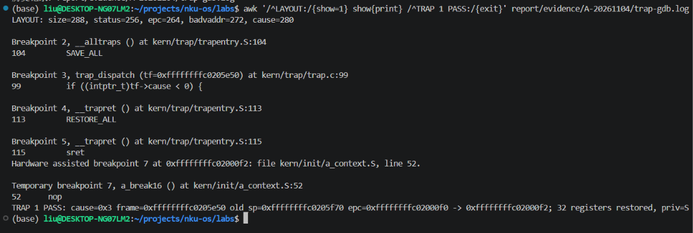
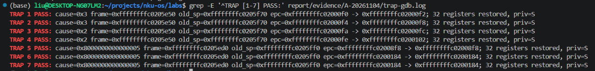

# 操作系统实验报告

## 实验基本信息

| 项目 | 内容 |
| --- | --- |
| 实验名称 | Lab3：中断、异常与 Trap 上下文恢复 |
| 小组成员 | 匡航逸 2412235、柯云超 2413575、刘华彬 2411238 |
| A 部分完成日期 | 2026-11-04 |
| 代码位置 | `../code/`，`lab3` 分支 |
| 运行与验证入口 | `make`、`make qemu`、`make check-a` |

| 成员 | 代码与实验任务 | 进度 |
| --- | --- | --- |
| 匡航逸 2412235（A） | Lab3 框架衔接、Trap 入口、现场恢复、GDB 验证 | 已完成 |
| 柯云超 2413575（B） | 中断分类、时钟重设、计数输出与关机、整体验证 | 待完成 |
| 刘华彬 2411238（C） | 异常分类、指令长度、返回地址更新、报告整合 | 待完成 |

我们沿用 Lab2 的“先形成共同基线，再分别实现和验证”的安排。我先导入 Lab3 框架，迁移物理内存初始化和 Best-Fit，然后建立从汇编入口到 C 处理函数、再返回原执行位置的完整路径。当前报告记录 A 的实现与验证，中断和异常处理按上表继续推进。

## 一、实验目的与整体逻辑

Lab2 中，我们已经通过页表访问高地址内核，并把空闲物理页交给页分配器。Lab3 在此基础上引入异步的时钟中断和同步的指令异常。我的关注点是：处理器跳进内核后，原程序的寄存器如何保留，C 函数如何访问这份状态，以及处理完成后如何回到正确的位置。

一次 Trap 包含硬件和软件两部分工作。硬件记录 `sepc`、`scause`、`stval`，调整 `sstatus`，并根据 `stvec` 跳转；汇编入口再把通用寄存器和这些 CSR 保存到当前内核栈。C 函数通过 `struct trapframe *` 访问保存的状态，返回后由汇编恢复寄存器并执行 `sret`。我们用同一份 Trap frame 连接这几个阶段。

```text
OpenSBI → kern_entry：建立 Sv39 映射、设置内核栈
  → kern_init：清零 BSS、解析 DTB、初始化控制台和物理内存
  → idt_init：清零 sscratch，将 stvec 指向 __alltraps
  → clock_init / intr_enable：设置时钟事件并开启 S 模式中断

Trap → __alltraps → SAVE_ALL
  → a0 = sp → trap(tf) → trap_dispatch(tf)
  → interrupt_handler(tf) / exception_handler(tf)
  → __trapret → RESTORE_ALL → sret → sepc 指定的位置
```

## 二、实验环境与 Lab2 衔接

| 项目 | 本次环境 |
| --- | --- |
| 宿主机 | Windows，WSL2 Ubuntu 24.04.4 LTS，x86-64 |
| AI 工具 | Codex，GPT-6 |
| 交叉 GCC | `riscv64-unknown-elf-gcc` 13.2.0 |
| ISA / ABI | `rv64imac_zicsr_zifencei` / `lp64` |
| QEMU / OpenSBI | 8.2.2 / 1.3 |
| GDB / Make | `gdb-multiarch` 15.1 / GNU Make 4.3 |
| 内存与地址 | 128 MiB RAM；内核 PA `0x80200000`，VA `0xffffffffc0200000` |

我从[课程代码目录](http://oslab.mobisys.top/lab2026/)下载 `lab3.zip`，以其中的 `lab3_new/` 建立本次源码。下载地址、SHA-256 和迁移来源保存在 [framework.json](evidence/A-20261104/framework.json)，实际工具版本保存在 [environment.json](evidence/A-20261104/environment.json)。

Lab3 框架留下两处 Lab2 填空：`pmm.c` 中的 `page_init()`，以及 `best_fit_pmm.c` 中的分配器实现。我复用 Lab2 的 DTB 内存边界检查、Page 数组初始化、按地址组织空闲块、最小适配和相邻块合并。默认页管理器选择 Best-Fit，原框架的 `basic_check()` 和 `best_fit_check()` 保持原文。

迁移时，我保留 Lab3 在 `alloc_pages()`、`free_pages()` 和 `nr_free_pages()` 外层增加的中断保护。内存初始化的内部实现来自 Lab2，外层接口继续使用 Lab3 的保存、关闭和恢复中断顺序。

启动部分沿用 Lab2 的临时恒等映射：开启 `satp` 时低地址 PC 仍能取指，跳到高地址后删除低地址映射并刷新 TLB。我还将入口放入链接脚本优先收集的 `.text.kern_entry`，使裸镜像起始位置固定为 `kern_entry`。QEMU 启动与评分命令使用 `-kernel`，把镜像及入口交给当前 OpenSBI。

## 三、Trap 入口与上下文恢复

### 3.1 保存布局决定恢复顺序

我先对照 `SAVE_ALL` 和 `trap.h`，确认每个保存槽的含义。RV64 下 `uintptr_t` 占 8 字节，Trap frame 一共占 `36 × 8 = 288` 字节。288 是 16 的整数倍，因此入口前已对齐的内核栈在建立帧后仍符合 C 调用约定。

| 字段 | 槽号 | 字节偏移 | 恢复用途 |
| --- | --- | --- | --- |
| x0 | 0 | 0 | 保存零值，x0 始终为零 |
| x1 / ra | 1 | 8 | 恢复被打断时的返回地址 |
| x2 / sp | 2 | 16 | 最后恢复原栈指针 |
| x3～x31 | 3～31 | 24～248 | 恢复其余通用寄存器 |
| status / sstatus | 32 | 256 | 恢复 Trap 返回状态 |
| epc / sepc | 33 | 264 | 恢复返回地址 |
| badvaddr / stval | 34 | 272 | 记录异常相关地址或信息 |
| cause / scause | 35 | 280 | 记录 Trap 原因 |

`SAVE_ALL` 在减小栈指针前执行 `csrw sscratch, sp`，随后把 `sscratch` 中的旧栈指针写入第 2 槽。这个槽保存的是 Trap 前的 `sp`。其余寄存器的保存地址都以减小后的 `sp` 为基址，因此我把恢复 x2 放在全部加载的最后，保证前面的访问始终指向同一份帧。

### 3.2 RESTORE_ALL

我先用 t0、t1 读取帧内的 `status` 和 `epc`，分别写入 `sstatus` 和 `sepc`。接着恢复 x1、x3～x31，最后执行 `LOAD x2, 2*REGBYTES(sp)`。t0、t1 自身的原值也会在这一过程中恢复。

`badvaddr` 和 `cause` 提供分类与诊断信息；恢复原执行流使用通用寄存器、`sstatus` 和 `sepc`。`SAVE_ALL` 已把 `sscratch` 清零，我沿用这个内核约定。

通用寄存器的保存范围也比普通函数调用更大。Trap 可以在任意指令之间发生，被打断的代码没有机会按函数调用约定保存 caller-saved 寄存器。因此，我同时恢复 a、t、s、ra、gp、tp 和 sp，保持原程序的完整整数寄存器状态。

### 3.3 __alltraps 与 C 调用

`SAVE_ALL` 执行后，`sp` 就是 Trap frame 的首地址。我用 `mv a0, sp` 传递第一个参数，再用 `jal trap` 进入 C 处理函数。原 a0 和 ra 已保存在帧内，调用产生的新参数和返回地址可以在处理结束后被原值覆盖。

C 函数按调用约定恢复自己的栈后返回，控制流顺序进入 `__trapret`。此时 `sp` 再次指向同一份 Trap frame，`RESTORE_ALL` 从这里读取处理后的状态。这样，C 函数只需修改 `tf->epc`，汇编返回路径就能使用新的地址。

### 3.4 sret 与实际返回模式

本次内核和验证样例都运行在 S 模式。Trap 发生后，保存的 `sstatus.SPP=1`；执行 `sret` 时，处理器据此返回 S 模式，同时令 `SIE=SPIE`、`SPIE=1`、`SPP=0`，并把 `sepc` 送入 PC。

我在四次异常和三次时钟中断返回后读取 `$priv`，结果均为 1，即 S 模式。四次异常在开启全局中断前触发，返回后 SIE 为 0；时钟中断在全局中断开启后触发，返回后 SIE 为 1。这两组结果同时验证了返回特权级和中断状态。

## 四、spec、提示词与实现过程

我把 spec 写成三个相互对应的约定：帧布局规定每个槽保存什么，调用约定规定帧地址如何进入 C 函数，返回约定规定哪些状态从帧内恢复。完整设计见 [A-spec.md](资料/A-spec.md)。

提示词沿用 Lab2 的组织方式，先给出 `SAVE_ALL`、`struct trapframe`、公共函数和修改范围，再说明栈指针的特殊位置、寄存器恢复顺序及验证方法。我让代码生成围绕这些已有关系展开，并用实际 Trap 检查生成结果。本次输入和整理后的结构化提示词见 [prompt.md](prompt.md)。

迁移初次编译时，`page_init()` 使用的 `PHYSICAL_MEMORY_END` 和 `KERNEL_BEGIN_PADDR` 在新框架中没有定义。我将它们分别写成 `KERNTOP - PHYSICAL_MEMORY_OFFSET` 和 `KERNBASE - PHYSICAL_MEMORY_OFFSET`，继续使用 Lab3 已有的内存布局常量。随后编译和物理页自检通过。

验证入口最初放在普通 `.text` 中，新增汇编文件改变了链接顺序，QEMU 显示 OpenSBI 信息后一直没有到达 `kern_init`。我查看反汇编，发现测试函数占据了 `0xffffffffc0200000`；裸镜像从文件开头加载，实际执行也就从测试函数开始。将 `kern_entry` 放入 `.text.kern_entry` 后，镜像起点恢复为内核入口，后续 GDB 断点能够正常命中。

调试脚本也有两次调整。最初在处理器仍处于复位阶段时读取高地址反汇编，GDB 报内存不可访问；我先停到 `kern_init`，再读取已建立映射的返回代码。随后，`stepi` 执行 `sret` 时停到了下一次 Trap 入口，我改为在帧内 `epc` 对应地址设置临时硬件断点，直接检查返回目标处的 PC、全部寄存器和特权级。

## 五、验证方法与结果

### 5.1 基线启动

我先在正式源码上执行 `make` 并启动 QEMU。内核解析到 `[0x80000000, 0x88000000)` 的 RAM，选用 `best_fit_pmm_manager`，输出 `check_alloc_page() succeeded!`，随后完成时钟初始化。记录见 [构建日志](evidence/A-20261104/build.log)和[启动日志](evidence/A-20261104/baseline-boot.log)。

### 5.2 实际 Trap 与完整恢复

我用 [check_a.py](../code/tools/check_a.py)复制源码到临时目录，在副本中加入寄存器触发样例和最小处理桩。异常桩根据触发编码更新 `epc`；时钟桩重设下一事件并递增 `ticks`。正式源码中的 B/C 函数保留待填位置。

GDB 依次停在 `__alltraps`、`trap` 第一条指令、`__trapret`、`sret` 和实际返回目标。每次验证都比较入口快照与帧内的 32 个寄存器槽，检查 `a0=sp=旧sp-288`、16 字节栈对齐、四个 CSR 保存值，并在返回目标再次比较全部整数寄存器。

| 触发样例 | scause | 原 epc | 返回地址 | 结果 |
| --- | --- | --- | --- | --- |
| 16 位断点 `0x9002` | `0x3` | `0xffffffffc02000f0` | `0xffffffffc02000f2` | 通过 |
| 32 位断点 `0x00100073` | `0x3` | `0xffffffffc02000f4` | `0xffffffffc02000f8` | 通过 |
| 16 位非法指令 `0x0000` | `0x2` | `0xffffffffc02000fa` | `0xffffffffc02000fc` | 通过 |
| 32 位非法指令 `0x0000007b` | `0x2` | `0xffffffffc02000fe` | `0xffffffffc0200102` | 通过 |
| 第一次时钟中断 | `0x8000000000000005` | `0xffffffffc02008f8` | 原 epc | 通过 |
| 第二、三次时钟中断 | `0x8000000000000005` | `0xffffffffc0200184` | 原 epc | 通过 |

第一份异常帧地址为 `0xffffffffc0205e50`，原栈指针为 `0xffffffffc0205f70`，差值为 `0x120=288`。进入 C 函数时，a0 和 sp 都等于帧地址；在 `__trapret` 处，sp 再次等于该地址。七次返回的全部整数寄存器比较均通过，最终执行到触发样例之后的标记，`ticks=3`，QEMU 正常关机。





完整记录见 [GDB 日志](evidence/A-20261104/trap-gdb.log)、[逐次结果](evidence/A-20261104/trap-summary.json)、[测试镜像反汇编](evidence/A-20261104/fixture-disassembly.log)和[串口日志](evidence/A-20261104/fixture-qemu.log)。两张图展示对应日志的节选。

### 5.3 复现

在仓库的 WSL 终端执行：

```bash
cd code
make
make check-a
```

脚本重新构建临时副本、启动 QEMU、连接 GDB，并将结果写入 `report/evidence/A-20261104/`。我将手动断点步骤和 B/C 接入位置整理在[运行说明](资料/运行说明.md)。B/C 完成处理函数后，我们继续运行教师的 `make grade`，检查周期输出、关机阈值和正式异常输出。

## 六、与 OS 原理的联系

| 知识点 | 本次实现与原理的联系 |
| --- | --- |
| 现场保存与恢复 | 我把寄存器和返回状态组织为内核栈上的 Trap frame，使处理代码可以暂时占用寄存器，结束后恢复原计算过程。 |
| 中断与异常 | 两者共用入口与恢复路径，`scause` 决定分发方向。中断返回保持原 epc，测试异常通过修改帧内 epc 跳过触发指令。 |
| 特权级与返回指令 | 我通过 SPP、SPIE、SIE 和实际 `$priv` 观察到硬件维护的返回状态，本次路径是 S 模式内核到 S 模式内核。 |
| 调用约定 | 我使用 a0 传递帧地址，保持栈对齐，并在恢复阶段取回调用所覆盖的参数和返回地址。 |
| 临界区 | Lab3 页分配接口保存并关闭中断，在操作完成后恢复原状态，避免单核上处理过程打断空闲链表操作。 |

Trap 现场恢复为后续进程切换提供了基础。当前七次测试都返回同一个内核执行流；进程调度还要选择另一个执行实体、切换它的内核栈和地址空间。用户态 Trap 还需要用户栈与内核栈切换、用户地址检查和系统调用接口。本次 A 的入口沿用当前内核栈，后续实验将继续建立这些机制。

我在这部分实验中进一步理解了“保存的数据结构就是恢复接口”的含义。帧地址、槽号、调用寄存器和返回状态必须一起核对；只观察启动输出，无法发现某个通用寄存器被破坏。把这些关系转成逐次比较后，我可以直接根据寄存器、内存和 PC 判断返回过程是否正确。
