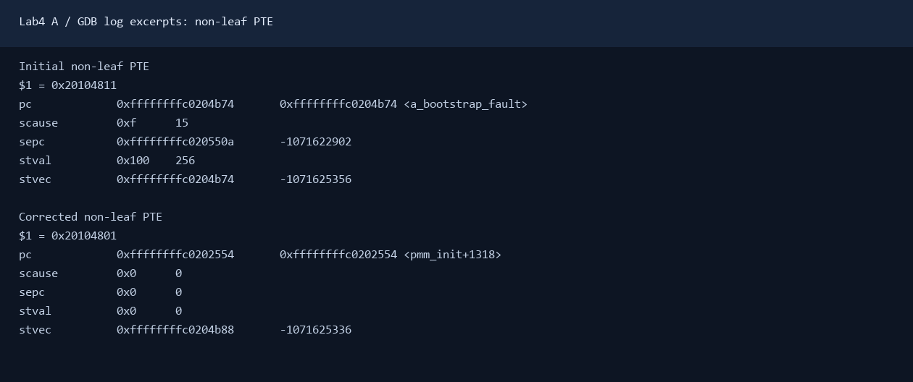
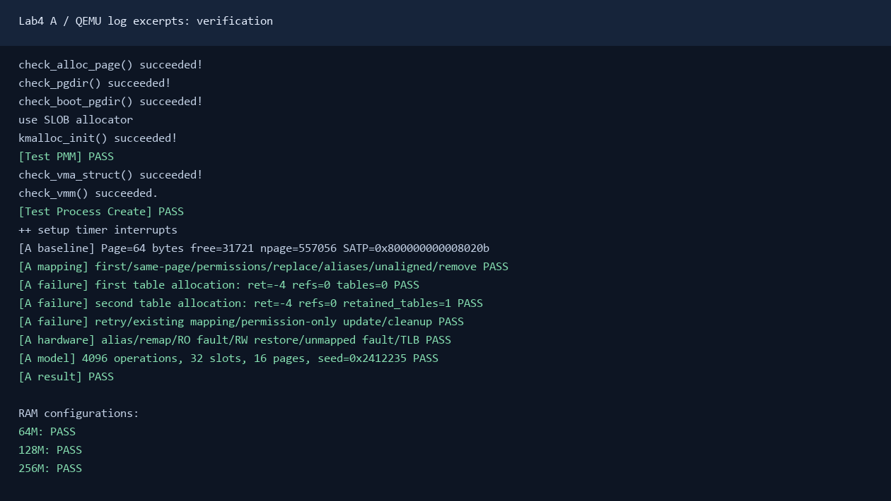
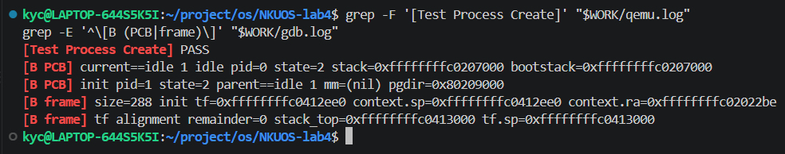
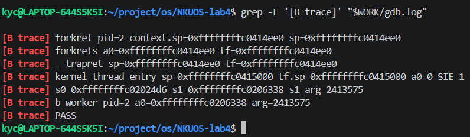
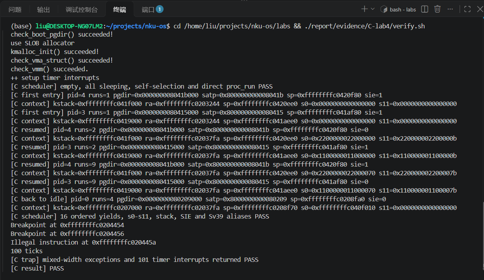

# Lab 4 实验报告 · 虚拟内存与内核线程

## 一、实验目标与分工

本实验把已有的物理页分配和 Trap 恢复机制接到同一条执行链上。内核先获得管理虚拟地址映射的能力，再为线程建立 PCB、内核栈和初始执行现场，最后让调度器从启动执行流切换到新线程，并能在随后切换时恢复线程的执行进度。集成内核通过教师的 PMM、Process Create 和 Schedule 三项检查，得分 **30/30**。

| 小组成员 | 实现与验证 |
| --- | --- |
| 匡航逸（2412235） | A · 页映射与内存基线。验证引用计数、权限、失败路径与 TLB，完成分页思考题。 |
| 柯云超（2413575） | B · 线程创建与初始化。验证 PCB、内核栈、首次运行现场和失败回收。 |
| 刘华彬（2411238） | C · 调度与上下文切换。验证线程轮换、Sv39 地址空间切换和 Trap 返回，完成开关中断 Challenge。 |

实验基于 `lab4` 分支的课程框架，平台为 RV64、QEMU virt 和 OpenSBI。下表记录各模块取证时使用的工具链。

| 环境 | A | B | C 与集成验证 |
| --- | --- | --- | --- |
| 系统 | WSL2 Ubuntu 24.04.4 | WSL Ubuntu 22.04 | WSL2 Ubuntu 22.04.5 |
| RISC-V GCC | 13.2.0 | 10.2.0 | 15.1.0 |
| QEMU / GDB | 8.2.2 / 15.1 | 6.2.0 / 12.1 | 7.0.0 / 12.1 |
| 生成与调试辅助 | Codex，GPT-6 | Codex 桌面应用 | Codex，GPT-6.2 系列 |

## 二、章节主线与前置实验衔接

我们以课程 Lab 4 框架为起点（`046550a`），在 `dad7267` 中从 `lab2` 迁入物理内存初始化和 Best-Fit，从 `lab3` 迁入 Trap 保存与恢复、时钟和异常处理。Lab 4 新增的小对象分配、VMA、进程管理和 `forkrets` 将这两项基础接入线程执行链。[前置代码迁移](资料/Lab4-前置代码迁移.md)

```text
kern_init
  → pmm_init                        初始化物理页，检查页表，启用 SLOB 分配
  → pic_init / idt_init              初始化中断控制器，设置 Trap 入口
  → vmm_init                        检查虚拟内存区域的插入与查找
  → proc_init                       将启动执行流登记为 idle，创建 init
  → clock_init / intr_enable        设置时钟事件，开启中断
  → cpu_idle → schedule             idle 请求调度，选中就绪的 init
  → proc_run → switch_to            切换 current、SATP 和寄存器现场
  → forkret → forkrets → __trapret
  → sret → kernel_thread_entry      恢复初始现场，调用 init_main
```

这条链的三个阶段分别解决地址、线程对象和 CPU 执行权的问题。A 维护页表项，使虚拟地址的翻译与物理页寿命一致。B 借助物理页和小对象分配构造线程，并把启动信息编码成 C 能恢复的 `context` 和 Trap frame。C 根据 PCB 选中线程，先切换地址翻译环境，再恢复寄存器。新线程的第一条指令由 B 写入的现场决定，已运行线程则从 C 保存下来的调用续点继续。

## 三、模块一 · 虚拟内存与页映射

### 3.1 从物理页分配到虚拟地址翻译

`pmm_init()` 根据 DTB 给出的 RAM 范围建立 `Page` 数组，将扣除内核和描述符后可管理的连续页交给 Best-Fit，随后执行页表检查并初始化 `kmalloc` 所需的 SLOB。线程创建时，PCB 由 `kmalloc()` 提供，内核栈由物理页分配器提供。

地址空间有区域管理和硬件翻译两个层次。`mm_struct` 组织某个地址空间的 VMA，`vma_struct` 描述带属性的半开区间 `[vm_start, vm_end)`。`insert_vma_struct()` 按起始地址插入并检查相邻区间，`find_vma()` 优先检查最近命中的区域，再沿链表查询。`vmm_init()` 通过区间首尾和空隙地址检验这些规则。具体地址如何翻译、读写是否获准，由硬件遍历 PTE 决定。[pmm.c](../code/kern/mm/pmm.c) · [vmm.c](../code/kern/mm/vmm.c)

### 3.2 一次映射怎样维护引用和 TLB

`get_pte()` 按 `PDX1 → PDX0 → PTX` 定位普通页的末级 PTE。前两级按需清零并挂接页表页，目录项保存下一级物理页号和有效位。叶项保存数据页的物理页号和权限。A 的关键是让**叶项、数据页引用计数和 TLB**随映射一起更新。

| 场景 | 函数及状态变化 |
| --- | --- |
| 首次映射 | `page_insert()` 取得末级 PTE 后给新页增加引用，写入带权限的叶项，并按地址执行 `sfence.vma`。 |
| 同址同页，修改权限 | 抵消刚增加的引用，再写完整叶项，使旧 W 等权限位可以被清除。 |
| 同址换页 | 先增加新页引用，再用 `page_remove_pte()` 清除旧项、使旧翻译失效并减少旧页引用，最后安装新映射。 |
| 撤销映射 | `page_remove()` 用 `create=0` 查询，有效时走同一个清项、失效和减引用流程，最后一个引用消失时回收数据页。空槽或缺少中间级时直接返回。 |
| 中间级分配失败 | `page_insert()` 返回 `-E_NO_MEM`，目标叶项及数据页引用维持原值。第二级分配失败时，已挂接的第一级页表由目录持有，重试可复用。 |

`check_pgdir()` 首先从软件侧核对页表和引用计数，`check_boot_pgdir()` 接着实际写入 `0x100`。第一次测试在写入时触发存储缺页，GDB 读到 `scause=15`、`stval=0x100`，根表项为 `0x20104811`。两级目录项错误地带有 U 位，处理器的页表遍历拒绝了该项。改用 `ptd_create()` 后，根表项变为 `0x20104801`，字符串写入通过。建立下级页表时全量刷新，修改末级映射时按目标地址刷新。[页表实现与调试记录](资料/A-页映射与内存.md)



*图 1　低地址存储缺页对应 U 位为 1 的非叶项。清除 U 位后，内核通过实际写入检查。*

独立用例将两个虚拟地址先映射到同一物理页，再替换其中一个地址的映射。两个地址随后分别读到新旧物理页的内容。将可写映射降为只读时，写入产生缺页，恢复写权限后可以继续写入。这组访存将 PTE 的变化与 CPU 实际使用的翻译对应起来。64、128、256 MiB 三组配置还完成了共 12,288 次模型对照操作。[A 验证汇总](evidence/A-lab4/summary.json)



*图 2　同一组测试分别核对软件映射状态和处理器访存结果，并在不同 RAM 容量下复现。*

### 3.3 Challenge · 分页层数与查询接口

| 模式 | 普通页大小 | PTE 大小 | 每张表的项数 | VPN 划分 |
| --- | --- | --- | --- | --- |
| Sv32 | 4 KiB | 4 字节 | 1,024 | 10 + 10 位，两级 |
| Sv39 | 4 KiB | 8 字节 | 512 | 9 + 9 + 9 位，三级 |
| Sv48 | 4 KiB | 8 字节 | 512 | 9 + 9 + 9 + 9 位，四级 |

三种模式都用 12 位作为页内偏移。由于每张表占一页，表项大小决定每级索引宽度。Sv39 的 `get_pte()` 前两段都执行“按当前级索引定位目录项、按需分配下级表、跟随物理页号”这一步，区别在于各自取 VPN 的哪 9 位。普通页在 Sv32 中经过一次下级表跳转，在 Sv48 中经过三次。当前接口沿普通页路径走到末级。若扩展到启动页表中已有的 1 GiB 叶映射，遍历需要识别提前遇到的叶项，并为大页拆分定义规则。

本实验用 `create` 参数共用遍历，查找和删除传 `0`，插入传 `1`。这种设计代码短，但调用方需要了解分配失败时已挂接的页表归谁管理。若后续加入完整回滚或并发页表修改，可以将只读查询和带分配的入口显式拆开，共用内部遍历，并由创建入口规定加锁、页表页归属和失败清理。

## 四、模块二 · 从启动执行流到可调度线程

### 4.1 PCB、资源准备与发布

`alloc_proc()` 分配并清零 PCB，建立自环的链表节点，置 `state=PROC_UNINIT`、`pid=-1`，并将 `pgdir` 设为启动根页表的物理地址。PCB 把 PID 和状态等管理信息、`kstack/context/tf` 执行信息，以及 `mm/pgdir` 地址空间信息组织在一起。

`proc_init()` 初始化全局进程链表和 PID 哈希桶。启动执行流已有栈，所以 PID 0 的 `idleproc` 直接复用 `bootstack`，置为 `PROC_RUNNABLE` 和 `need_resched=1`，并成为 `current`。idle 计入进程总数，普通进程链表和哈希登记从它创建的 PID 1 的 `initproc` 开始。

`do_fork()` 先检查容量，依次准备 PCB、父线程指针、两个连续物理页的内核栈和初始现场。`copy_mm()` 为本实验的内核线程保留 `mm=NULL`，继续使用启动页表，遇到携带用户 `mm` 的父线程时返回 `-E_INVAL`。准备完成后，`do_fork()` 在本 hart 的关中断区间内分配 PID、挂接哈希与链表、增加计数，再由 `wakeup_proc()` 改为 `PROC_RUNNABLE`。这样调度器看到就绪状态时，栈与现场已经完整。此前发生的失败按逆序释放已申请资源。故障注入覆盖 PCB 分配、栈分配、`copy_mm()` 和容量上限，四种情况的进程计数和空闲页数都保持原值。[线程创建实现](../code/kern/process/proc.c) · [失败回收日志](evidence/B-lab4/qemu.log)

### 4.2 把第一次执行写进新线程的栈

`kernel_thread(fn, arg, flags)` 构造临时 Trap frame。在 `s0` 和 `s1` 中分别保存函数与参数，将 `epc` 指向 `kernel_thread_entry`，设置 `SPP=1`、`SPIE=1`、`SIE=0`，使恢复路径最终回到 S 态并开启 S 态中断。

`copy_thread()` 将 Trap frame 复制到新线程 8 KiB 内核栈的顶部区域，将子线程的 `a0` 设为 0，把帧中待恢复的 `sp` 设为调用方指定的值或内核栈顶。用于线程切换的 `context.sp` 则指向帧基址，和待恢复的 `sp` 相差一个 288 字节的帧（默认栈时）。它还把 `context.ra` 设为 `forkret`，交给调度阶段触发首次恢复。



*图 3　idle 使用启动栈，init 的父线程是 idle。init 的 `context.sp` 指向 Trap frame，帧里的 `sp` 则指向恢复后使用的栈顶。*

## 五、模块三 · 调度、切换与继续执行（2411238）

### 5.1 沿进程链表选择下一个线程

`cpu_idle()` 检查 `need_resched`。启动时 idle 的标记已置位，首次进入循环便调用 `schedule()`。调度器保存并屏蔽本 hart 的中断，清除当前线程的标记。从 idle 出发时从链表头之后扫描，从普通线程出发时从当前节点的后继扫描。扫描跨过哨兵，遇到第一个 `PROC_RUNNABLE` 即选中。绕回后当前线程仍就绪时可以选中自己，一轮内无就绪候选则回到 idle。选中后递增 `runs`，目标与当前线程不同时调用 `proc_run()`。

`PROC_RUNNABLE` 同时涵盖就绪和运行，`current` 标出实际占用 CPU 的线程。普通启动的调度点位于 `cpu_idle()`，评分和补充用例中的工作线程直接调用 `schedule()` 主动让出。时钟中断负责续订下一次事件并计数。接入 Lab 4 时移除了 Lab 3 评分模式在第 100 个 tick 触发的 panic，使时钟处理结束后能持续返回被打断的线程。[sched.c](../code/kern/schedule/sched.c) · [trap.c](../code/kern/trap/trap.c)

### 5.2 地址翻译和寄存器现场怎样一起切换

`proc_run()` 在关中断区间保存旧 PCB，令 `current` 指向目标，再把目标的根页表物理地址右移 12 位写入 RV64 SATP 的 PPN 字段，高四位置为 Sv39 模式值 8，ASID 取 0。框架中的 `lsatp()` 沿用 Sv32 编码，因此这里直接构造 RV64 SATP。写入后执行全量 `sfence.vma`，再调用 `switch_to(&prev->context, &proc->context)`。SATP 在换栈前就已生效，因此两套页表都要能访问切换指令、PCB 和内核栈。

`switch_to()` 接收两个 context 指针，`a0` 指向旧现场，`a1` 指向目标现场。它按 8 字节槽位保存旧线程的 `ra`、`sp` 和 `s0–s11`，再按同一布局装入目标的 14 个寄存器值。`sp` 让目标线程取回自己的调用栈，`ra` 决定最后的 `ret` 到哪里继续。这是已知的函数调用边界，编译器按 ABI 处理仍需使用的调用者保存寄存器。异步 Trap 可以打断任意指令，Trap frame 还保存其余通用寄存器和返回需要的 CSR。[proc.c](../code/kern/process/proc.c) · [switch.S](../code/kern/process/switch.S) · [trapentry.S](../code/kern/trap/trapentry.S)

### 5.3 首次运行和再次恢复走向不同的续点

首次选中 init 时，`ret` 依据 B 准备的 `context.ra` 进入 `forkret()`。`forkrets` 接收 `current->tf`，把它放入 `sp` 后转入 `__trapret`。恢复代码写回 `sstatus` 和 `sepc`，恢复通用寄存器并最后装入 `sp`，再执行 `sret`。CPU 于是到达 `kernel_thread_entry`，入口把 `s1` 移到 `a0`，以 `jalr s0` 调用 `init_main`。普通启动中，PID 1 打印线程名和问候语，返回后到达框架的 `do_exit()`，由该函数进入调试监视器。[普通启动串口](evidence/C-lab4/C-qemu-kernel.log)



*图 4　以 B 用例的工作线程为例，前三个断点处使用同一个帧地址，`sret` 后 `sp` 恢复为栈顶，线程函数收到 `2413575`。*

已运行的线程再次被选中时，`ret` 回到它先前调用 `switch_to()` 的续点。C 的独立用例让两个线程有序让出 16 次，每次恢复都核对当前 PCB、实际 SP、栈上局部变量、`s0–s11`、SATP 和 SIE。两个线程对同一虚拟地址 `0x400000` 分别读到不同物理页中的值，说明切换同时恢复了执行现场和地址翻译。两个工作线程最终睡眠，由 idle 接回执行权。[独立调度串口](evidence/C-lab4/C-fixture.log)



*图 5　刘华彬（2411238）的 QEMU 验证截图。`[C resumed]` 行可对照两个 PID 恢复后的 SATP、SP 和 SIE，`[C back to idle]` 行记录了切回 PID 0 的现场。*

| 独立用例中首次恢复的线程 | 根页表物理地址 | 读回的 SATP | 线程内的 SP |
| --- | --- | --- | --- |
| PID 4 | `0x8041b000` | `0x800000000008041b` | `0xffffffffc0420f80` |
| PID 3 | `0x80415000` | `0x8000000000080415` | `0xffffffffc041af80` |

SATP 的低位分别对应两个根页表的物理页号，两个 SP 也分别落在各自的内核栈上。普通启动中的 idle 和 init 共用启动页表，独立用例通过准备两套根页表观察地址翻译随调度切换的效果。

### 5.4 Challenge · 中断状态如何跨切换保存

`local_intr_save(flag)` 读取 `sstatus.SIE`。原先开启时清零 SIE 并保存 `true`，原先关闭时保存 `false`。`local_intr_restore(flag)` 仅在标记为 `true` 时置回 SIE。每层调用各有标记，所以外层从开启状态进入后，内层保存的是已关闭状态，内层退出仍保持关闭，外层退出才恢复开启。若进入最外层时已经关闭，退出后仍保持关闭。

`schedule()` 调用 `proc_run()` 时就是一次嵌套。旧线程切出后，两层调用的状态随它自己的栈保存，等它重新运行再从内到外恢复。新线程则由 `sret` 把初始帧中的 SPIE 写入 SIE。SIE 控制本 hart 在 S 态响应的中断，同步异常仍可发生，因此临界区内的指令和栈映射必须有效。多 hart 对共享结构的并行访问需要锁和相应的跨 hart 协调。[sync.h](../code/kern/sync/sync.h) · [C 调度与中断验证](资料/C-调度与切换.md)

## 六、规格、提示词与调试记录

三个模块的实现规格和验收条件按 `[PROMPT]`、`[RELY]`、`[SPEC]`、`[CHECK]` 四段式写入各自的最终提示词。[Lab 4 最终提示词](prompt.md)

| 模块 | 如何写 spec 和 prompt | 生成与验证中的现象及处理 |
| --- | --- | --- |
| A · 页映射 | 将首次映射、同页改权限、换页、幂等删除和分配失败逐条写成契约，要求同时检查 PTE、引用数、空闲页与真实访存。 | 结构检查通过后，实际写入 `0x100` 缺页。借助 GDB 将故障定位到非叶项 U 位，改用 `ptd_create()`，再用实际访存和模型对照验证。 |
| B · 线程创建 | 围绕六个创建函数，将 PCB 初值、发布顺序、失败回收及 `context` 与 Trap frame 的字段逐项写入规格。 | 测试脚本的 `"$qemu"` 只传递数组第一个元素，导致 QEMU 缺少参数并超时。改用 `"${qemu[@]}"` 展开完整命令后，完成串口和 GDB 验证。 |
| C · 调度与切换 | 提示词指定轮换起点、哨兵和回退规则、Sv39 SATP、14 个 RV64 槽位及每层中断标记，验收要求包含实际让出、恢复和访存。 | AI 生成的独立探针最初放在 `kern/init/`，链接顺序改变了裸镜像开头。用 `nm` 确认 `kern_entry` 移位后，将探针放到临时测试树的 `kern/schedule/`，入口回到链接基址，轮换和 Trap 检查通过。 |

集成时，QEMU 7 的原 loader 启动使 OpenSBI 报告的下一阶段地址为 0。改用 `-kernel` 加载裸镜像后，入口为 `0x80200000`，init 正常启动。教师调度用例传入 `void (*)(void *)`，而 `kernel_thread()` 接收 `int (*)(void *)`，GCC 15 会将该诊断视为错误。评分命令将该项降为警告以运行原用例。[默认启动日志](evidence/C-lab4/C-qemu.log) · [GCC 15 初次评分](evidence/C-lab4/C-grade-gcc15-default.log)

## 七、集成验收

| 验证 | 观察结果 |
| --- | --- |
| 正式构建与启动 | `make` 成功。QEMU 串口打印 `this initproc, pid = 1, name = "init"` 和两行演示消息。[构建](evidence/C-lab4/C-build.log) · [串口](evidence/C-lab4/C-qemu-kernel.log) |
| 教师评分 | PMM、Process Create、Schedule 全部通过，`Total Score: 30/30`。[评分输出](evidence/C-lab4/C-grade.log) · [评分串口](evidence/C-lab4/C-grade-serial.log) |
| 独立调度与 Trap | 空链表、全睡眠、自选和直接 `proc_run()` 通过。16 次有序让出和双页表访问通过。混合指令长度的异常及 101 次定时中断均返回。[独立用例串口](evidence/C-lab4/C-fixture.log) |

在 `labs/` 下可用 C 验证环境复现独立用例、普通构建、启动和教师评分。

```bash
report/evidence/C-lab4/verify.sh
cd code
make
adapter=$(realpath ../report/evidence/C-lab4/qemu-kernel.sh)
timeout 5s make QEMU="$adapter" qemu
make QEMU="$adapter" DEFS=-Wno-error=incompatible-pointer-types grade
```

普通启动结束后停在框架调试监视器，示例中的 `timeout` 用于结束 QEMU 会话。评分与独立用例在当前集成源码上复跑，结果与表中记录一致。[评分与验证所用源码](evidence/C-lab4/C-source.txt)

## 八、实验知识与操作系统原理

| 知识点 | 本实验中的对应关系 |
| --- | --- |
| 地址空间与物理页寿命 | VMA 描述地址区间，页表决定访问位置和权限，`Page.ref` 决定共享页面何时能释放。PTE 写入需要配合 TLB 失效，处理器才会使用更新后的翻译。 |
| 线程与资源组织 | `idleproc` 和 `initproc` 共享内核地址空间，分别保有自己的内核栈和执行进度。PCB 将可调度实体的状态与它使用的资源关联起来。 |
| 调度策略与切换机制 | `schedule()` 选择运行者，`proc_run()` 与 `switch_to()` 完成切换。链表轮换决定 CPU 交给谁，ABI 和 Trap frame 布局决定目标线程如何继续。 |
| 临界区与恢复 | 本 hart 屏蔽中断使选择、`current`、SATP 和寄存器切换在同一临界区内完成。中断状态随旧线程的调用现场保存，新线程的状态来自人工构造的返回帧。 |
