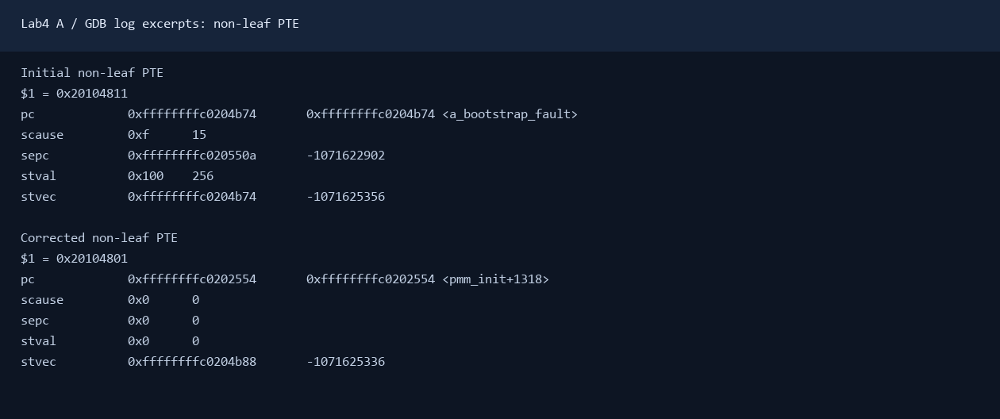
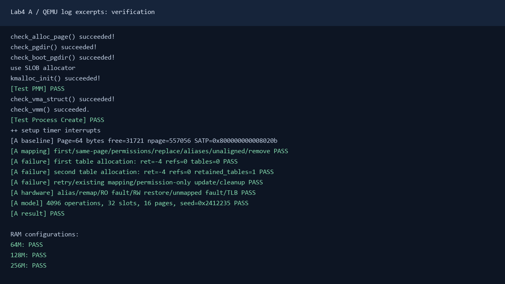

# Lab4 A：页映射与内存基线

| 项目 | 内容 |
| --- | --- |
| 负责人 | 匡航逸，2412235 |
| 实现与验证日期 | 2026-11-21 |
| 起始版本 | `lab4` 分支，`c42cc35` |
| 已有实现 | Lab2/3 前置迁移、B 的线程创建与初始化 |
| 环境 | WSL2 Ubuntu 24.04.4，GCC 13.2.0，QEMU 8.2.2，OpenSBI 1.3，GDB 15.1 |
| AI 工具 | Codex，GPT-6 |

[实现约定](A-spec.md) · [提示词记录](../prompt.md) · [源码](../../code/kern/mm/pmm.c) · [验证汇总](../evidence/A-lab4/summary.json)

## 一、从物理页到虚拟地址映射

前置迁移已经完成 `page_init()` 和 Best-Fit，`alloc_page()` 可以取得物理页。Lab4 的 `page_insert()`、`page_remove()` 进一步维护虚拟地址与物理页之间的关系。页表保存物理页号和权限，页描述符记录映射引用数；映射变化还需要刷新 TLB，使处理器使用新的翻译结果。

本框架的分配器位于 `default_pmm.c`，通过 `default_pmm_manager` 注册，实际算法和输出名称为 Best-Fit。`struct Page` 已增加页替换相关字段，RV64 下大小为 64 字节。前置 `page_init()` 按新结构体大小计算描述符数组，并初始化 `page_link` 和 `pra_page_link`。本次复核后直接沿用，在页表和线程创建检查中验证。

## 二、spec 与实现

### 2.1 引用计数的变化

页分配与页映射是两个不同的操作。分配器返回页面时，引用计数为零；建立一条映射后增加一个引用，同一物理页可以被多个地址引用。删除最后一条映射时，引用计数归零，页面回到分配器。

| 场景 | 页表和计数变化 |
| --- | --- |
| 原地址没有映射 | 新页引用加一，写入物理页号和权限 |
| 原地址已映射同一物理页 | 更新权限，最终引用计数不变 |
| 原地址映射其他物理页 | 新页引用加一，旧页引用减一，旧页归零时释放 |
| 页表分配失败 | 返回 `-E_NO_MEM`，目标页引用及原有映射保持原值 |
| 删除有效映射 | 清除页表项、失效 TLB、减少引用，必要时释放 |
| 删除未映射地址 | 直接返回，空闲页数和引用计数不变 |

### 2.2 page_insert()

首先调用 `get_pte(pgdir, la, 1)`。只有取得末级页表项后才增加新页引用，因此页表分配失败时不会多出一个数据页引用。

旧项有效时，通过 `pte2page()` 找到原物理页。如果新旧物理页相同，撤销刚增加的引用，随后直接更新权限；如果不同，调用 `page_remove_pte()` 撤销旧映射。最后用 `pte_create(page2ppn(page), perm)` 写入新项，并失效目标地址的 TLB。

先增加新引用，再判断旧映射，可以统一处理大部分流程。同页重映射时则需要抵消这次增加，避免误删仍在使用的页面。写入整个新页表项也会替换旧权限，因此从可写改为只读时，旧 W 位会被清除。

### 2.3 page_remove()

删除使用 `get_pte(pgdir, la, 0)`，查询过程不会申请页表。没有中间页表时直接返回；末级项存在但 V=0 时也直接返回。

有效映射由 `page_remove_pte()` 统一处理：先保存原物理页，清除页表项，再失效目标地址的 TLB，最后减少引用并在归零时释放。这样，页面进入空闲链表前，旧映射已经失效。删除函数和换页操作共用这个过程。

地址索引会忽略页内偏移，因此 `la=0` 与 `la=123` 定位同一页表项。测试也覆盖了从未对齐地址建立和删除映射的情况。

### 2.4 页表页的生命周期

`get_pte()` 最多申请两个中间页表页。第一次申请失败时，目录保持原值；第一次成功而第二次失败时，已有代码会保留第一张页表，由目录项继续持有。此时目标地址没有有效映射，数据页引用仍为零，但空闲页数减少一。重试可以复用这张表。

本次保留这一分配行为。`page_remove()` 只撤销末级映射，中间页表仍供后续映射复用。独立测试结束时显式遍历并回收临时页表，检查空闲页数回到测试前的值。

## 三、非叶项问题的定位与修复

补齐映射函数后，独立内核通过了 `check_pgdir()`，随后停在 `check_boot_pgdir()`。前者主要检查页表内容和引用计数，后者会实际向低地址写入字符串，因此两组检查的区别指向地址翻译过程。

GDB 在 `strcpy((void *)0x100, str)` 前停住时，根表项为 `0x20104811`。将异常入口临时指向测试中的停止标签，再执行写操作，得到：

```text
scause = 0xf
stval  = 0x100
sepc   = 0xffffffffc020550a
```

这是对 `0x100` 的存储缺页异常。检查 `get_pte()`，两处新建中间页表都使用了 `PTE_U | PTE_V`。Sv39 非叶项中的 U、A、D 为保留位，软件应将它们清零；U 位应出现在末级叶项中。[RISC-V 特权架构手册](https://github.com/riscv/riscv-isa-manual/blob/main/src/priv/supervisor.adoc)

两处目录项改为 `ptd_create(page2ppn(page))` 后，根表项变为 `0x20104801`，实际写入正常完成。原 `check_pgdir()` 中要求根表 U=1 的断言也改为检查非叶项 U/R/W/X/A/D 均为零。`tools/test_lab4.c`、评分脚本以及分配器检查保持原样。

中间页表建立后采用全量 `sfence.vma`，末级映射更新后采用按地址的 `sfence.vma`。两种刷新都添加 `memory` clobber，使页表写入相对于刷新保持编译器可见的顺序。



完整记录见[修复前 GDB](../evidence/A-lab4/bootstrap-gdb.log)、[初次启动](../evidence/A-lab4/initial-qemu-128M.log)和[修复后 GDB](../evidence/A-lab4/after-fix/bootstrap-gdb.log)。

## 四、验证结果

### 4.1 页映射、分配失败与硬件访问

[check_a.py](../../code/tools/check_a.py)在临时目录中复制源码，运行教师注入工具，保留 PMM 和 Process Create 两组检查。C 的调度代码尚未实现，临时副本以 A 的验证函数作为 `cpu_idle()`，在检查完成后关机。

| 检查 | 结果 |
| --- | --- |
| 原有内存检查 | `check_alloc_page()`、`check_pgdir()`、`check_boot_pgdir()`、SLOB 和 VMA 检查通过 |
| 教师检查 | `[Test PMM] PASS`、`[Test Process Create] PASS` |
| 基本映射 | 首次映射、同页修改权限、换页、别名映射、未对齐地址和重复删除通过 |
| 第一次页表申请失败 | 返回 `-4`，数据页引用为零，目录项和空闲页数保持原值 |
| 第二次页表申请失败 | 返回 `-4`，保留一张中间页表，目标映射为空，重试后复用该表 |
| 已有映射附近申请失败 | 其他有效项、数据页引用和空闲页数保持原值 |
| 同页权限更新 | 在分配器故障注入期间仍可完成，页表申请次数为零 |
| 随机模型 | 每组 4,096 次操作，对照 32 个地址、16 个物理页的独立模型检查映射、权限和全部引用计数 |

硬件访问测试使用启动页表中空闲的低地址分支。两个虚拟地址先指向同一物理页，写入一处后从另一处读出相同值；随后替换其中一处映射，读取结果转为新物理页中的内容，另一处仍保留原内容。

权限降为只读后，32 位 `sd` 指令触发存储缺页异常，物理页内容保持原值；重新赋予写权限后写入成功。删除映射后，`ld` 触发加载缺页异常。这些检查同时观察了权限和 TLB 的实际效果。测试专用 Trap 包装函数记录预期异常，并跳过长度已确定为 4 字节的探测指令。



### 4.2 不同 RAM 大小

| QEMU RAM | 检测到的物理终点 | 管理终点 | Page 数组项数 | 结果 |
| --- | --- | --- | --- | --- |
| 64 MiB | `0x84000000` | `0x84000000` | 16,384 | 通过 |
| 128 MiB | `0x88000000` | `0x88000000` | 32,768 | 通过 |
| 256 MiB | `0x90000000` | `0x88000000` | 32,768 | 通过 |

三组测试均保留原内核直接映射，全部映射测试结束后恢复各自的空闲页数。随机操作累计 12,288 次。256 MiB 的物理内存范围扩大，但管理范围继续受 Lab4 的 `KERNTOP` 限制。

### 4.3 已有 B 部分回归与正式构建

已有 [B 验证脚本](../evidence/B-lab4/verify.sh)在当前源码上重新运行通过：PCB 和内核栈分配失败、`copy_mm` 拒绝用户地址空间、进程数上限四组回滚正常，PID 查询和显式栈指针检查通过。两个线程沿 `forkret → forkrets → __trapret → kernel_thread_entry` 首次运行，分别收到参数 `2413575` 和 `20261120`。记录见 [B 回归日志](../evidence/A-lab4/B-regression-qemu.log)。

正式 `make` 和 `make qemu` 在链接阶段缺少 `cpu_idle()`。`make grade` 注入调度测试后还缺少 `schedule()`，本轮退出码为 2，脚本输出 `Total Score: 0/30`。完整日志保存在[构建记录](../evidence/A-lab4/build.log)、[运行记录](../evidence/A-lab4/make-qemu.log)和[评分记录](../evidence/A-lab4/make-grade.log)。C 接入后继续完成普通启动和三组整体验证。

## 五、分页思考题

### 5.1 Sv32、Sv39 与 Sv48

| 模式 | 虚拟地址位数 | 页内偏移 | VPN 划分 | PTE 大小 | 每表项数 | 普通页遍历层数 |
| --- | --- | --- | --- | --- | --- | --- |
| Sv32 | 32 | 12 位 | 10 + 10 | 4 字节 | 1,024 | 2 |
| Sv39 | 39 | 12 位 | 9 + 9 + 9 | 8 字节 | 512 | 3 |
| Sv48 | 48 | 12 位 | 9 + 9 + 9 + 9 | 8 字节 | 512 | 4 |

三种模式的普通页大小都是 4 KiB。每张页表也占一页，PTE 大小决定一张表能放多少项，地址索引位数则由表项数决定。Sv39 和 Sv48 使用 64 位地址寄存器，未用于 VPN 的高位按有效虚拟地址最高位进行符号扩展。

当前 `get_pte()` 的第一段用 `PDX1(la)` 访问根表，得到下一层表；第二段用 `PDX0(la)` 访问这张表，得到末级表；最后用 `PTX(la)` 返回具体页表项。前两段都在做“检查目录项 → 必要时申请并清零页表页 → 写入目录项 → 进入下一层”，所以形式相似。

若改为 Sv32，普通页只需要一次中间层处理；Sv48 则需要三次。可以用层数和索引位移组织公共遍历，但还需要处理高层叶项。当前启动根表第 511 项就是 1 GiB 叶映射，现有 `get_pte()` 面向普通 4 KiB 页表，不能直接把这个叶项继续当作下级页表。大页拆分和合并需要单独设计。[RISC-V 特权架构手册](https://github.com/riscv/riscv-isa-manual/blob/main/src/priv/supervisor.adoc)

### 5.2 查找和分配是否拆开

合在一个函数中，调用方只需传入 `create`，页表遍历代码可以共用。本实验中，`page_remove()` 使用 `create=0`，`page_insert()` 使用 `create=1`，接口简洁，查找也能明确保持只读。

随着错误处理变复杂，显式区分两种操作更容易判断副作用。例如第二级分配失败时，当前接口返回 NULL，但第一级页表可能已经分配并挂接。若需要整次创建失败后完全回滚，还必须记录本次新建的页表页，按逆序撤销，并避免回收原来就存在的表。

较合适的扩展方式是保留内部公共遍历，外层分别提供只读查找和创建接口，让创建接口说明页表页所有权与失败清理规则。本次保留 `get_pte()` 的签名和分配顺序，在测试中明确验证中间页表保留、重试复用和最终回收。

## 六、与 OS 原理的联系

物理页分配解决“哪些页可用”，页表解决“某个虚拟地址访问哪一页”，引用计数解决“页面何时可以释放”。这三个层次由 `Page`、PTE 和分配器联系起来。多个地址引用同页时，删除一个地址只撤销一个引用；最后一个引用消失后，物理页才回到空闲链表。

TLB 缓存的是地址翻译及权限。只更新内存中的 PTE，处理器可能继续使用旧映射，因此映射替换和权限收回都必须考虑失效操作。本次使用单 hart 的本地 `sfence.vma`；多核系统还需要通知其他 hart，完成 TLB shootdown。

当前线程共享内核页表，VMA 只完成基本区域管理。用户地址空间的建立与复制、缺页分配、写时复制、页面换出以及进程退出时的完整地址空间回收，仍需要后续实验中的机制。

## 七、复现

从仓库根目录进入 WSL 后执行：

```bash
cd code
make check-a
python3 ../report/evidence/A-lab4/regress_b.py
```

第一条命令运行三组 RAM 配置和全部 A 检查。第二条命令复现已有 B 测试，并记录当前 `make qemu`、`make grade` 的集成结果。默认日志写入 `report/evidence/A-lab4/`。

只运行一组，或另存日志：

```bash
python3 tools/check_a.py --memory 128M --output ../report/evidence/A-recheck
```
