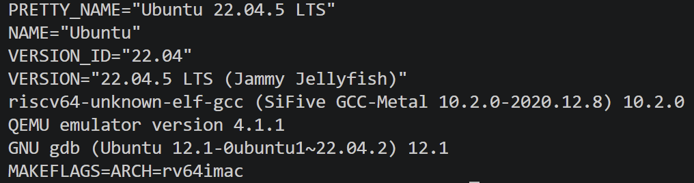
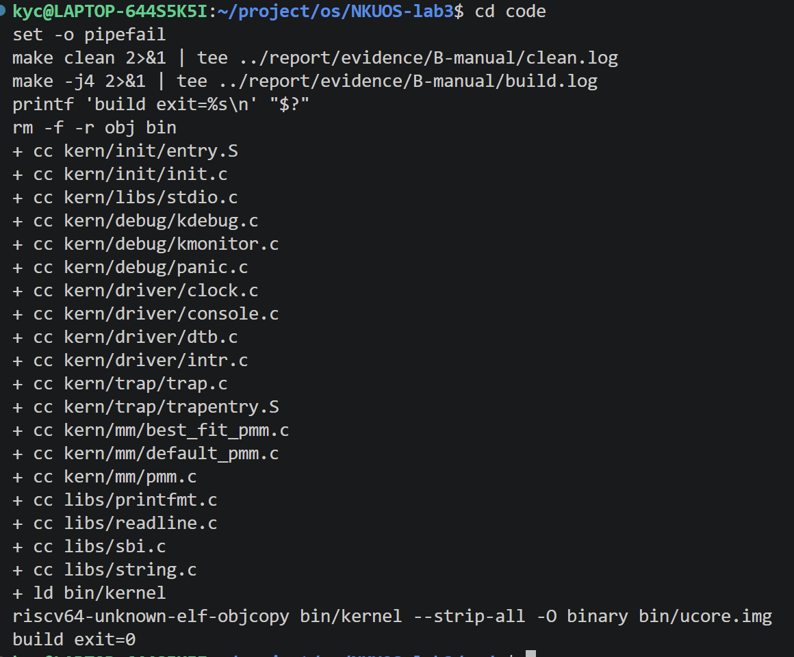
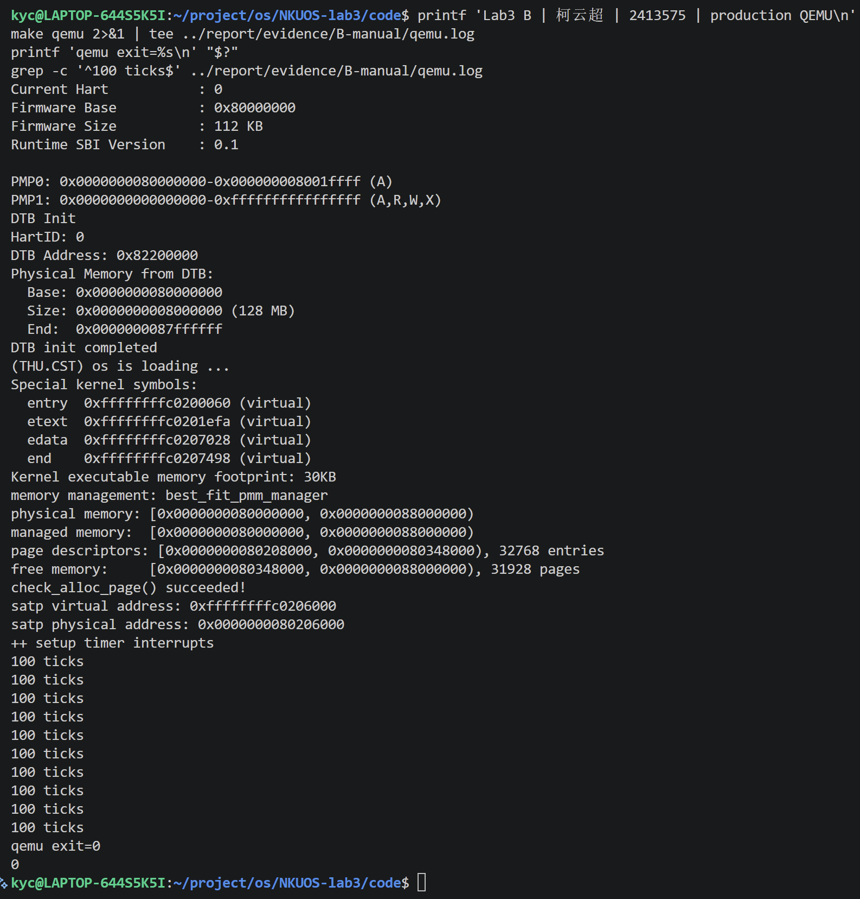
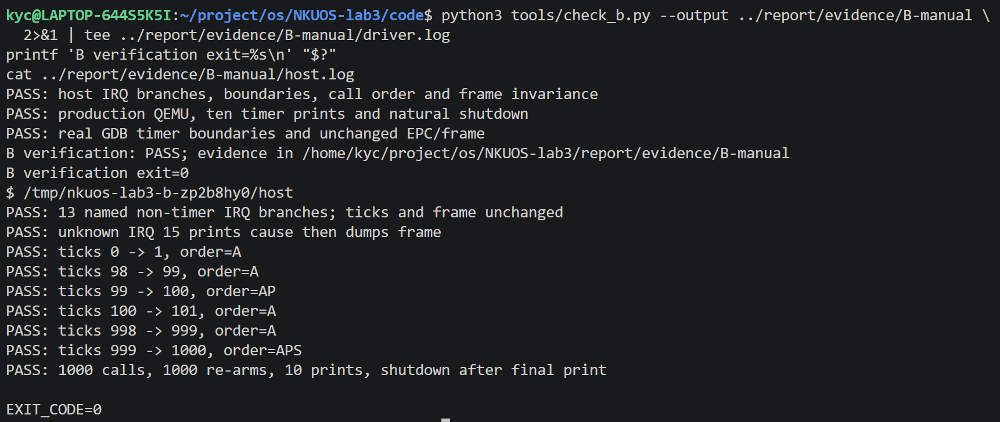
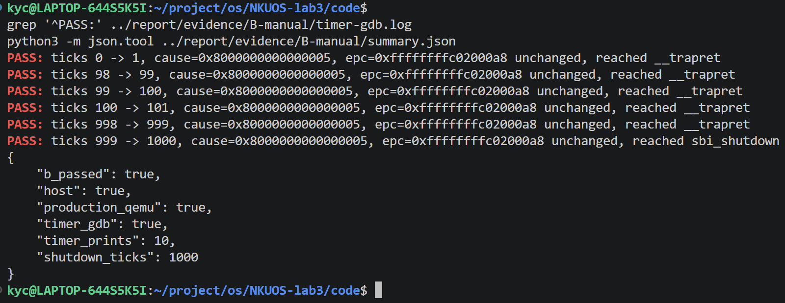
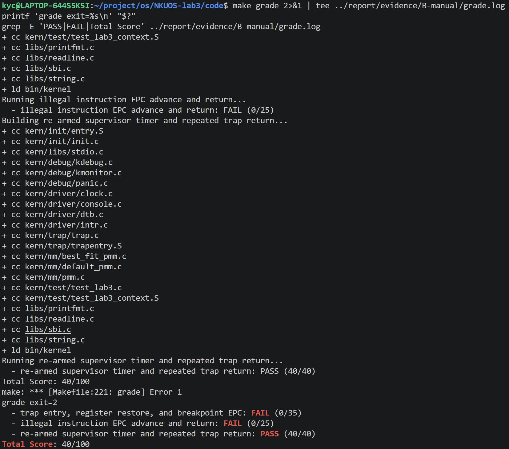

# Lab3 B：中断处理与时钟链路

负责人：柯云超，学号 2413575。完成日期：2026-11-04。

本部分完成 `interrupt_handler()`、分支与边界测试、正式时钟运行和关机验证，并记录目前的整体验证结果。C 的 `exception_handler()` 仍为原始待填状态，当前全组尚未完成最终验收。2026-11-05 已补入柯云超本人提供的六张截图及复现日志；全流程演示与答辩状态另行确认。

## 1. 来源、环境和实现范围

本轮先执行远端 fetch，发现仓库已有 `lab3`，从最新 `origin/lab3` 的 `7df2517` 建立本地跟踪分支和独立工作目录 `/home/kyc/project/os/NKUOS-lab3`。原有 lab1/lab2 工作目录有未提交资料，保留原状。

| 项目 | B 本机实际配置 |
| --- | --- |
| 系统 | Windows / WSL2 Ubuntu 22.04.5 LTS |
| AI 工具 | Codex 桌面应用，GPT-6 |
| 交叉编译器 | SiFive GCC-Metal 10.2.0 |
| ISA / ABI | `rv64imac` / `lp64` |
| B 时钟验证 | QEMU 4.1.1，OpenSBI 0.4，128 MiB |
| A 回归复核 | 系统 QEMU 6.2.0，OpenSBI 0.9 |
| 调试器 | 本轮安装的 `gdb-multiarch` 12.1 |
| 宿主测试编译器 | GCC 12.3.0 |
| 构建参数 | `export MAKEFLAGS=ARCH=rv64imac` |

这里的环境与 A 的历史环境分别记录，不把 A 的 Ubuntu 24.04 / GCC 13 / QEMU 8 输出当作 B 本机输出。完整版本见 [environment.json](../evidence/B-20261104/environment.json)。

正式功能改动限于 `trap.c` 的 B 区域：加入 SBI 声明、关机常量和中断处理实现。`lab3 interrupt_handler` 标记填写 `2413575`，C 的学号和实现留给 C。为使 A 的临时副本脚本在共享段注释更新后仍能定位，将其查找锚点从包含 `YOUR CODE` 的整行改为稳定的 `//lab3 function2`，测试内容与断言保持不变。



## 2. 从时钟初始化到中断返回

```text
kern_init()
  ├─ idt_init()：stvec = __alltraps
  ├─ pmm_init()：物理页管理及自检
  ├─ clock_init()
  │    ├─ sie.STIE = 1
  │    ├─ clock_set_next_event()：SBI 设置第一个截止时间
  │    └─ ticks = 0
  └─ intr_enable()：sstatus.SIE = 1

截止时间到达 → OpenSBI 提供 S 模式定时器中断
  → __alltraps / SAVE_ALL → trap(tf) → trap_dispatch(tf)
  → interrupt_handler(tf)
       ├─ 重设下一事件
       ├─ ticks += 1
       ├─ 每 100 次输出一行 100 ticks
       └─ 第十行输出后 SBI 关机
  → 未到关机阈值：__trapret / RESTORE_ALL / sret → 原 epc
```

时钟工作依赖事件设置、单源中断使能 `sie.STIE` 和全局使能 `sstatus.SIE`。只打开全局使能但没有事件，或设置事件但没有打开对应中断源，都不能形成持续的处理流程。Trap 进入时硬件清除 SIE，将原状态保存到 SPIE；返回时通过 `sret` 恢复使能状态。B 不在处理函数中主动开启中断。

`clock.c` 中 `timebase=100000`，QEMU 的 time CSR 频率为 10 MHz，因此一次间隔约为 10 ms。它是定时器的时间基准，不等于直接以 CPU 指令执行周期计时。每次用“当前时间 + 间隔”安排下次事件，处理开销会使实际输出间隔略长于一秒，不保证严格的墙钟周期。

## 3. 中断原因分类

RV64 的 `scause` 最高位为 1 表示中断，低位是原因编号。例如真实 S_TIMER 的 cause 为 `0x8000000000000005`，其编号才是 `IRQ_S_TIMER=5`。`trap_dispatch()` 先分流中断和异常；B 清除最高位后进行 switch，避免直接比较完整值导致时钟分支永远不命中。

当前头文件包含用户、监督者、旧版 Hypervisor、机器级的软件、定时器和外部中断，以及旧版 coprocessor/host 编号。实现对这些已定义编号输出相应提示；未知编号先输出 `Unknown interrupt: cause N`，再调用已有 `print_trapframe(tf)`。教师测试要求的 `Supervisor software interrupt` 和 `Unknown interrupt: cause 15` 均保留精确格式。

这些分支只做分类提示，不代表已经实现相应设备、PLIC、中断确认或 IPI 协议；部分旧版编号也不代表现代 RISC-V 的完整定义。QEMU 实际端到端触发验证的是 S_TIMER，其他编号由函数级测试构造帧验证。

## 4. 时钟重设、计数与关机

核心顺序是：

```c
clock_set_next_event();
++ticks;
if (ticks % TICK_NUM == 0) {
    print_ticks();
    if (ticks / TICK_NUM >= SHUTDOWN_AFTER) {
        sbi_shutdown();
    }
}
```

SBI 一次只安排一个截止时间。每次处理中重设下一事件，才能持续接收中断；仅在 `clock_init()` 安排第一次事件会导致后续停止。`ticks` 是已处理时钟中断的次数，每次恰好加一，并且在加一之后判断输出条件。

教师框架规定 `TICK_NUM=100`，提供 `print_ticks()`，但没有定义 `SHUTDOWN_AFTER` 的数值。本实现补充 `SHUTDOWN_AFTER=10`，单位为周期输出次数。直接通过 `ticks / TICK_NUM` 判断累计输出数，避免额外静态计数器与 ticks 不一致。若课程另行指定次数，只需调整此常量，并同步修改测试预期。

| 进入处理函数时 ticks | 处理后 ticks | 周期输出 | 关机 |
| ---: | ---: | --- | --- |
| 0 | 1 | 无 | 否 |
| 98 | 99 | 无 | 否 |
| 99 | 100 | 第 1 行 | 否 |
| 100 | 101 | 无 | 否 |
| 998 | 999 | 无 | 否 |
| 999 | 1000 | 第 10 行 | 是，先输出再关机 |

`100 ticks` 是每个统计周期的固定输出，不是累计计数的十进制展开。中断没有需要跳过的异常指令，B 不修改 `tf->epc`；否则会跳过原程序尚未执行的指令。第 1000 次调用关机后通常不会返回到 `sret`，该路径的验收终点是 SBI 关机接口。

## 5. 中断屏蔽与临界区

`sync.h` 的 `__intr_save()` 先读取 SIE。如果原来开启，就关闭并返回 true；如果原来关闭，则返回 false。`__intr_restore(flag)` 仅在 flag 为 true 时重新开启。这样恢复的是进入临界区之前的状态，不能无条件开启中断。

例如外层进入时 SIE=1，保存 true 后关闭；内层再进入时保存 false，退出内层不重新开启；退出外层时才恢复开启。该方式支持单核上的这种嵌套保护，不支持跨 CPU 的互斥。每层应使用自己的状态变量。

`local_intr_save(x)` 使用 `do { ... } while (0)` 将多条宏语句包装为一条语句，使其在 `if/else` 等位置使用时遵循常规分号语义。`local_intr_restore` 本框架是单次函数调用宏，按已有形式使用即可。

页分配器通过 `local_intr_save()` / `local_intr_restore()` 包围空闲链表的修改，避免单核中断处理与被打断的代码交错破坏结构。`volatile ticks` 使轮询代码重新读取内存中的计数，但不提供原子操作、跨核同步或通用锁语义；不能把 volatile 当锁使用。

## 6. spec、prompt 与实际迭代

实现前约定见 [B-spec.md](B-spec.md)，本轮用户输入及结构化实现、测试约束见 [B-prompts.md](B-prompts.md)。提示词先绑定真实接口，再明确 cause 编号、重设事件、计数次序、周期输出、关机边界和 epc 不变，避免只要求“实现时钟中断”却遗漏验收条件。

本轮正式处理函数一次实现后，通过了函数级与真实时钟检查；实际遇到的问题主要出现在环境和验证脚本中：

1. 直接从 Windows 用 `wsl ... make` 启动时，非登录环境没有加载工具链 PATH，报告编译器找不到。改为进入 Bash 并 `source /home/kyc/.local/opt/riscv/env.sh`。
2. 默认 `rv64imac_zicsr_zifencei` 被本机旧汇编器拒绝，报 `cannot find default versions ... zicsr / zifencei`。保持框架默认值，使用 `MAKEFLAGS=ARCH=rv64imac` 兼容本机旧工具链；旧工具链的 I 扩展已经包含这里使用的 CSR 指令。
3. 宿主测试最初把 `print_trapframe` 桩声明成 static，与实际 `trap.h` 的外部声明冲突。移除桩的 static，保留真实头文件声明，重新构建通过。
4. 本机 SiFive GDB 10.1 不支持 Python，不能运行 A/B 的 GDB 自动断言。安装 Ubuntu 的 `gdb-multiarch` 12.1 后继续验证。
5. A 的原始回归在 QEMU 4.1.1 上于 `SPP/SPIE after sret` 断言处停止；此前已经比较通过该次保存帧、寄存器恢复和实际返回地址。保留失败日志 [a-qemu4-regression](../evidence/B-20261104/a-qemu4-regression/trap-gdb.log)，不删除或放宽 A 的状态位断言。安装系统 QEMU 6.2 后用相同汇编和相同断言复核，四次异常和三次时钟返回均通过，说明这项检查存在模拟器版本差异。仅 A 回归使用系统 QEMU；B 正式时钟和教师评分仍用原 QEMU 4.1.1。复核结果和模拟器选择见 [summary.json](../evidence/B-20261104/summary.json)。

## 7. 测试与证据

新增 `tools/check_b_handler.c` 与 `tools/check_b.py`。宿主测试提取当前正式 B 函数，沿用真实 Trap frame 结构和 IRQ 定义，仅替换时钟、打印与关机接口；因此它可以检查分支和顺序，但不能单独证明硬件中断或 SBI 关机。

| 检查 | 实际结果与含义 |
| --- | --- |
| 干净构建 | 正式镜像编译、链接成功 |
| 非时钟分支 | 13 个已定义非 S_TIMER 分支提示正确，ticks 和帧不变 |
| 未知分支 | IRQ 15 输出原因后打印完整帧 |
| 计数边界 | 0→1、98→99、99→100、100→101、998→999、999→1000 均通过 |
| 连续函数调用 | 1000 次重设、10 次周期输出、第十次输出后关机；每次完整帧不变 |
| 正式 `make qemu` | 十行 `100 ticks`，自然退出码 0；Best-Fit 自检通过 |
| 真实 GDB | 六组计数边界通过，cause 为 S_TIMER，全部 288 字节帧不变，最后到达 `sbi_shutdown` |
| A 独立回归 | QEMU 6.2 下，原断言验证四次异常和三次时钟返回通过；使用 A 的处理桩，不代表 C 正式验收 |
| 教师 `make grade` | 持续时钟 40/40；上下文/断点组 0/35、非法指令组 0/25；总分 40/100，退出码 2 |

教师前两项会实际触发 C 负责的异常；C 的函数尚为空，返回后重复执行触发指令，不能正常完成测试。此处的失败不等同于已证明 A 的恢复有误，也不能以 A 的测试桩通过替代 C 的正式验收。评分脚本的时钟组只观察到 200 次，所以另外使用完整正式运行与 GDB 检查 1000 次关机边界。





图中可见十行 `100 ticks` 和 `qemu exit=0`。末尾原命令的 `grep` 显示 0，是串口日志行尾含 `\r` 导致 `^100 ticks$` 无法匹配；去除回车符后计数为 10，截图保留原始结果。截图指南已修正计数命令。







证据目录：[B-20261104](../evidence/B-20261104/)。主要文件：

- [build.log](../evidence/B-20261104/build.log)：干净编译。
- [host.log](../evidence/B-20261104/host.log)：分类、边界和调用顺序。
- [qemu.log](../evidence/B-20261104/qemu.log)：正式 QEMU 自然关机。
- [timer-gdb.log](../evidence/B-20261104/timer-gdb.log)、[timer-summary.json](../evidence/B-20261104/timer-summary.json)：真实时钟边界。
- [grade.log](../evidence/B-20261104/grade.log)：未修改的教师评分结果。
- [tested-source.json](../evidence/B-20261104/tested-source.json)：被测正式源码 SHA-256。
- [summary.json](../evidence/B-20261104/summary.json)：B 验证和集成状态汇总。

复现与截图的完整命令、每张图的预期画面、文件名和占位符替换方法见 [B-截图操作指南.md](B-截图操作指南.md)。

2026-11-05 已再次完整复核，结果见 [复核汇总](../evidence/B-20261105-recheck/summary.json)：B 的分支、真实时钟、GDB 边界及关机均通过，A 独立回归通过；教师评分仍为 40/100，C 正式异常处理继续待办。原始日志保存在 `evidence/B-20261105-recheck/`。

本人按指南复现的记录见 [B-manual](../evidence/B-manual/)，补充集成验证见 [B-final 汇总](../evidence/B-final/summary.json)。六张截图分别对应环境、构建、正式运行、函数边界、GDB 和教师评分；集成总分仍为 40/100。

## 8. 与 OS 原理的联系、差异与未覆盖内容

| 原理知识点 | 本实验体现 | 限制或差异 |
| --- | --- | --- |
| 异步中断与同步异常 | cause 最高位分流，共用保存/恢复入口 | B 仅处理中断，不修复异常或更新异常 epc |
| 定时器与 OS 时间管理 | 连续重设截止时间，维护 ticks | 没有计时轮、休眠队列、超时回调和动态 tick |
| 抢占与调度时机 | 周期中断提供进入内核的机会 | 没有调度器和进程切换；当前只计数、输出、关机 |
| 中断屏蔽与临界区 | 保存原 SIE，修改页链表后恢复 | 单核局部保护，不是 SMP 锁，不屏蔽同步异常 |
| 特权级与固件接口 | S 模式内核通过 SBI 安排时钟并关机 | 通过 OpenSBI 完成机器级工作，未直接编写 M 模式定时器驱动 |
| 状态可见性与并发 | volatile 计数支持中断与主循环观察 | 不提供原子性与多核内存顺序保证 |

重要但本实验没有实现的内容包括：完整进程调度与时间片抢占、SMP 中断和自旋锁、设备中断控制器及确认流程、用户态系统调用、缺页恢复、嵌套中断的优先级策略。不能从十行时钟输出推出这些功能已经完成。

## 9. 交接与待完成项

- [x] B 正式中断实现、本人学号标记、spec 与 prompt 整理。
- [x] 分支、边界、连续时钟、epc 保持和自然关机的真实证据。
- [x] 原样运行教师评分，记录当前集成缺口。
- [x] 编写详细截图操作指南，报告接入六张本人截图。
- [ ] C 提交正式异常处理后再做全组回归，实际达到 100/100。
- [x] 本人按指南复现、采集截图并替换占位符（2026-11-05）。
- [ ] 本人完成全流程演示和答辩；按小组安排完成课程提交。

本次 B 提交包含实现、报告、截图指南和两轮真实验证证据。C 合并后，使用 B 指南的整体验证命令重新检查，更新总分和截图；不能直接沿用当前 40/100 作为全组最终通过结果。
