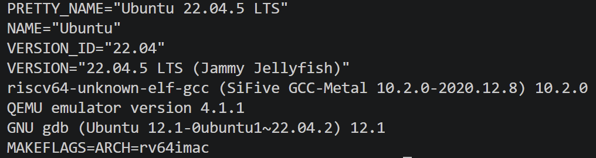
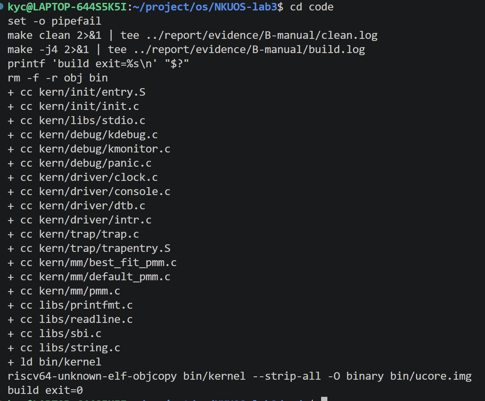
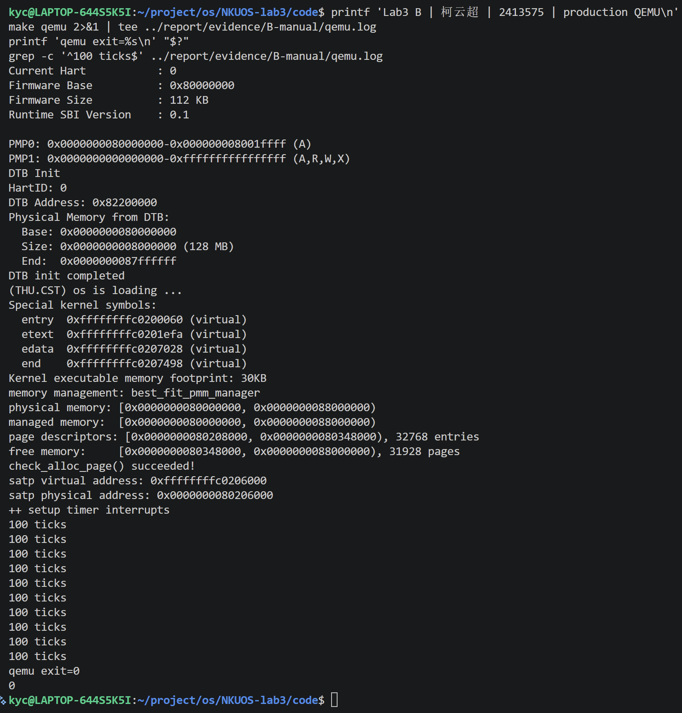
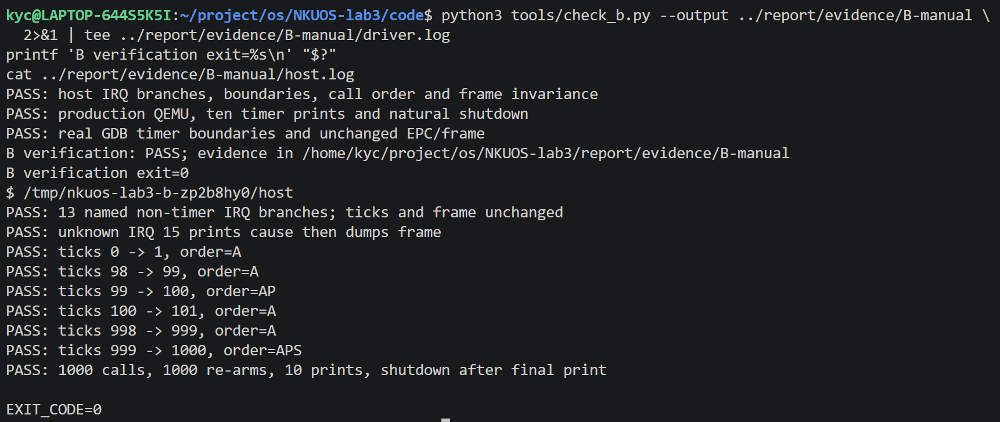
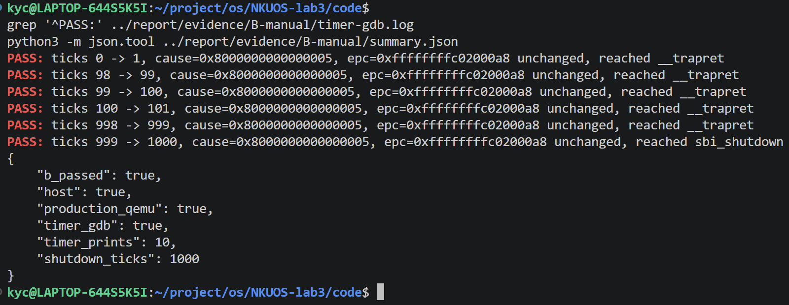
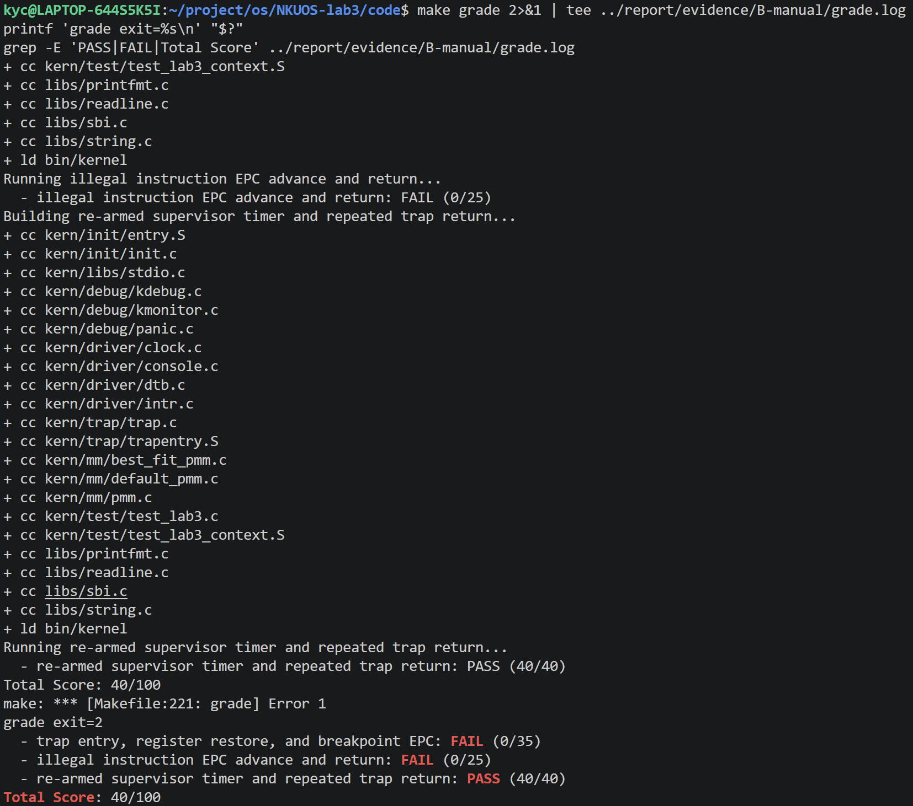

# Lab3 B：逐步截图操作指南

负责人：柯云超，2413575。工作目录：`/home/kyc/project/os/NKUOS-lab3`。

本轮未采集截图。报告中的 B-01～B-06 都是明确的文字占位符，按下面流程亲自运行后替换。自动验证日志已放入 `report/evidence/B-20261104/`，它们是真实运行记录，但不作为本人已经截图或答辩的证明。

## 0. 打开正确的终端与目录

1. 在 Windows 打开 Windows Terminal，选择 Ubuntu-22.04。若当前是 PowerShell，先输入：

   ```powershell
   wsl -d Ubuntu-22.04
   ```

2. 以下命令都在 Ubuntu 的 Bash 中执行，不在 PowerShell 中执行：

   ```bash
   cd /home/kyc/project/os/NKUOS-lab3
   source /home/kyc/.local/opt/riscv/env.sh
   export MAKEFLAGS=ARCH=rv64imac
   export GDB=gdb-multiarch
   mkdir -p report/images report/evidence/B-manual
   ```

   `MAKEFLAGS` 会把旧工具链需要的 `ARCH=rv64imac` 传递给各级 make。A 使用的新工具链接受默认的 `rv64imac_zicsr_zifencei`；本机 GCC 10.2 的汇编器不接受该写法。此处的设置只对当前终端有效，新终端需要重新执行。

3. 放大终端到能显示约 30～40 行、每行至少 100 个字符。可使用 Ctrl+加号调整字号。不要把关键行裁掉。
4. 截图时按 Windows+Shift+S，选择矩形截取，点击通知后另存为 PNG。保存文件夹是：

   ```text
   \\wsl.localhost\Ubuntu-22.04\home\kyc\project\os\NKUOS-lab3\report\images
   ```

5. 下文要求的姓名标记通过 `printf` 主动打印在终端中，说明操作者信息；它不是内核输出。不要把该标记或日志回放说成内核自动识别了姓名。

## 1. B-01：环境与源码状态

在仓库根目录执行：

```bash
cd /home/kyc/project/os/NKUOS-lab3
source /home/kyc/.local/opt/riscv/env.sh
export MAKEFLAGS=ARCH=rv64imac
export GDB=gdb-multiarch
mkdir -p report/images report/evidence/B-manual
printf 'Lab3 B | 柯云超 | 2413575\n'
pwd
git branch --show-current
git rev-parse --short HEAD
git -c core.quotepath=false status --short
cat /etc/os-release | head -n 4
riscv64-unknown-elf-gcc --version | head -n 1
qemu-system-riscv64 --version | head -n 1
gdb-multiarch --version | head -n 1
printf 'MAKEFLAGS=%s\n' "$MAKEFLAGS"
```

预期关键内容：目录末尾为 `NKUOS-lab3`，分支 `lab3`，Ubuntu 22.04.5、GCC 10.2.0、QEMU 4.1.1、GDB 12.1、`ARCH=rv64imac`。HEAD 在提交后可能变化，按实际输出记录，不要求伪造为旧值。未提交修改属于当前实现的正常状态。

`MAKEFLAGS` 是当前 Bash 进程中的环境变量。先前自动验证进程设置过它，不会使新打开的终端自动继承；若显示 `MAKEFLAGS=`，执行上面的 export 后再截图和构建。这里重复环境设置，使第 1 节可以单独复制执行。`git status` 中的 `M` 和 `??` 分别表示未提交修改和未跟踪文件，不是编译或测试失败。

若粘贴时出现字面字符 `^[[200~`，这是终端的括号粘贴控制序列被显示出来。按 Ctrl+C 清空当前输入，再重新粘贴纯命令，不要复制 shell 提示符或上次终端输出；它与内核是否已运行无关。

截图应包含姓名学号、目录、分支和工具版本。保存为 `B-01-environment.png`，对应报告占位符 B-01。

## 2. B-02：实现与干净构建

先查看实现：

```bash
nl -ba code/kern/trap/trap.c | sed -n '83,128p'
```

确认可看到 `SHUTDOWN_AFTER 10`、`lab3 interrupt_handler 2413575`、清除 cause 最高位、`clock_set_next_event()`、`++ticks`、整百输出和关机。

然后构建并保存完整日志：

```bash
cd code
set -o pipefail
make clean 2>&1 | tee ../report/evidence/B-manual/clean.log
make -j4 2>&1 | tee ../report/evidence/B-manual/build.log
printf 'build exit=%s\n' "$?"
```

预期末尾：`+ ld bin/kernel`、`objcopy ... bin/ucore.img`、`build exit=0`，没有编译错误。构建完成后可再次显示上面的关键实现，使画面同时呈现代码标记和构建末尾。若终端放不下，可分别截图，第二张命名 `B-02b-handler.png`。

主截图保存为 `B-02-build.png`，对应 B-02。不要只截命令尚未执行的画面。

## 3. B-03：正式内核持续中断与自动关机

保持在 `code/`，执行：

```bash
printf 'Lab3 B | 柯云超 | 2413575 | production QEMU\n'
make qemu 2>&1 | tee ../report/evidence/B-manual/qemu.log
printf 'qemu exit=%s\n' "$?"
grep -c '^100 ticks$' ../report/evidence/B-manual/qemu.log
```

等待约 10～15 秒，必须让它自行退出回到 Bash 提示符。正常应出现：

```text
check_alloc_page() succeeded!
...
++ setup timer interrupts
100 ticks
...（共十行，实际截图不要用省略号替代）
qemu exit=0
10
```

`100 ticks` 每行表示本轮新增 100 次中断，累计中断达到 1000 时关机。截图至少包含时钟初始化、十行输出、退出码和行数 10；适当向上滚动也保留 Best-Fit 自检成功。

保存为 `B-03-qemu-shutdown.png`，对应 B-03。此步骤不要按 Ctrl+C 或 Ctrl+A、X 提前退出，否则无法证明正常关机。

## 4. B-04：函数级分支与计数边界

在 `code/` 执行：

```bash
python3 tools/check_b.py --output ../report/evidence/B-manual \
  2>&1 | tee ../report/evidence/B-manual/driver.log
printf 'B verification exit=%s\n' "$?"
cat ../report/evidence/B-manual/host.log
```

此命令会依次运行宿主测试、重新构建、正式 QEMU 和 GDB，约 25 秒。宿主测试直接提取当前 `interrupt_handler()`，使用桩记录时钟重设、输出和关机调用。

截图内容应包含：

- 13 个已知非 S_TIMER 分支通过；未知 IRQ 15 输出编号后打印帧。
- `98 -> 99, order=A`、`99 -> 100, order=AP`、`100 -> 101, order=A`。
- `998 -> 999, order=A`、`999 -> 1000, order=APS`。
- 1000 calls、1000 re-arms、10 prints、shutdown after final print。

`A` 表示设置下一事件，`P` 表示周期输出，`S` 表示关机。该截图证明处理函数逻辑；下一步的真实 QEMU/GDB 验证补充硬件路径证据。

保存为 `B-04-handler-boundaries.png`，对应 B-04。

## 5. B-05：真实 GDB 的边界与 epc

紧接上一步执行：

```bash
grep '^PASS:' ../report/evidence/B-manual/timer-gdb.log
python3 -m json.tool ../report/evidence/B-manual/summary.json
```

预期能看到六条实际断点检查结果，包括 `99 -> 100`、`100 -> 101` 和 `999 -> 1000`，cause 为 `0x8000000000000005`，每条说明 `epc ... unchanged`；最后一条说明 `reached sbi_shutdown`。JSON 中 `b_passed`、`host`、`production_qemu`、`timer_gdb` 都为 `true`，输出次数为 10，关机计数为 1000。

保存为 `B-05-real-gdb.png`，对应 B-05。地址由编译器、链接布局决定，可能与历史日志不同，以实际输出为准。

### 可选：亲自在双终端观察 99→100

此步骤用于理解和答辩，不要求替换自动验证截图。先确认上一轮 QEMU 已退出。终端一进入 `code/` 并重新执行第 0 节环境设置，然后：

```bash
make debug
```

终端二进入同一个 `code/` 并执行：

```bash
gdb-multiarch -q -nx bin/kernel
```

在 GDB 提示符中逐行输入：

```gdb
set pagination off
set architecture riscv:rv64
target remote localhost:1234
hbreak *interrupt_handler
condition 1 ticks == 99
continue
p ticks
set $frame = (struct trapframe *)$a0
set $old_epc = $frame->epc
p/x $frame->cause
p/x $frame->epc
disable 1
thbreak *__trapret
continue
p ticks
p/x $frame->epc
p $frame->epc == $old_epc
detach
quit
```

入口 `ticks=99`，返回处 `ticks=100`，epc 相等比较输出 1。先在第一条指令取 `$a0`，避免编译器函数前导改变参数寄存器。`disable 1` 避免条件断点干扰本次返回观察。`detach` 后终端一继续运行并在阈值自然关机。若 1234 被其他调试占用，结束自己上一轮调试后再试，不要终止他人的进程。

## 6. B-06：教师评分和全组状态

当前 C 的 `exception_handler()` 尚未填写，所以此步骤的部分失败是集成状态，不能写成全部通过。在 `code/` 执行：

```bash
make grade 2>&1 | tee ../report/evidence/B-manual/grade.log
printf 'grade exit=%s\n' "$?"
grep -E 'PASS|FAIL|Total Score' ../report/evidence/B-manual/grade.log
```

约需 45～50 秒。当前应为前两项失败、持续时钟项 `PASS (40/40)`、`Total Score: 40/100`、非零退出码。截图完整保留失败项与总分，不能只截通过行。保存为 `B-06-grade.png`，对应 B-06。

`make grade` 会清理正式构建目录，结束后运行 `make -j4` 恢复可启动镜像。C 提交完成后，先核对差异并合并 C 的正式实现，再执行：

```bash
python3 tools/check_b.py --integration --a-qemu /usr/bin/qemu-system-riscv64 \
  --output ../report/evidence/B-final
```

此时重新检查正式 QEMU、B 边界、A 回归和教师总分，只有实际得到 100/100 后才能更新全组验收状态和 B-06 截图。不要为得到分数去修改 `grade.sh` 或教师测试。A 回归的原状态位断言在旧 QEMU 4.1.1 上失败，使用本轮安装的系统 QEMU 6.2 运行该项；`--a-qemu` 只影响 A 回归，B 和教师评分仍使用 PATH 中的 QEMU 4.1.1。脚本最后打印 B 的 PASS 不代表教师总分达到 100，必须同时读取 `grade.log` 和 `summary.json`。

若现在就需要重跑本轮全部集成检查，可使用同一命令并把输出目录改为 `../report/evidence/B-manual-integration`；C 未完成时总分仍应为 40/100。本轮新增环境依赖为 `gdb-multiarch` 和 `qemu-system-misc`，已安装；旧 QEMU 位于用户目录，保留可用。更换机器时可通过 `sudo apt-get install --no-install-recommends gdb-multiarch qemu-system-misc` 准备系统调试器与新版 QEMU。

## 7. 替换报告占位符

打开 `report/资料/B-中断与时钟.md`，逐一将 B-01～B-06 的整行文字占位符替换为下列对应图片语法：

```markdown






```

图片路径是相对于 `report/资料/` 的，使用 `../images/`。若将图片直接放在报告入口 `report/report.md`，路径应使用 `images/`。

最后在仓库根目录检查：

```bash
git diff --check
git status --short
ls -lh report/images/B-*.png
```

逐张打开核对：文字可读、姓名学号和命令可对应、真实输出完整、未把旧 Lab2 截图当 Lab3 使用。截图完成与本人复现由本人确认，本轮自动验证不替代该确认。
