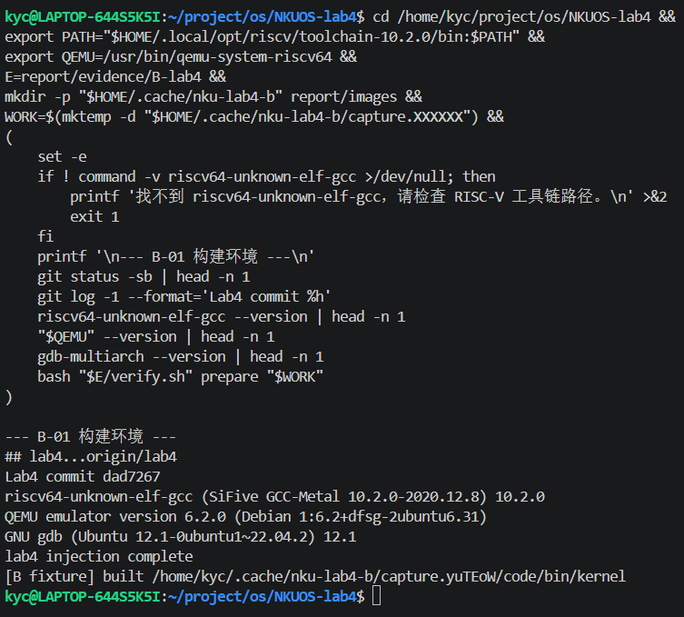
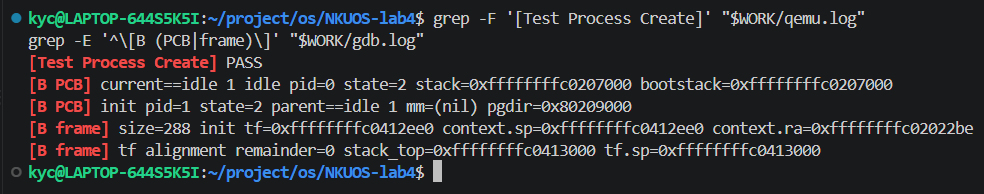
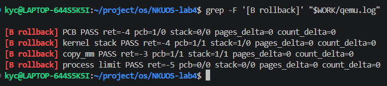
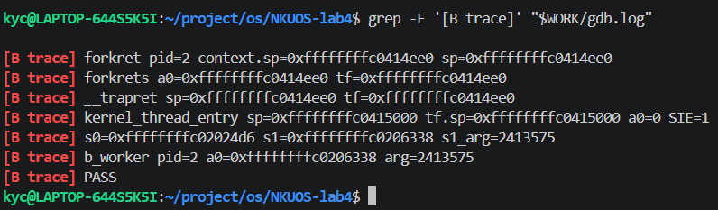
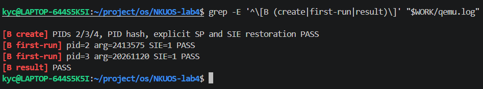

# Lab4 分工 B · 线程创建与初始化

| 项目 | 内容 |
| --- | --- |
| 负责人 | 柯云超（2413575） |
| 验证日期 | 2026-11-20 |
| Lab4 基线 | `BLH549/NKUOS` 的 `lab4` 分支，提交 `dad7267` |
| 实验环境 | WSL Ubuntu 22.04，RV64，GCC 10.2.0，QEMU 6.2.0，GDB 12.1 |
| AI 工具 | Codex 桌面应用，具体模型版本以本次会话界面显示为准 |

[实现规格](B-spec.md) · [实际提示词](B-prompts.md) · [逐步截图指南](B-截图操作指南.md) · [实现源码](../../code/kern/process/proc.c)

## 一、实验主线

Lab4 先在 `pmm_init()` 和 `vmm_init()` 准备内核地址空间及内存分配能力，再由 `proc_init()` 把开机执行流登记为 idle，并创建第一个可运行的内核线程 init。之后调度器选出 runnable 线程，通过 `proc_run()` 和 `switch_to()` 恢复其上下文。分工 B 建立这条链的中间部分，交付一个可查询的 PCB、独立内核栈和符合 Trap 返回约定的初始现场。

## 二、功能实现

| 函数 | 行为 |
| --- | --- |
| `alloc_proc()` | 申请并清零 PCB，设置 `PROC_UNINIT`、`pid = -1` 和内核页目录物理地址，初始化私有链表节点。 |
| `proc_init()` | 初始化进程链表与哈希桶。idle 使用 PID 0 和 `bootstack`，`current` 指向 idle，`need_resched = 1`。由 idle 创建 init，成功后以 PID 取回 PCB 并命名。idle 计入总数，普通进程链表及哈希登记从 init 开始。 |
| `kernel_thread()` | 构造临时 Trap frame，将函数、参数分别放进 `s0`、`s1`，令 `epc` 指向 `kernel_thread_entry`。初始 `SPP=1`、`SPIE=1`、`SIE=0`。 |
| `do_fork()` | 检查容量，分配 PCB 和内核栈，记录父线程并准备内存及寄存器现场。关本 hart 中断后分配 PID，完成哈希、链表和计数更新，再唤醒。PCB 或内核栈分配失败返回 `-E_NO_MEM`。 |
| `copy_thread()` | 将 Trap frame 复制到子线程自己的栈顶区域，设置子线程 `a0=0` 和恢复后 `sp`。切换上下文的 `sp` 指向 Trap frame，`ra` 指向 `forkret`。 |
| `copy_mm()` | 内核线程保持 `mm == NULL` 并共用启动页目录。父线程携带用户 `mm` 时返回 `-E_INVAL`，触发内核栈和 PCB 的逆序回收。 |

`KSTACKSIZE = 8192`，RV64 的 `struct trapframe` 占 288 字节（36 个 8 字节槽）。例如测试中 PID 2 的内核栈基址为 `0xffffffffc0413000`，栈顶为 `0xffffffffc0415000`，Trap frame 基址为 `0xffffffffc0414ee0`。切换时先用 Trap frame 的基址建立 `context.sp`。汇编恢复最后读取现场里的 `gpr.sp`，使首个线程函数在栈顶附近正常建立调用帧。

`forkret()` 把 `current->tf` 传入 `forkrets`，后者用它更新 `sp` 并跳到 `__trapret`。`sret` 按 `epc` 回到 `kernel_thread_entry`，并把 `SPIE` 恢复到 `SIE`。入口将 `s1` 移入参数寄存器 `a0`，再用 `jalr s0` 调用线程函数。父线程由 `do_fork()` 获得正 PID，子现场在进入入口时的 `a0` 为 0，调用线程函数时 `a0` 转为实际参数。

## 三、规格、提示词和真实迭代记录

1. 以附件任务范围和指导书模块二确定六个函数。规格补上框架实际使用的 `boot_pgdir_pa`、RV64 Trap frame 长度、PID 哈希及发布顺序。用户消息和附件范围记录在 [B-prompts.md](B-prompts.md)。
2. 首次完整构建时，`proc.c` 编译成功，链接器报告 `page_insert`、`page_remove`、`cpu_idle` 缺少定义。独立验证在临时树保留教师 Process Create 检查，绕过依赖 A/C 的检查与调度入口。首跑驱动只装载 B 已构造的初始 `sp/ra`，之后走真实 Trap 汇编链。[完整构建日志](../evidence/B-lab4/build.log)
3. 首次从非登录 shell 启动测试时，交叉编译器未进入 `PATH`，切换到已配置工具链的 WSL shell 后完成构建。首版复现脚本又使用 `"$qemu"` 展开命令数组，只传出了程序名，启动因此超时。用直接命令确认内核能运行后，改为 `"${qemu[@]}"`，并显式设置串口和内核镜像参数。修正后的脚本完成了普通运行和 GDB 跟踪。

## 四、验证结果与截图

临时树由 [verify.sh](../evidence/B-lab4/verify.sh) 准备，故障注入只存在于 [fixture.c](../evidence/B-lab4/fixture.c)。下方截图记录了本机运行的教师 Process Create 检查和 B 的边界测试。

| 检查 | 实际观察 |
| --- | --- |
| 教师 Process Create | `[Test Process Create] PASS`。新 PCB 的零值字段、idle/init 的 PID、状态、父子关系、栈和页目录额外检查通过。 |
| 分配和回滚 | PCB 分配失败返回 `-4`，未尝试分配内核栈。栈分配失败返回 `-4`，已分配的 PCB 被释放。`copy_mm` 拒绝非空父 `mm` 时返回 `-3`，内核栈和 PCB 都被释放。进程数上限返回 `-5`，没有申请资源。四种失败均未发布 PID，链表、哈希、进程计数和空闲页保持原值。 |
| 多线程与现场 | PID 2、3、4 都可以查询。PID 2、3 的内核栈互相独立，实际收到的参数依次为 `2413575` 和 `20261120`。PID 4 验证了 `do_fork()` 显式提供的 `sp` 和子现场 `a0=0`。 |
| 首次执行 | GDB 在 `forkret`、`forkrets`、`__trapret`、`kernel_thread_entry` 和工作函数依次停住。在汇编入口处 `a0=0`、`SIE=1`，工作函数入口的 `a0` 解引用为 `2413575`。 |
| 全量集成 | PMM、普通调度切换和 `make grade` 的全量结果待 A/C 联调。 |

[隔离构建日志](../evidence/B-lab4/fixture-build.log) · [QEMU 日志](../evidence/B-lab4/qemu.log) · [GDB 日志](../evidence/B-lab4/gdb.log)

## 五、与操作系统原理的对应

- **PCB 与状态转换**。PCB 将 PID、状态、执行现场和地址空间联系起来。新对象从 `UNINIT` 经登记和唤醒进入 `RUNNABLE`，此时已经可以被调度器选中。
- **执行上下文与 Trap frame**。上下文切换保存调用约定要求的 `ra/sp/s0–s11`，Trap frame 还保存通用寄存器及返回所需的 CSR。新线程先从精简上下文进入 C 入口，再通过 Trap frame 恢复首次运行需要的完整现场。
- **地址空间与内核栈**。内核线程共享内核页表，分别使用自己的内核栈和 Trap frame，因此每个线程拥有独立的函数调用空间。
- **失败原子性**。在可能失败的准备阶段完成后才向进程表公布对象。失败时按资源依赖逆序收回，查询进程的代码看不到半初始化 PCB。

后续还需要理解用户地址空间复制与写时复制、进程退出与父进程回收、SMP 下的同步和调度。当前实验的页目录共用、退出桩和本 hart 关中断均有单独的适用范围。
